# Proyecto integrador "Distribuidora Río Claro"

Proyecto que integra **Odoo Community 20.0** con servicios de IA de
Microsoft Azure para apoyar la recepción, revisión y consulta de facturas de
proveedores dentro de una empresa. Odoo es el sistema de registro; la IA clasifica o extrae
información para revisión humana.

> **Estado:** este proyecto es un prototipo educativo. No está listo para procesar
> datos empresariales reales. La clasificación y extracción pueden equivocarse;
> una persona debe revisar los resultados y crear las facturas como borradores.

## Qué incluye

- Un addon de Odoo que permite la recepción de facturas, extracción de datos,
  consultas asistidas con permisos y entrada por Telegram.
- Una Azure Function de screening de correo basada en Azure AI Language.
- Integración opcional con Azure AI Document Intelligence, Azure OpenAI y Azure
  AI Speech.
- Compose para desarrollo local y una configuración de despliegue de referencia
  con Caddy.

La Function de screening analiza texto y metadatos de adjuntos; **no** inspecciona
el contenido de los archivos. El conjunto de datos incluido es sintético y no
demuestra precisión en producción. No se conecta al SAT ni valida CFDI.

## Arquitectura

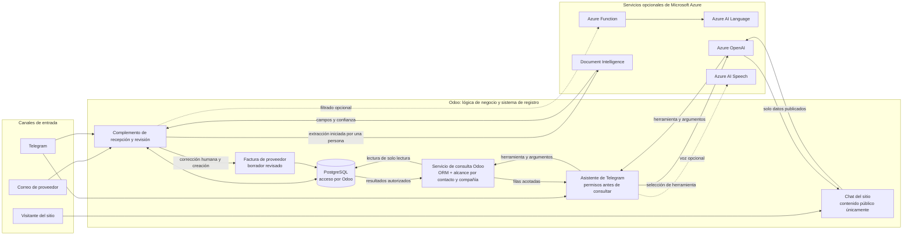

## Estructura

```text
azure/email-screening/                 Azure Function y pruebas
custom_addons/rioclaro_invoice_inbox/   complemento Odoo y pruebas
deploy/                                Compose de producción y Caddy
docs/                                  evidencias visuales del curso, sanitizadas
scripts/                               utilidades de operación
compose.yaml                           entorno local Odoo + PostgreSQL
```

## Prueba el sistema en vivo

### Chat en la tienda en línea

1. Visita <https://rioclaro.ropech.com> y abre el chat.
2. Escribe una consulta, por ejemplo: «Quiero detergente para ropa». El sistema
   buscará los productos registrados que coincidan con ella.


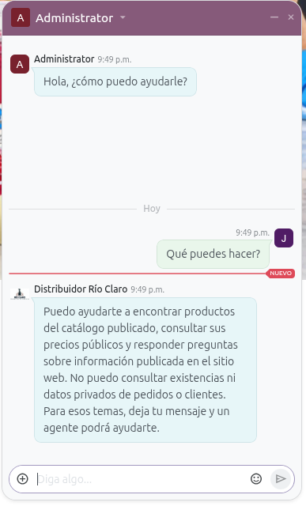

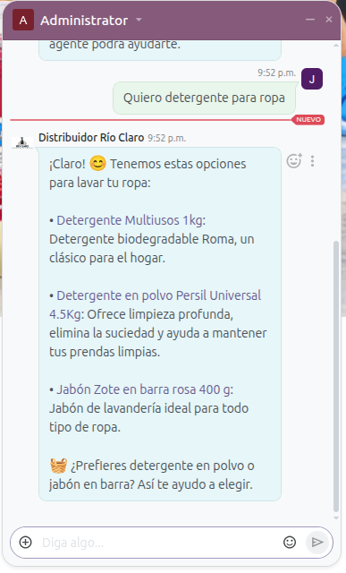

### Asistente de Telegram

1. Abre el [bot de Río Claro en Telegram](https://web.telegram.org/k/#@RioClaroBot).
2. Envía un mensaje para registrar un usuario público. Este usuario solo podrá
   consultar información no privada, igual que en el chat de la tienda.
3. Pide recomendaciones sobre productos de limpieza.

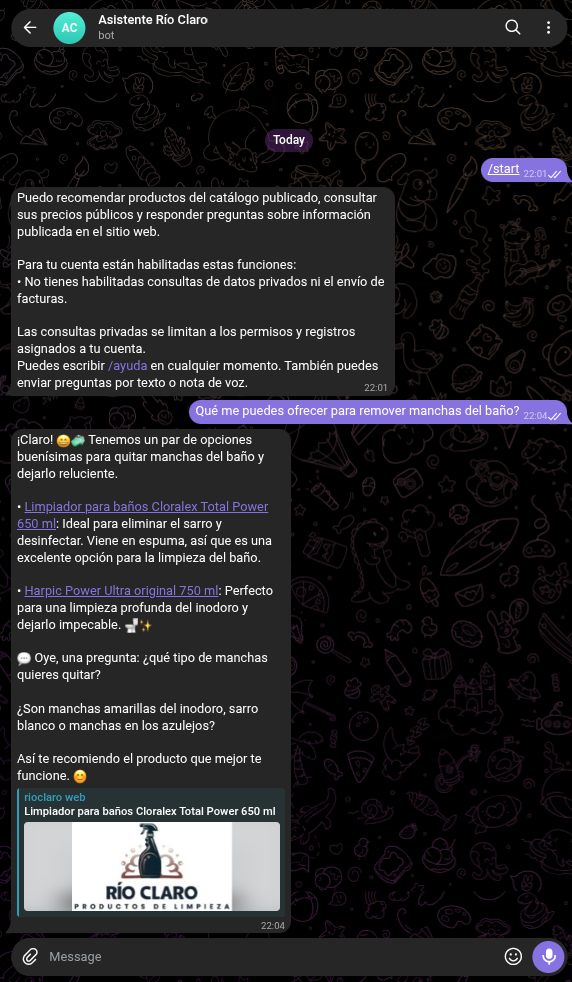

#### Habilitar consultas sobre información interna

Para permitir que el usuario consulte datos privados de la empresa:

1. Inicia sesión en [Odoo](https://rioclaro.ropech.com/web/login) con el usuario
   `admin` y la contraseña `admin`.

   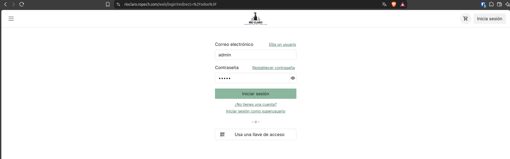

2. Abre el menú de la esquina superior izquierda y selecciona **Invoice Intake**.

   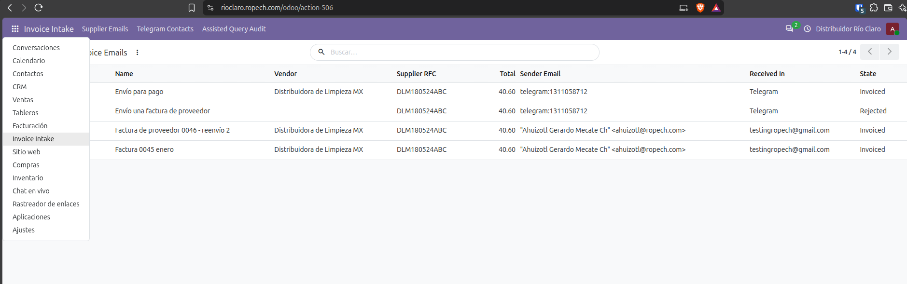

3. En **Telegram Contacts**, abre el contacto correspondiente.

   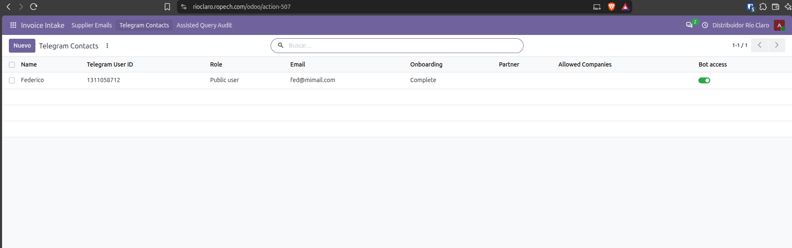

4. Cambia el campo **Role** a **Internal user** para habilitar las consultas
   sobre ventas y existencias. Las opciones disponibles son **Supplier**,
   **Internal user** y **Customer**.

5. Guarda los cambios.

   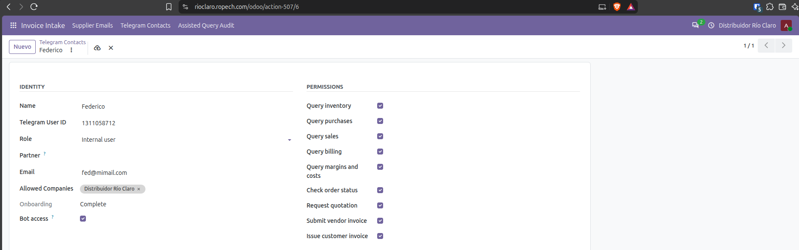

6. En Telegram, prueba una consulta como «¿Cuáles son las ventas de los últimos
   cuatro días en Distribuidor Río Claro?». Incluye siempre el nombre de la
   empresa, ya que el sistema es multiempresa.

   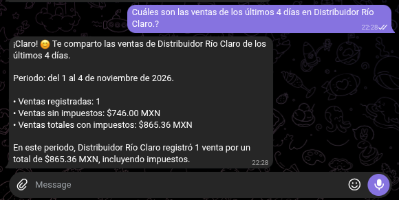

### Enviar facturas de proveedor por Telegram

1. Envía al bot una factura como imagen o documento PDF.
2. En Odoo, abre **Invoice Intake** desde el menú superior izquierdo y consulta
   el registro más reciente, cuyo estado (**State**) debe ser **Received**.

   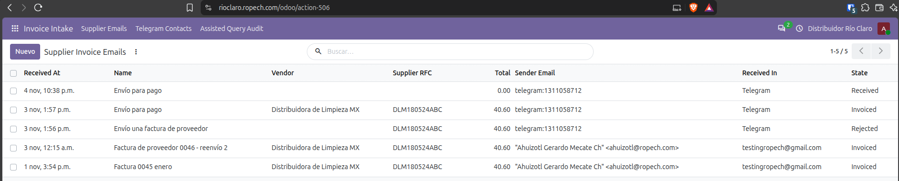

   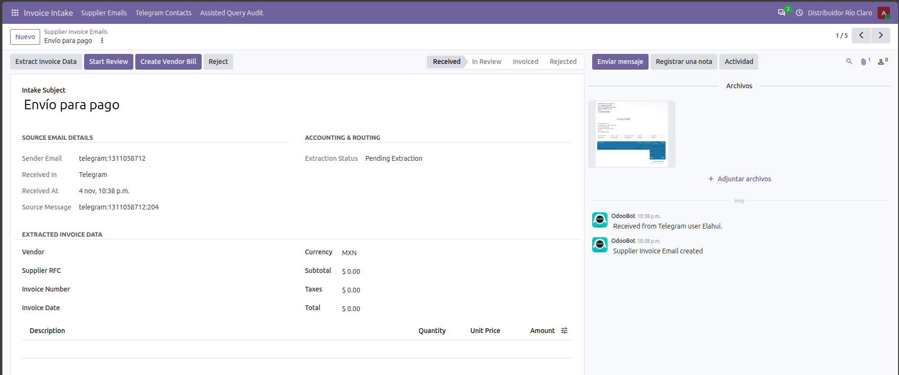

3. Selecciona **Extract Invoice Data** para extraer los datos y completar el
   formulario. Revisa la información antes de crear la factura de proveedor.

   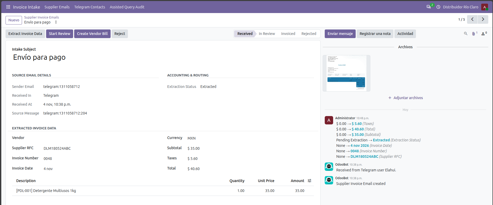

### Enviar facturas de proveedor por correo electrónico

1. Envía un correo con la factura adjunta a la dirección configurada en Odoo.
   Para esta prueba, se utiliza `testingropech@gmail.com`.

   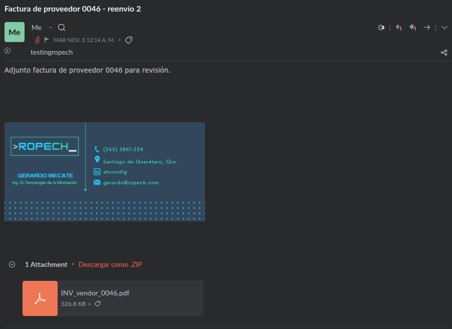

2. En Odoo, abre **Invoice Intake** y consulta el registro más reciente, cuyo
   estado (**State**) debe ser **Received**.

   

   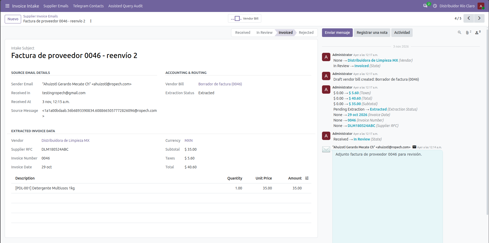

3. Selecciona **Extract Invoice Data** para extraer los datos. Revisa el
   formulario antes de crear la factura de proveedor.

## Inicio rápido: Odoo local

Requisitos: Docker Compose v2 y una copia local de los archivos de configuración.

```bash
cp .env.example .env
cp odoo/odoo.conf.example odoo/odoo.conf
```

Edita `.env` y `odoo/odoo.conf`: define contraseñas fuertes, distintas y solo
locales. Después:

```bash
docker compose config -q
docker compose up -d
docker compose ps
```

Abre <http://127.0.0.1:8079> (puerto configurado en `.env.example`). Los datos
persisten en volúmenes Docker; `docker compose down -v` los elimina.

Para habilitar integraciones de Azure o Telegram, configura solo las variables
que necesites en `.env` a partir de `.env.example`. No actives el polling de
Telegram en más de una base de datos para el mismo bot.

## Pruebas y validaciones

Pruebas de Azure email screening:

```bash
cd azure/email-screening
python -m pip install -r requirements.txt
python -m unittest discover -s tests -v
python prepare_dataset.py --output /tmp/rioclaro-synthetic-dataset
```

Comprobación de sintaxis para el código Python del repositorio:

```bash
python -m compileall -q azure/email-screening custom_addons scripts
```

Las pruebas del complemento Odoo se ejecutan dentro de Odoo con PostgreSQL;
consulta [`guia.md`](./guia.md) y el
[README del complemento](./custom_addons/rioclaro_invoice_inbox/README.md).
GitHub Actions ejecuta las pruebas disponibles de screening y la validación del
conjunto sintético en cada pull request.

## Documentación

- [Guía para entender y probar las funcionalidades](./custom_addons/rioclaro_invoice_inbox/README.md)
- [Guía del curso y configuración](./guia.md)
- [Semántica del chatbot](./CHATBOT_SEMANTICS.md)
- [Arquitectura de Telegram, Odoo y Azure AI](./TELEGRAM_ODOO_AZURE_AI_ARCHITECTURE.md)
- [Azure email screening](./azure/email-screening/README.md)
- [Despliegue de referencia](./deploy/README.md)
- [Lista antes de publicar](./docs/PUBLICATION_CHECKLIST.md)

## Seguridad, datos y licencia

No uses datos personales, facturas reales ni credenciales productivas para
pruebas. Revisa [SECURITY.md](./SECURITY.md) antes de reportar un problema.
Consulta la lista de publicación para revisar el historial Git y la configuración
de GitHub antes de hacer público el repositorio.

Este repositorio aún no declara una licencia raíz. Hasta que sus autores elijan
y agreguen una, no se debe asumir permiso para reutilizar el contenido. El
complemento declara su propia licencia en el manifiesto.
