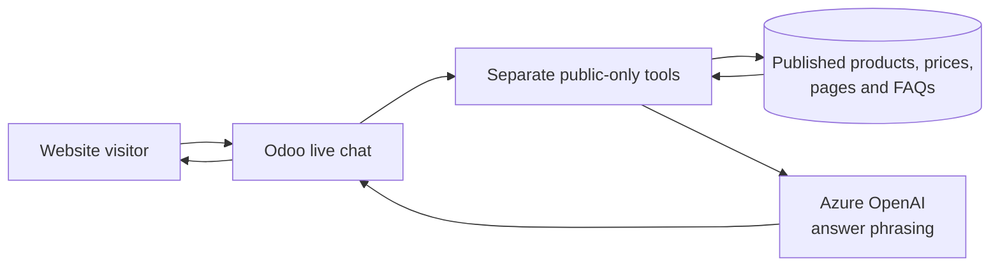

# Telegram, Odoo, and Azure AI architecture

This document describes the trust boundaries for the assistant implemented by
`rioclaro_invoice_inbox`. Odoo is the system of record and policy enforcement
point. Azure AI services receive only the request data needed for an enabled
feature; they do not connect to Odoo's PostgreSQL database.

## Private Telegram query

```mermaid
sequenceDiagram
    actor Contact as Telegram contact
    participant Bot as Odoo Telegram controller
    participant Speech as Azure AI Speech
    participant Policy as Odoo contact/query policy
    participant AOAI as Azure OpenAI
    participant ORM as Odoo ORM/query service
    participant DB as PostgreSQL

    Contact->>Bot: Text or voice message
    opt Voice input
        Bot->>Speech: Voice audio for es-MX transcription
        Speech-->>Bot: Transcribed text
    end
    Bot->>Policy: Resolve active contact and onboarding state
    alt New contact
        Policy-->>Bot: Public-only contact; request name and optional email
        Bot-->>Contact: Onboarding prompt
    else Inactive or blocked contact
        Policy-->>Bot: Deny before AI processing
        Bot-->>Contact: Fixed access-denied response
    else Active contact
        Bot->>Policy: Check request type, permissions, company and partner scope
        alt Public catalog or FAQ question
            Bot->>AOAI: Question and public-only tool definitions
            AOAI-->>Bot: Fixed public tool name and arguments
            Bot->>Policy: Revalidate the public tool and arguments
            Policy->>ORM: Read published website/catalog data only
            ORM->>DB: Scoped read through Odoo
            DB-->>ORM: Published records
            ORM-->>Bot: Bounded public result
            Bot->>AOAI: Bounded public rows for answer phrasing
            AOAI-->>Bot: Response grounded in published content
        else Private business query is authorized
            Policy-->>Bot: Allowed tool schemas and company scope
            Bot->>AOAI: Question and fixed read-only tool definitions
            AOAI-->>Bot: One tool name and arguments
            Bot->>Policy: Revalidate tool and arguments
            Policy->>ORM: Authorized read-only query
            ORM->>DB: ORM query with company/partner restrictions
            DB-->>ORM: Authorized records
            ORM-->>Bot: Sanitized, bounded result rows
            Bot->>AOAI: Result rows for answer phrasing
            AOAI-->>Bot: Spanish response grounded in supplied rows
        else Missing permission or unauthorized company
            Policy-->>Bot: Deny or ask for an allowed company
        end
        Bot-->>Contact: Text response
        opt Optional voice response
            Bot->>Speech: Text for MP3 synthesis
            Speech-->>Bot: MP3 audio
            Bot-->>Contact: Audio response
        end
    end
```

The model proposes a tool call; it does not execute it. Odoo validates the
contact, permissions, company, partner, tool name, and arguments before reading
business data. The question and returned rows are bounded and sanitized before
they are sent for answer phrasing. Voice uses the same authorization path as
text.

## Public website chat



The website assistant has a separate tool allowlist and uses published
catalog/content only. It does not enter the Telegram contact/permission flow
and cannot query private business records.

## Invoice intake

The email and Telegram intake, optional email screening, and human-controlled
extraction/bill creation flow is documented in the
[Odoo add-on README](./custom_addons/rioclaro_invoice_inbox/README.md).
