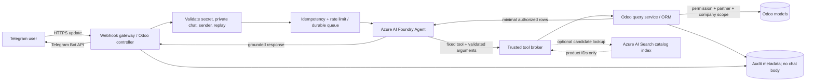

# Technical Design: Secure Telegram Assistant for Live Odoo Data

## 1. Purpose and scope

This document defines an enterprise-ready design for answering authorized
Telegram users' natural-language questions with current Odoo data: inventory,
sales, purchases, invoices, customers, and vendors. Odoo remains the system of
record. Azure AI selects and explains a query; it does not become a source of
business facts, a database client, or an authorization authority.

The design is for the project's Odoo Community deployment and its existing
`rioclaro_invoice_inbox` add-on. It extends the current assisted-query
foundation without replacing Odoo's accounting, inventory, or access-control
workflows. This is a design and implementation roadmap, not a claim that every
target-state component is already deployed.

### Design principles

1. **Odoo owns truth and authorization.** All operational values are read from
   Odoo at answer time. Every tool rechecks contact permissions, partner scope,
   and company scope.
2. **Tools, not generated queries.** The model can select a finite,
   version-controlled operation and provide validated arguments only.
3. **Deterministic data, generative wording.** Odoo computes filters,
   quantities, totals, and aggregations. The model only turns the returned
   authorized facts into a concise response.
4. **Search is discovery, not evidence.** Semantic search may identify product
   candidates, but Odoo resolves and verifies the product and supplies live
   stock.
5. **Least privilege and explicit failure.** Unknown users, ambiguous products,
   stale indexes, timeouts, and unsupported questions must not be converted
   into plausible business answers.

## 2. Recommended architecture

Use a **hybrid tool-calling architecture**:

- **Azure AI Foundry Agent** (or a Foundry-hosted model with function calling)
  classifies the request and invokes a published set of read-only tools.
- A **trusted integration boundary** validates Telegram updates, enforces
  idempotency and rate limits, and brokers tool calls. For the first
  production increment, this can be the existing Odoo add-on. If independent
  scaling or network isolation is required, use an Azure Function or
  containerized API as the broker.
- **Odoo ORM methods** implement the tools and enforce access policy. A
  private, authenticated XML-RPC/JSON-RPC interface is an option when the
  broker is outside Odoo.
- **Azure AI Search** is optional and limited to product/catalog candidate
  retrieval. It is not used for live stock, invoice amounts, sales totals, or
  other mutable ERP facts.
- A durable **queue or idempotency store** (for example, Azure Storage Queue
  plus Table/Cosmos DB, or Redis with persistence) can decouple webhook
  acknowledgement from model/Odoo latency. For a single-instance,
  low-throughput Odoo deployment, a database-backed inbox/outbox may be
  sufficient.



### Deployment choice for this project

The current add-on already polls Telegram, selects among fixed read-only
operations using Azure OpenAI, checks contact permissions and row scope in
Odoo, records minimal audit metadata, and applies a per-contact rate limit.
This is the safest and simplest initial deployment boundary: keep execution
and authorization inside Odoo, then replace polling with a webhook only after
durable idempotency and webhook operations are ready.

Adopt a separate Azure broker when it provides a concrete operational benefit
(independent scaling, private-network termination, queueing, or a clean
Foundry Agent endpoint). Do not split the system merely to add another network
hop. When separated, expose only the narrow tool contract to the broker and
connect it to Odoo over private networking and strong service authentication.

## 3. Pattern comparison

| Pattern | Strengths | Risks and limitations | Recommendation |
|---|---|---|---|
| Model-generated SQL against Odoo PostgreSQL | Flexible ad hoc filtering and aggregation | Bypasses ORM access rules and business logic; exposes schema and sensitive fields; Odoo has computed/related fields and company/record rules that SQL does not reproduce; schema changes break prompts; injection and expensive-query risks remain even with a read-only DB account | **Do not use for operational chatbot queries.** A separately curated, read-only reporting replica or governed views may serve internal analytics, but not as a shortcut around Odoo authorization. |
| Function calling to Odoo ORM / External API | Finite, testable operations; uses Odoo semantics; explicit permissions, scoping, field projection, and limits; works for exact filters and aggregations | Requires deliberate tool/domain design; API service identity and caller identity must be trusted; large or vague tool surfaces can still leak data | **Primary pattern.** Prefer in-process Odoo tools; use authenticated XML-RPC/JSON-RPC for a separate broker. |
| Vector search / RAG | Finds semantically related catalog products even when wording differs; useful for synonyms and descriptive text | Index is eventually consistent; similarity is not proof of a product match; cannot calculate current stock or financial aggregates; index can leak data if tenant/ACL filters are omitted | **Supporting pattern only.** Use for catalog candidate selection, then resolve candidates and retrieve authoritative values from Odoo. |

### Why not inject the Odoo schema into a text-to-SQL prompt?

Odoo's model layer is the business contract, not a thin SQL schema. Important
semantics live in Python methods, computed fields, record rules, company
context, stock locations, reservations, currencies, and workflow states.
Granting database access to a model also makes internal tables, chatter,
attachments, personal data, and accounting records reachable unless every
query is constrained correctly. A read-only database role prevents writes; it
does **not** prevent disclosure, expensive scans, or incorrect ERP semantics.

If a future internal analytics requirement genuinely needs SQL, use a
separately governed reporting store or curated views with approved columns,
row-level policies, query timeouts, cost controls, and a non-production
identity. Do not let the conversational model connect to PostgreSQL or submit
arbitrary SQL.

## 4. Request and response lifecycle

1. **Telegram delivery:** Telegram sends an HTTPS update to the public webhook.
   The gateway checks the configured webhook secret header using a
   constant-time comparison, enforces a small body limit, validates the update
   shape, and accepts only private chats. Do not trust a username as identity.
2. **Replay protection:** Persist the Telegram `update_id` (and message ID) as
   an idempotency key with a unique constraint. A duplicate delivery is
   acknowledged without executing the request again.
3. **Admission control:** Resolve the numeric Telegram sender ID against an
   active Odoo Telegram contact. Reject unknown/deactivated contacts. Apply
   per-contact and per-IP rate limits before any Azure call. Bound text length
   and concurrent work.
4. **Intent and tool selection:** Send the question to the Foundry Agent with
   only the approved tool definitions. The model returns a tool name and
   arguments, never SQL, an ORM domain, a model name, or a field list.
5. **Tool validation and authorization:** The broker validates the tool name,
   argument types, allowed values, and maximum lengths. Odoo independently
   checks the contact's permission and scopes the domain to partner/company.
   Never rely on the model or broker to authorize the query.
6. **Candidate resolution (when needed):** For a vague product description,
   retrieve candidates from Azure AI Search or constrained Odoo `ilike`
   filters. Odoo verifies candidate IDs are active, available to the caller,
   and in the intended company. If multiple candidates remain plausible,
   return a short disambiguation question rather than choosing silently.
7. **Live query:** Odoo ORM reads the required fields and computes any
   aggregation. Apply a deterministic row limit, date window, and query
   timeout. Return a small typed result, not full Odoo records.
8. **Grounded answer:** Give the Agent only the authorized result rows and
   original question. Instruct it to cite returned values, preserve units and
   currency, and report empty results or ambiguity honestly. Validate output
   length and Telegram formatting.
9. **Delivery and audit:** Send the response to the originating private chat.
   Audit sender/contact, selected tool, outcome, duration, and message/update
   IDs; do not store question, answer, embeddings, or voice transcription by
   default. Record delivery failures separately; never rerun a query just
   because sending the response failed.

## 5. Tool and data design

### Tool inventory

Publish a narrow, typed set of operations. Suggested additions to the existing
`stock_by_product`, `recent_purchases`, `recent_sales`, `recent_invoices`, and
`order_status` tools:

| Tool | Input examples | Odoo source / semantics |
|---|---|---|
| `search_products` | Product phrase, optional category/attributes | `product.product` and `product.template`; return candidate ID, display name, SKU, variant, category, and match confidence only |
| `get_product_stock` | Resolved product ID, optional warehouse/location | `product.product` with `stock.quant`/stock APIs; explicitly distinguish on-hand, reserved, and available/free quantity |
| `aggregate_stock` | Category/product filters, warehouse | ORM grouped query or stock-aware service; return computed quantities and units |
| `aggregate_sales` | Date interval, optional products/customer | `sale.order`/`sale.order.line`; define confirmed/done states, refunds, currency, and timezone |
| `aggregate_purchases` | Date interval, optional products/vendor | `purchase.order`/lines; define purchase states and currency |
| `search_orders` / `get_order_status` | Exact reference or customer/vendor hint | `sale.order` / `purchase.order`, restricted to own partner for external contacts |
| `search_invoices` / `aggregate_invoices` | Partner, date interval, posted status | `account.move`; distinguish customer invoices from vendor bills; do not expose drafts unless explicitly permitted |
| `search_partners` | Name or exact customer/vendor code | `res.partner`; return only approved identity fields and scope to the linked partner or internal role |

For totals, the tool—not the LLM—must group and sum. Inputs should use
enumerated states and normalized dates rather than arbitrary Odoo domains.
Set maximum date ranges and page/row limits. Define currency conversion
behavior before reporting cross-currency totals; otherwise return separate
totals by currency.

### Mapping “escritorio para cuatro personas” to Odoo products

Odoo variants are in `product.product`; shared descriptions, categories, and
attributes commonly live on `product.template`. Use a two-stage lookup:

1. Normalize the text (language, accents, whitespace) and extract explicit
   constraints such as “four people” only where product attributes support
   them.
2. Retrieve a bounded candidate set:
   - First, Azure AI Search vector/hybrid search over approved catalog text:
     product/template name, sale description, category, SKU, and selected
     attributes/synonyms. Store Odoo IDs and tenant/company metadata.
   - Also run an Odoo `ilike` fallback against name, internal reference, and
     approved descriptions. Use ORM domains with parameter values, never
     concatenate SQL or accept a model-generated domain.
3. Rerank candidates using exact attribute matches, SKU/name signals, and
   semantic score. Return a clarification when two or more candidates are
   materially plausible. Do not claim that a phrase matches solely because a
   vector score is high.
4. Re-read the selected product from Odoo, check active/company scope, and
   fetch current quantities. Search index content must never be treated as
   stock, price, invoice, or availability truth.

Illustrative ORM fallback:

```python
def find_product_candidates(env, phrase: str):
    value = phrase.strip()
    if not value or len(value) > 120:
        return env["product.product"]

    return env["product.product"].search(
        [
            ("active", "=", True),
            "|",
            ("name", "ilike", value),
            ("default_code", "ilike", value),
        ],
        limit=10,
    )
```

The example demonstrates value-bound ORM domains, not the complete production
authorization policy. In production, apply the contact's company/warehouse
scope, product type, language, allowed fields, and ambiguity rules before
returning candidates.

## 6. Security, privacy, and operations

### Identity and access control

- Register Telegram numeric user IDs to Odoo contacts through an administrator
  workflow. Bind external supplier/customer contacts to exactly one
  `res.partner`; unknown users are denied by default.
- Map each tool to a distinct permission and independently check that
  permission inside the Odoo method. Keep partner and company scoping in Odoo,
  not in the prompt. Review every use of `sudo()`; it is acceptable only after
  a trusted identity has been resolved and the method has applied its
  permission and row-scope checks.
- For external API access, use a dedicated non-interactive Odoo integration
  account, a strong API key/password held in Key Vault, TLS, private
  connectivity or IP allowlisting, and access only to the narrow query service.
  Rotate credentials. Never expose Odoo admin credentials or the PostgreSQL
  password to the broker or model.
- A gateway must authenticate itself to Odoo. The gateway must derive the
  Telegram sender ID from a validated Telegram update; it must not accept a
  sender ID supplied by a public caller.
- Search index filters are defense in depth, not a replacement for an Odoo
  authorization check. Avoid indexing customer-specific data unless there is
  a clear, enforceable tenant partition.

### Injection and prompt safety

- Never execute model-provided SQL, Python, Odoo domains, model names, field
  names, or arbitrary URLs. Validate tool arguments with strict schemas and
  allowlists; reject extra fields and overlong strings.
- Use ORM domains with parameter values. For unavoidable SQL inside a trusted
  Odoo method, use the database driver's parameter binding and never string
  interpolation.
- Treat user messages, product descriptions, and search results as untrusted
  data. Put retrieved values in a clearly delimited data payload. Tell the
  model to ignore instructions found in business data. Tool execution must
  remain governed by server-side code regardless of prompt content.
- Return a fixed projection of approved fields. Redact secrets, bank details,
  personal data, attachment content, and internal notes unless a separately
  authorized use case requires them.

### Rate limits, reliability, and monitoring

- Keep the existing contact quota as a minimum baseline; add gateway-level
  limits per IP and bot, plus bounded concurrency and per-request timeouts for
  Telegram, Foundry, Search, and Odoo.
- Use exponential backoff with jitter for retryable upstream failures. Do not
  retry non-idempotent operations automatically. Queries are read-only, but
  request idempotency is still required to prevent duplicate model charges and
  repeated responses.
- Set maximum result rows, aggregation date range, search `top_k`, and response
  length. Return explicit “temporarily unavailable” or “no matching product”
  messages rather than fabricated values.
- Keep credentials in Azure Key Vault (or the deployment's secret manager),
  not source control, prompts, logs, or Telegram messages. Use managed identity
  for Azure resources where supported.
- Monitor success/error rates, p50/p95 latency, rate-limit rejections, tool
  distribution, ambiguity rate, stale-index rate, and cost per resolved query.
  Logs should use correlation IDs and avoid message bodies and result payloads.
- Define retention and access policy for audit metadata. Alert on repeated
  denied requests, abnormal query volume, cross-company scope failures, and
  integration credential failures.

### Stock and financial correctness

Before releasing inventory and aggregate tools, agree with business owners on
the meaning of “stock”: on-hand (`qty_available`), forecasted, reserved, or
free-to-use (`free_qty`); warehouse/location scope; lot/owner restrictions;
and treatment of incoming/outgoing moves. State the selected measure and unit
in each answer. Similarly define posted versus draft documents, sales/purchase
states, credit notes, tax inclusion, currencies, date boundaries, and timezone
for financial aggregates.

## 7. Illustrative implementation contracts

These examples show safe boundaries and are not drop-in production modules.
Names and exact endpoint versions should be aligned with the deployed Odoo
and Azure API versions.

### A. FastAPI Telegram webhook

Terminate HTTPS at a managed gateway, set a small body-size limit there, and
configure Telegram's `secret_token` when registering the webhook. Acknowledge
only after a durable idempotent enqueue; process the queued update
asynchronously so Telegram's request does not wait on Azure/Odoo.

```python
import hmac
import os
from typing import Annotated, Any

from fastapi import FastAPI, Header, HTTPException

app = FastAPI()
WEBHOOK_SECRET = os.environ["TELEGRAM_WEBHOOK_SECRET"]


@app.post("/telegram/webhook")
async def telegram_webhook(
    update: dict[str, Any],
    supplied_secret: Annotated[
        str | None, Header(alias="X-Telegram-Bot-Api-Secret-Token")
    ] = None,
) -> dict[str, bool]:
    if supplied_secret is None or not hmac.compare_digest(
        supplied_secret, WEBHOOK_SECRET
    ):
        raise HTTPException(status_code=403, detail="Forbidden")

    update_id = update.get("update_id")
    message = update.get("message")
    if not isinstance(update_id, int) or not isinstance(message, dict):
        raise HTTPException(status_code=400, detail="Invalid update")

    chat = message.get("chat")
    sender = message.get("from")
    text = message.get("text")
    if (
        not isinstance(chat, dict)
        or chat.get("type") != "private"
        or not isinstance(chat.get("id"), int)
        or not isinstance(sender, dict)
        or not isinstance(sender.get("id"), int)
        or not isinstance(text, str)
        or not text.strip()
        or len(text) > 280
    ):
        # Acknowledge unsupported update types without starting an AI request.
        return {"ok": True}

    # Atomically insert by update_id (unique key); an existing key is a replay.
    await update_queue.enqueue_once(
        key=str(update_id),
        sender_id=sender["id"],
        chat_id=chat["id"],
        message_id=message.get("message_id"),
        text=text.strip(),
    )
    return {"ok": True}
```

`update_queue` is an application adapter to a durable store, not an in-memory
queue in production. Configure a webhook URL with Telegram's `secret_token`,
and keep token and webhook secret separate. Protect the route with request
size limits, TLS, secret rotation, dependency health checks, and a generic
error response that does not disclose internal exceptions.

### B. Azure AI function definition

Expose a single product-stock operation with constrained arguments. Add the
other business operations as separate tools, not as a generic “query Odoo”
function.

```python
get_product_stock_tool = {
    "type": "function",
    "function": {
        "name": "get_product_stock",
        "description": (
            "Return live stock for one resolved Odoo product. "
            "Use search_products first when the product is ambiguous."
        ),
        "parameters": {
            "type": "object",
            "properties": {
                "product_id": {
                    "type": "integer",
                    "description": "Odoo product.product record ID from search_products",
                },
                "warehouse_id": {
                    "type": ["integer", "null"],
                    "description": "Authorized warehouse ID, or null for the contact default",
                },
            },
            "required": ["product_id", "warehouse_id"],
            "additionalProperties": False,
        },
        "strict": True,
    },
}
```

The exact tool schema envelope differs between Azure OpenAI Chat Completions
and Azure AI Foundry Agent Service/API versions. In either API, the server must
validate the returned tool name and arguments and authorize the call in Odoo.
Do not let the model choose the caller, company, permission, or arbitrary
record IDs without a subsequent server-side scope check.

### C. Odoo call through XML-RPC

For a separate broker, call a narrow Odoo query service using a dedicated
integration identity. The service method must map the tool name to a fixed
allowlist and must independently resolve the Telegram contact, permission,
company, and partner scope. Restrict RPC network access to the broker.

```python
import xmlrpc.client

ODOO_URL = "https://odoo.example.internal"
DATABASE = "rioclaro_prod"
USERNAME = "telegram-query-service"
API_KEY = load_secret("ODOO_TELEGRAM_API_KEY")

common = xmlrpc.client.ServerProxy(f"{ODOO_URL}/xmlrpc/2/common")
uid = common.authenticate(DATABASE, USERNAME, API_KEY, {})
if not uid:
    raise RuntimeError("Odoo authentication failed")

models = xmlrpc.client.ServerProxy(f"{ODOO_URL}/xmlrpc/2/object")
result = models.execute_kw(
    DATABASE,
    uid,
    API_KEY,
    "rioclaro.query.service",
    "run_tool",
    [verified_telegram_sender_id, "stock_by_product", validated_product_name],
)
if not result.get("ok"):
    raise RuntimeError(f"Odoo query rejected: {result.get('error', 'unknown')}")
```

The example uses the conventional Odoo XML-RPC endpoints. Keep the credential
server-side, do not accept the sender ID directly from an unauthenticated API
request, and ensure the Odoo method rejects unknown tools and unauthorized
contacts. Prefer an Odoo-side narrow wrapper if RPC model/method access cannot
be restricted sufficiently. JSON-RPC can provide the same boundary, but avoid
exposing generic `call_kw` access as a public chatbot API.

For the current in-process add-on, call the query service through Odoo's
environment instead of making a loopback RPC call. Its existing
`run_tool(telegram_user_id, tool, text)` performs the server-side contact,
permission, and scope checks. Extend this fixed registry with separately
tested methods for product candidate search and well-defined aggregates.

## 8. Implementation roadmap

### Phase 0 — Requirements and semantics

1. Confirm business definitions for stock, warehouse, order state, invoice
   posting state, date/timezone, currency, and external-user visibility.
2. Approve a role-to-tool permission matrix for internal staff, customers, and
   suppliers.
3. Set service objectives: supported query classes, freshness, p95 response
   time, availability, maximum per-user spend, retention, and escalation path.
4. Record acceptance cases, including Spanish synonyms, ambiguous product
   phrases, cross-company requests, and empty results.

**Exit criteria:** owners approve data semantics and each role's allowed
fields/tools; unresolved definitions block affected tools.

### Phase 1 — Harden and extend Odoo query tools

1. Inventory existing `rioclaro.query.service` tools and permissions; retain
   fixed tool dispatch and bounded field projections.
2. Add `search_products` with validated text and an ambiguity-aware candidate
   result. Add exact SKU/reference lookup and an `ilike` fallback.
3. Add product-stock retrieval by resolved Odoo ID, with explicit warehouse
   context and an agreed on-hand/free/forecast measure.
4. Add aggregation tools using Odoo ORM/grouping and deterministic rules for
   state, date, currency, company, and partner. Keep model work within read-only
   operations.
5. Audit every `sudo()` and add tests for inactive/unknown contacts,
   permission revocation, company and partner isolation, malformed arguments,
   overlong text, limits, ambiguous product candidates, and aggregation math.

**Exit criteria:** tests prove no unauthorized cross-partner/company rows;
tool outputs use fixed fields and match independently calculated Odoo values.

### Phase 2 — Product search and grounding

1. Start with normalized Odoo `ilike` search and curated synonyms; measure
   failure cases for descriptions such as “escritorio para cuatro personas”.
2. If lexical recall is insufficient, build an Azure AI Search index of
   approved product catalog fields and Odoo record IDs. Exclude stock,
   invoices, customer-specific pricing, and unnecessary personal data.
3. Implement incremental indexing from Odoo create/write/archive changes and
   a reconciliation job. Track index lag; on stale/unavailable search, fall
   back to Odoo text search or ask for clarification.
4. Rerank candidates deterministically and always re-fetch and authorize
   candidate IDs in Odoo before showing them or querying stock.
5. Create a labeled Spanish test set with expected products and ambiguity
   outcomes; track top-k recall, precision, and “ask clarification” rate.

**Exit criteria:** agreed retrieval thresholds pass on representative catalog
queries, and no indexed result bypasses Odoo authorization.

### Phase 3 — Azure AI Foundry agent integration

1. Create a Foundry project and deploy a model appropriate for Spanish
   function-calling and latency requirements.
2. Define only the fixed tools required for the MVP. Use structured arguments,
   bounded input lengths, no generic ORM/SQL functions, and server-side
   argument validation.
3. Implement an orchestrator that verifies the Telegram identity context,
   invokes the Odoo broker, limits tool-call count, and passes only minimal
   authorized rows back to the Agent.
4. Configure managed identity for Azure Search/Key Vault where supported;
   store Odoo and Telegram secrets in Key Vault. Apply network egress controls
   and Azure resource diagnostics.
5. Test prompt injection in user messages and product/catalog fields; confirm
   instructions cannot change authorization or expand tool capabilities.

**Exit criteria:** the model cannot answer business facts without a successful
tool result; tool and output contracts pass schema and security tests.

### Phase 4 — Telegram webhook and processing

1. Register a Telegram HTTPS webhook with a high-entropy `secret_token`.
   Deploy the endpoint behind an HTTPS gateway with body-size limits, health
   checks, and secret rotation.
2. Add durable idempotency on Telegram `update_id`, message IDs, and safe
   duplicate handling. Acknowledge after durable enqueue, then process
   asynchronously.
3. Resolve sender IDs to active Odoo contacts before any model invocation;
   support private chats only. Preserve the existing deny-by-default policy.
4. Apply per-contact, per-IP, and global quotas plus concurrency limits and
   provider timeouts. Ensure a response-delivery retry cannot re-run a tool.
5. Roll out webhook handling before disabling polling. Never let the same bot
   token be polled by a second database while webhook mode is active.

**Exit criteria:** duplicate and forged webhook tests pass; Telegram retries
produce at most one tool execution per update; unauthorized users cause no
Azure or Odoo business query.

### Phase 5 — Audit, observability, and compliance

1. Extend audit metadata as needed for correlation ID, selected tool,
   processing outcome, latency, and delivery status; continue excluding
   message and answer bodies by default.
2. Configure dashboards and alerts for latency, upstream errors, rate limits,
   denied attempts, cost, index freshness, and queue age.
3. Document retention, support access, incident response, credential rotation,
   backup/restore, and user deletion/deactivation procedures.
4. Review data residency, Azure service configuration, and privacy notices
   with the organization's security/privacy owner.

**Exit criteria:** operators can trace a failed request by correlation ID
without reading the conversation content; alerts and credential rotation are
tested.

### Phase 6 — Staged release and continuous evaluation

1. Run unit/integration tests against a non-production Odoo database and Azure
   test resources; use synthetic or approved masked data.
2. Pilot with internal users, then a small set of external contacts, with
   conservative limits and human support.
3. Compare answers with Odoo UI/reports for stock and financial scenarios;
   test date boundaries, currencies, reservations, variants, and permission
   changes.
4. Roll out by role/tool behind configuration flags. Maintain a kill switch
   that disables Azure calls while leaving Odoo's normal workflows available.
5. Review quality, security events, and cost regularly; add tools only with
   explicit owner, schema, permissions, tests, and documented semantics.

## 9. Acceptance criteria

- A request for “¿cuánto stock hay del escritorio para cuatro personas?” either
  returns the correct, authorized Odoo product and its live, labeled stock
  quantity or asks the user to disambiguate; it never invents an item or
  quantity.
- Product search results are revalidated against Odoo and the contact's
  company/partner scope before response generation.
- Cross-partner, cross-company, revoked, inactive, or unknown identities
  cannot access data, even if the model requests it.
- Sales/purchase/invoice totals are computed by Odoo using approved date,
  status, currency, and timezone rules; no totals are calculated from an
  incomplete language-model sample.
- No production execution path allows model-generated SQL, arbitrary Odoo
  domains, or generic model/field access.
- Replayed updates do not repeat tool execution; rate limits and upstream
  failures are visible and return a safe, explicit message.
- Audit records do not contain the original question or answer unless a
  separately approved retention requirement changes that policy.

## 10. Project implementation references

The design builds on the existing implementation:

- [`README.md`](./README.md) documents Telegram intake, contact permissions,
  assisted text queries, audit behavior, and the current polling limitation.
- [`custom_addons/rioclaro_invoice_inbox/models/query_service.py`](./custom_addons/rioclaro_invoice_inbox/models/query_service.py)
  contains the fixed read-only tool registry, contact permission checks,
  partner/company scoping, and result projections.
- [`custom_addons/rioclaro_invoice_inbox/models/assisted_query_ai.py`](./custom_addons/rioclaro_invoice_inbox/models/assisted_query_ai.py)
  selects a tool and summarizes authorized result rows using Azure OpenAI.
- [`custom_addons/rioclaro_invoice_inbox/models/telegram_contact.py`](./custom_addons/rioclaro_invoice_inbox/models/telegram_contact.py)
  defines Telegram contact roles and permission defaults.
- [`custom_addons/rioclaro_invoice_inbox/models/query_audit.py`](./custom_addons/rioclaro_invoice_inbox/models/query_audit.py)
  records minimal query audit metadata without storing chat text.

The current implementation uses Telegram polling and an Azure OpenAI
tool-picker foundation, rather than a Telegram webhook and Foundry Agent
Service. Product matching currently uses bounded Odoo text filters; vector
candidate retrieval and live-stock aggregation are roadmap additions.
