# Bandeja de facturas de Río Claro

**Versión:** 20.0.1.3.0 · **Categoría:** Contabilidad · **Licencia:** LGPL-3 · **Autor:** Distribuidora Río Claro

## Descripción general

`rioclaro_invoice_inbox` es un módulo personalizado para Odoo 20 que reúne la recepción y revisión de facturas de proveedores, consultas de negocio por Telegram y un asistente de contenido público para el chat en vivo del sitio web.

Las facturas llegan por correo o Telegram y se conservan en Odoo para que el equipo contable las revise. Las consultas de Telegram respetan permisos y compañías autorizadas; el asistente del sitio solo responde con información pública.

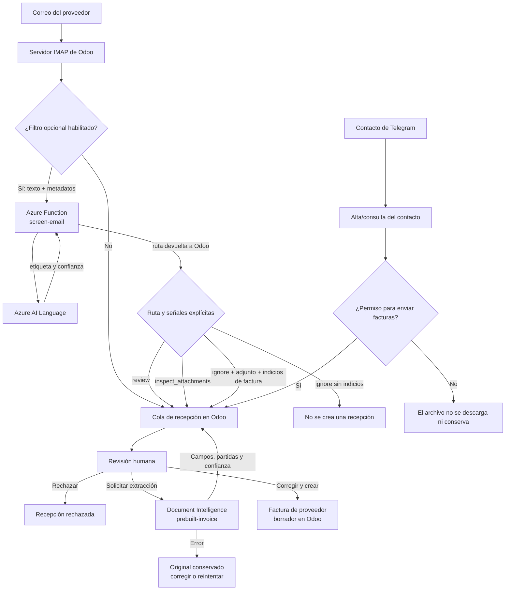

La extracción es manual y sus resultados son sugerencias que debe verificar
una persona. El módulo no valida CFDI ni se conecta con el SAT.

## Tecnologías de Microsoft Azure

El módulo se comunica con los servicios de Azure desde Odoo mediante HTTPS.
Odoo sigue siendo el sistema de registro y se encarga de los permisos, el
alcance por compañía, las consultas a la base de datos y la creación de
facturas. Los servicios de Azure no se conectan directamente a la base de
datos de Odoo.

| Tecnología de Microsoft | Para qué se usa | Cómo se usa en este módulo |
|---|---|---|
| **Azure AI Document Intelligence** | Reducir la captura manual de datos de facturas. | Cuando un revisor elige **Extraer datos de factura**, Odoo envía el primer archivo compatible (PDF, JPEG o PNG) al modelo `prebuilt-invoice` (API `2024-11-30`). Odoo guarda en la recepción los datos generales, las partidas y sus niveles de confianza. No crea facturas automáticamente. |
| **Azure OpenAI** | Interpretar preguntas en lenguaje natural y redactar respuestas breves. | Odoo llama a un despliegue de chat completions (API `2024-06-01`) para seleccionar una herramienta y sus argumentos de una lista fija. Odoo verifica los permisos y las compañías autorizadas, ejecuta la consulta de solo lectura y envía resultados acotados y depurados para generar un resumen en español. El chat del sitio usa el mismo servicio, pero con una lista separada que solo permite consultar catálogo y preguntas frecuentes publicados. |
| **Azure AI Speech** (servicio Speech) | Permitir interacciones por voz en Telegram. | Odoo envía notas de voz OGG/Opus para transcribirlas en español de México (`es-MX`). Para las consultas por voz, el bot también puede convertir su respuesta a audio MP3 con la voz `es-MX-DaliaNeural`. Las conversaciones solo de texto no requieren Speech. |
| **Azure Functions** (puente opcional para filtrar correos) | Ofrecer un endpoint HTTP que clasifique los correos antes de crear recepciones de facturas en Odoo. | Si se activa el filtro, Odoo envía al endpoint configurado el cuerpo en texto, si hay adjuntos y el idioma. Usa la ruta devuelta (`ignore`, `review` o `inspect_attachments`) para decidir si conserva la ruta de correo de facturas. |
| **Azure AI Language** (lo usa la Function de filtrado) | Clasificar el texto del correo como `supplier_invoice` o `not_invoice`. | La Function consulta un despliegue de clasificación personalizada de una sola etiqueta y combina la etiqueta y la confianza con la presencia de adjuntos para recomendar una ruta. No descarga, revisa ni valida adjuntos, ni extrae datos de facturas. El filtro es opcional; el conjunto sintético de práctica no demuestra precisión para producción. |
| **Azure Storage** | Guardar documentos de entrenamiento del proyecto de Language y los datos de ejecución que requiere Functions. | El proyecto de clasificación usa un contenedor Blob conectado para sus documentos. La Function tiene su propia cuenta de almacenamiento para el host; no se reutiliza el almacenamiento de entrenamiento de Language. |
| **Application Insights** | Dar seguimiento a la ejecución de la Function. | Se habilitó como recurso de monitoreo al crear la Function App. No procesa correos ni se conecta a Odoo. |

Azure AI Language y Azure Functions conforman una ruta opcional de filtrado,
separada de la extracción de facturas. **Azure Logic Apps y el conector de
Outlook para Microsoft 365 no forman parte del flujo implementado**: se
consideraron como una posible orquestación, pero la prueba de recepción en
producción usó el servidor IMAP de Odoo y una cuenta de Gmail. El conector de
Gmail tampoco es una tecnología de Microsoft. Azure es la infraestructura
elegida para alojar el Odoo de producción, pero el módulo no depende de Azure
para instalarse ni ejecutarse.

Para desarrollo local del filtrado, **Azure Functions Core Tools** inicia el
host HTTP y **Azurite** simula el almacenamiento local de Azure. El proyecto
de Language usa **Language Studio** para etiquetar documentos, entrenar y
evaluar el modelo. En Azure, la Function usa una identidad administrada con el
rol **Cognitive Services User** en el recurso de Language; en local, se usa
`DefaultAzureCredential` con una sesión iniciada mediante Azure CLI. Estos
componentes son para el desarrollo y la operación del filtro, no servicios
adicionales requeridos por el módulo de Odoo.

### Cómo se configuraron los servicios de Microsoft

Estos son los recursos y pasos que se usaron en la integración documentada.
Los nombres y las capturas sirven como referencia; al crear tu propio entorno,
usa los recursos y credenciales que correspondan. **No copies claves ni
tokens en el README, en Odoo ni en Git.**

#### Azure AI Document Intelligence

1. En el grupo de recursos `rg-rioclaro-ai-dev`, se creó el recurso
   `rioclaro-docintel-dev` en **Canada Central**, con el nivel gratuito **F0**.
2. En Document Intelligence Studio, se vinculó el recurso y se probó el modelo
   precompilado **Invoices** con una factura de ejemplo.
3. El endpoint y la clave del recurso se configuraron en el entorno del
   contenedor de Odoo como `RIOCLARO_DOCUMENT_INTELLIGENCE_ENDPOINT` y
   `RIOCLARO_DOCUMENT_INTELLIGENCE_KEY`. Odoo envía el archivo cuando un
   revisor solicita la extracción.

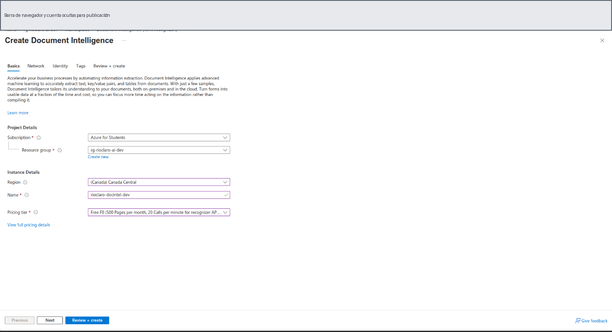
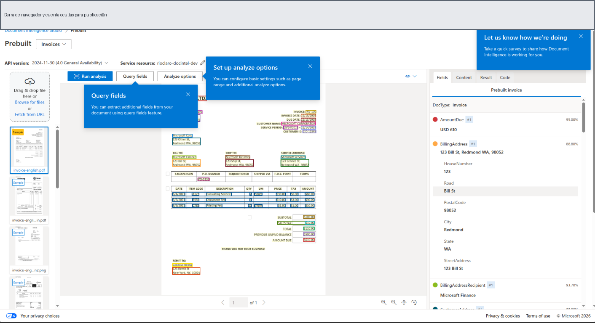

#### Azure OpenAI y Azure AI Speech

1. Se creó `rioclaro-aoai-dev` en `rg-rioclaro-ai-dev`, en **Canada Central**,
   con el nivel **Standard S0**. Después, en Azure AI Foundry, se desplegó el
   modelo de chat `gpt-chat-latest` con soporte para llamadas a funciones.
2. El endpoint, la clave y el nombre del despliegue se pasaron al contenedor
   de Odoo mediante `RIOCLARO_AOAI_ENDPOINT`, `RIOCLARO_AOAI_API_KEY` y
   `RIOCLARO_AOAI_DEPLOYMENT`.
3. Para voz, se creó el recurso Speech `rioclaro-speech-dev` en
   **Canada Central**, nivel **F0**. Su endpoint, región (`canadacentral`) y
   clave se configuraron en `RIOCLARO_SPEECH_ENDPOINT`,
   `RIOCLARO_SPEECH_REGION` y `RIOCLARO_SPEECH_KEY`.
4. Se probó la transcripción de notas OGG/Opus en español de México y la
   síntesis de respuestas en MP3. La integración usa el endpoint del recurso;
   no se guardan las grabaciones ni las transcripciones en el registro de
   auditoría.

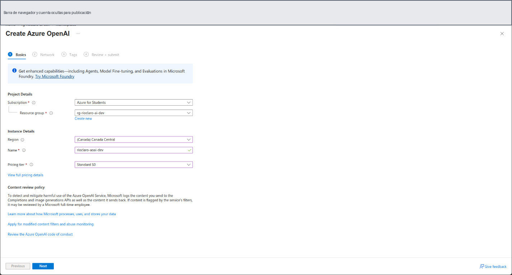
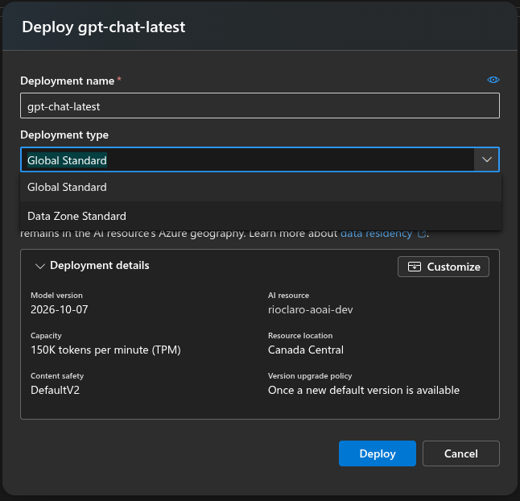
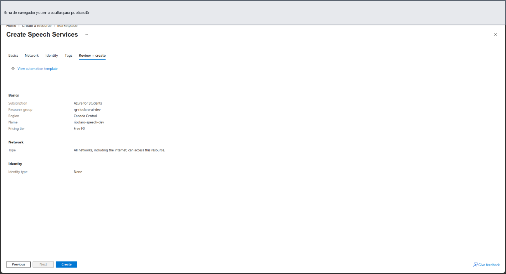

#### Azure AI Language y Azure Functions para filtrar correos

1. En `rg-rioclaro-ai-dev` se crearon el recurso Language
   `rioclaro-language-dev` y la cuenta de almacenamiento Blob
   `rioclaroaiscreen02`, ambos en **Canada Central**. Language quedó en nivel
   **F0** y el almacenamiento se dedicó al proyecto de clasificación. Se
   habilitó la clasificación de texto personalizada y se asignó **Storage
   Blob Data Contributor** a la identidad administrada de Language y al
   usuario de Azure que prepara el conjunto de datos. Para que Language
   Studio pudiera cargar documentos, también se habilitó CORS en Blob Storage
   para `https://ai.azure.com` y `https://language.cognitive.azure.com`.
2. En Language Studio se creó el proyecto
   `supplier-invoice-email`, de clasificación de una sola etiqueta y en
   español. Se etiquetaron ejemplos como `supplier_invoice` o `not_invoice`,
   se entrenó el modelo de práctica `supplier-invoice-email-practice-01` y se
   creó el despliegue `practice-screening-deployment`.
3. El conjunto de datos usado es sintético. Aunque las pruebas de práctica
   coincidieron con sus etiquetas, esos resultados **no demuestran la
   precisión con correos reales**. Evalúa el modelo con ejemplos reales
   depurados antes de confiarle el filtrado automático.
4. Para producción, se creó la Function App `rioclaro-screening-942` en el
   grupo `rg-rioclaro-prod`, región **Canada Central**, plan **Flex
   Consumption**, Python 3.11 y 2048 MB. Se configuraron una cuenta de
   almacenamiento independiente para el host de Functions, **Application
   Insights** y acceso público protegido con una clave de Function. La
   integración con Azure OpenAI se dejó desactivada: esta Function no la usa.
5. Se habilitó la identidad administrada de la Function App y se le asignó el
   rol **Cognitive Services User** en el recurso `rioclaro-language-dev`.
   Mediante Azure CLI se configuraron `LANGUAGE_ENDPOINT` (endpoint del
   recurso), `LANGUAGE_PROJECT_NAME=supplier-invoice-email`,
   `LANGUAGE_DEPLOYMENT_NAME=practice-screening-deployment` y
   `INVOICE_CONFIDENCE_THRESHOLD=0.90` en la Function App y se publicó el
   código de `azure/email-screening/`. El umbral 0.90 es un valor de práctica,
   no una precisión validada para producción.
6. La clave de la Function se guardó como secreto en el entorno del contenedor
   de Odoo. En Odoo se activó el filtrado mediante
   `rioclaro_invoice_inbox.screening_enabled` y se configuró
   `rioclaro_invoice_inbox.screening_url` con la ruta `/api/screen-email`.
   Odoo manda únicamente el texto del correo, el indicador de adjuntos y el
   idioma; el servicio no descarga ni analiza el contenido de los archivos.

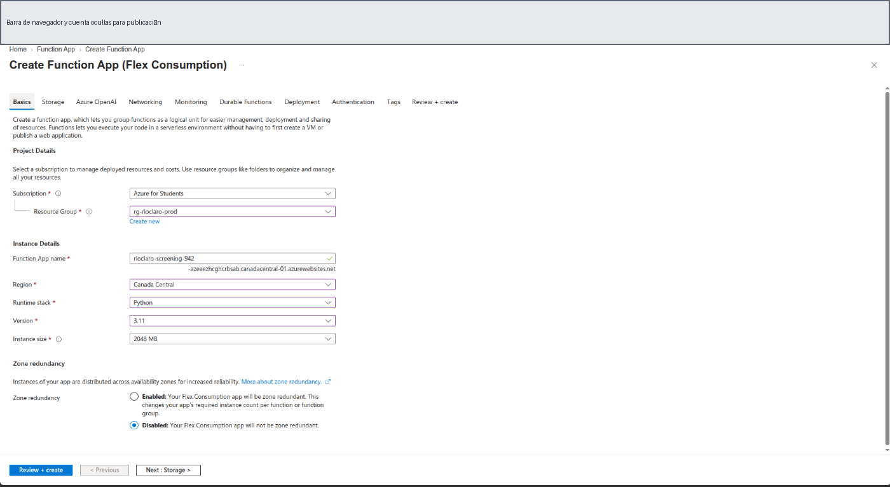
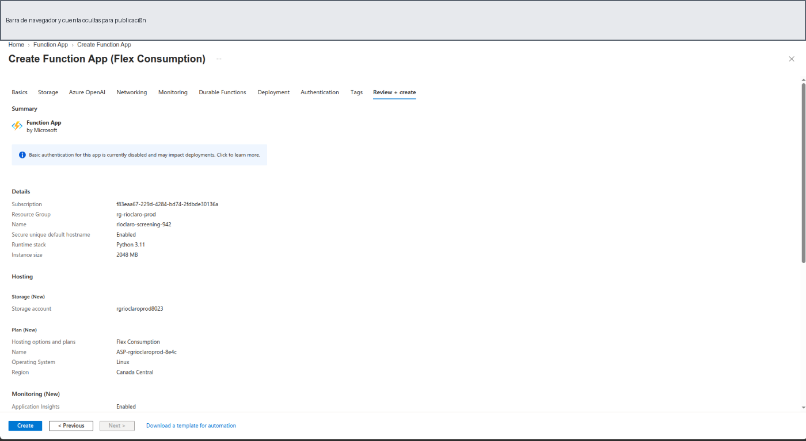
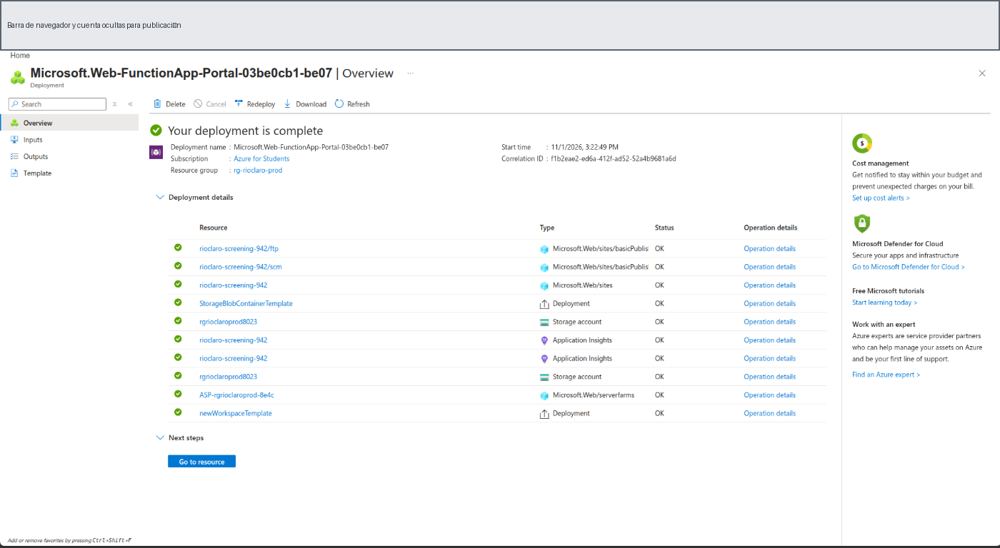

#### Odoo, Azure y el buzón de correo

La instancia de Odoo de producción se aloja en una máquina virtual de Azure.
La prueba integral de recepción usa un servidor entrante **IMAP** configurado
en Odoo y el modelo de destino **Supplier Invoice Email**. No hay una
dirección de destinatario ni una cuenta de correo fija incluida en el módulo:
cada persona debe configurar y usar un buzón de pruebas que controle. La
recepción por Microsoft 365 y Azure Logic Apps no forma parte del flujo
implementado.

Para desarrollo local del filtro se usaron **Azure Functions Core Tools 4**,
**Azurite** y Azure CLI. Core Tools ejecuta la Function en la computadora
local, Azurite simula su almacenamiento y `az login` permite que
`DefaultAzureCredential` acceda al recurso Language. Esto no sustituye la
Function App desplegada en Azure.

### Flujo de consultas del asistente

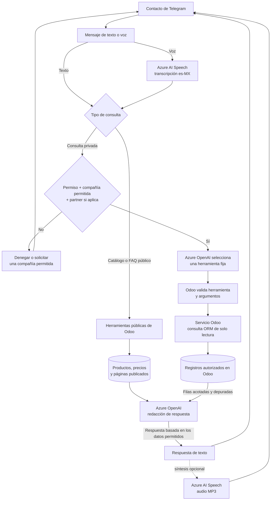

Azure OpenAI selecciona una herramienta, pero **no** ejecuta SQL ni accede a
la base de datos. Odoo valida los permisos, argumentos y alcance por compañía
o partner antes de consultar. La respuesta se redacta solo con filas permitidas.
La nota de voz usa el mismo control de acceso que una pregunta de texto; el
envío de audio es opcional y no reemplaza la respuesta escrita.

El chat en vivo del sitio tiene un flujo y herramientas separados: solo puede
consultar catálogo, precios y contenido publicados. No comparte el acceso a
datos privados de Telegram. Consulta también la
[arquitectura detallada](../../TELEGRAM_ODOO_AZURE_AI_ARCHITECTURE.md).

### Flujo opcional de filtrado de correos

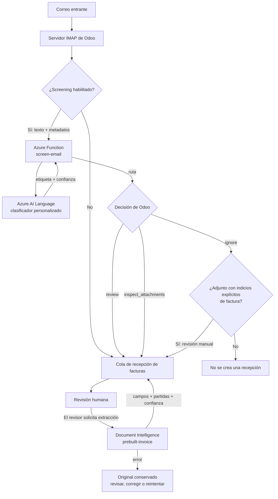

El filtrado y la extracción son procesos separados a propósito: el filtro
solo recibe el texto del correo y el indicador de si hay adjuntos.
Document Intelligence recibe un archivo compatible únicamente cuando un
revisor solicita la extracción. `inspect_attachments` es una ruta de correo:
la Function no descarga ni inspecciona el contenido de los archivos.

---

## Funcionalidades

### 📥 Recepción de facturas

- Recibe correos mediante el alias configurado en Odoo y archivos de Telegram enviados por contactos autorizados.
- Conserva el mensaje original y sus adjuntos; evita crear otra recepción cuando se procesa el mismo mensaje.
- Permite revisar, rechazar o crear una factura de proveedor en borrador. La coincidencia por RFC ayuda a identificar al proveedor.

### 🤖 Integración con Azure AI Document Intelligence

- El revisor inicia la extracción desde la recepción. Los formatos admitidos y los datos que devuelve el modelo se describen en [Tecnologías de Microsoft Azure](#tecnologías-de-microsoft-azure).
- La extracción no publica ni crea automáticamente una factura; el proceso de revisión se detalla en la [guía de pruebas](#guía-de-pruebas-manuales).

### 💬 Chatbot de Telegram

- Recibe archivos de factura y preguntas por mensaje privado.
- El administrador registra los contactos y define sus permisos y compañías autorizadas.
- Las herramientas de consulta disponibles son:

| Herramienta | Descripción |
|---|---|
| `stock_by_product` | Existencias disponibles y físicas por producto |
| `search_products` / `get_product_stock` | Búsqueda de productos y consulta detallada de existencias |
| `recent_purchases` | Órdenes de compra recientes |
| `recent_sales` | Órdenes de venta recientes |
| `recent_invoices` | Facturas publicadas recientes |
| `aggregate_sales` | Total de ventas confirmadas por moneda y periodo |
| `aggregate_purchases` | Total de compras confirmadas por moneda y periodo |
| `aggregate_invoices` | Total de facturas por tipo y periodo, descontando notas de crédito |
| `order_status` | Estado de una orden por referencia |
| `top_products` | Cinco productos principales por ingresos y unidades vendidas |
| `compare_sales` | Comparación de ventas entre periodos |
| `product_margin` | Margen bruto por categoría de producto |
| `open_balances` | Cuentas por cobrar y por pagar pendientes |
| `public_catalog` | Productos publicados en el sitio y sus precios públicos |
| `public_faq` | Páginas publicadas del sitio |

- Admite preguntas por texto y notas de voz de hasta 60 segundos. La configuración de voz y de IA se explica en [Tecnologías de Microsoft Azure](#tecnologías-de-microsoft-azure).
- El administrador puede ajustar el límite de consultas y el estilo de respuesta desde Ajustes.

### 🌐 Asistente de IA para chat en vivo

- Se activa por canal mediante `rioclaro_ai_enabled` y responde a visitantes con información publicada.
- Puede sugerir productos del catálogo con enlaces. Para habilitarlo y probar sus límites, consulta la [guía de pruebas](#guía-de-pruebas-manuales).

---

## Dependencias de Odoo

| Módulo de Odoo | Para qué se usa |
|---|---|
| `account` | Facturas de proveedor y contabilidad |
| `mail` | Alias de correo, chatter y manejo de conversaciones |
| `purchase` | Consultas de órdenes de compra |
| `sale_management` | Consultas de órdenes de venta |
| `stock` | Consultas de inventario |
| `website_livechat` | Asistente de IA para chat en vivo |
| `website_sale` | Catálogo público de productos |

---

## Instalación

1. Copia este módulo en la ruta de complementos de Odoo (`addons` o `custom_addons/`).
2. Actualiza la lista de aplicaciones e instala **Bandeja de facturas de Río Claro**.
3. Configura las variables de entorno necesarias (consulta [Configuración](#configuración)).
4. Configura el alias de correo y las tareas programadas que necesites.

---

## Configuración

### Variables de entorno

| Variable | Cuándo se requiere | Descripción |
|---|---|---|
| `RIOCLARO_TELEGRAM_BOT_TOKEN` | Para usar Telegram | Token de la API de Telegram |
| `RIOCLARO_TELEGRAM_WEBHOOK_SECRET` | Si se usa webhook | Token secreto para el encabezado `X-Telegram-Bot-Api-Secret-Token`. Al configurarlo, se desactiva la consulta periódica. |
| `RIOCLARO_AOAI_ENDPOINT` | Para consultas con IA | Endpoint HTTPS de Azure OpenAI |
| `RIOCLARO_AOAI_API_KEY` | Para consultas con IA | Clave de Azure OpenAI |
| `RIOCLARO_AOAI_DEPLOYMENT` | Para consultas con IA | Nombre del despliegue de Azure OpenAI |
| `RIOCLARO_DOCUMENT_INTELLIGENCE_ENDPOINT` | Para extraer datos de facturas | Endpoint HTTPS de Azure AI Document Intelligence |
| `RIOCLARO_DOCUMENT_INTELLIGENCE_KEY` | Para extraer datos de facturas | Clave de Azure AI Document Intelligence |
| `RIOCLARO_SPEECH_ENDPOINT` | Para notas de voz | Endpoint HTTPS del servicio Azure AI Speech |
| `RIOCLARO_SPEECH_REGION` | Para notas de voz | Región del recurso de Azure AI Speech |
| `RIOCLARO_SPEECH_KEY` | Para notas de voz | Clave del servicio Azure AI Speech |
| `RIOCLARO_SCREENING_FUNCTION_KEY` | Si se usa una Function protegida para filtrar correos | Clave de Azure Functions enviada en el encabezado `x-functions-key`. Es opcional al usar Functions localmente. |

La configuración del recurso Azure AI Language (endpoint, proyecto,
despliegue, identidad y umbral de confianza) corresponde a la Function App
separada que filtra correos, no al entorno de Odoo. Consulta la
[guía de configuración del filtro de correos](../../azure/email-screening/README.md).

Guarda las claves de los servicios y los tokens del bot en el mecanismo de
administración de secretos de tu despliegue o en un archivo local ignorado por
Git. No guardes claves de API como parámetros del sistema en Odoo ni las
incluyas en el repositorio.

### Parámetros del sistema (`ir.config_parameter`)

| Clave | Descripción | Valor predeterminado |
|---|---|---|
| `rioclaro_invoice_inbox.company_id` | Compañía a la que se asignan las facturas entrantes | Compañía actual |
| `rioclaro_invoice_inbox.telegram_polling_enabled` | Activa la consulta periódica de Telegram en esta base de datos. En producción, debe activarse solo en la base que procesará el bot. | `False` |
| `rioclaro_invoice_inbox.telegram_update_offset` | Guarda el último aviso de Telegram confirmado | 0 |
| `rioclaro_invoice_inbox.telegram_query_rate_limit` | Máximo de consultas por usuario durante el periodo | 5 |
| `rioclaro_invoice_inbox.telegram_query_window_minutes` | Duración del periodo para limitar consultas, en minutos | 5 |
| `rioclaro_invoice_inbox.screening_enabled` | Llama a la Function opcional de filtrado antes de procesar rutas de correo de facturas | `False` |
| `rioclaro_invoice_inbox.screening_url` | Endpoint HTTP de la ruta `screen-email` de la Function | Vacío |

Para activar el filtro, configura ambos parámetros y asegúrate de que el
servidor de Odoo pueda acceder al endpoint. Una Function alojada en Azure
puede requerir `RIOCLARO_SCREENING_FUNCTION_KEY` en el entorno del proceso de
Odoo. Si la llamada falla o la respuesta no es válida, Odoo muestra un error;
no considera silenciosamente que el correo sea seguro.

### Opciones en la interfaz de ajustes (`Ajustes → Técnico`)

En el formulario de Ajustes de Odoo están disponibles estas opciones:

- **Consultas de Telegram por usuario**: máximo de consultas durante el periodo configurado.
- **Periodo límite de Telegram (minutos)**: duración de la ventana móvil.
- **Estilo de respuesta de Telegram**: selección de un tono predefinido para la IA.
- **Instrucciones personalizadas para las respuestas**: texto opcional para orientar el tono (máximo 500 caracteres).
- **Saludo personalizado para el primer contacto**: reemplazo opcional del mensaje inicial predeterminado (máximo 500 caracteres).

---

## Guía de pruebas manuales

Realiza estas pruebas en una base de **desarrollo o pruebas**, con productos,
proveedores, clientes, órdenes y facturas de ejemplo. No uses un buzón de
producción ni marques facturas reales como pagadas o publicadas. Algunas
pruebas llaman servicios de Azure y pueden consumir cuota.

### Preparación y mapa de pruebas

La guía está organizada para que puedas probar cada característica por
separado. No necesitas configurar Azure para comprobar la recepción básica de
correo. Configura únicamente los servicios requeridos por la prueba que vas a
ejecutar:

| Característica | Requisitos principales | Sección |
|---|---|---|
| Recibir una factura por correo | Buzón de pruebas propio, servidor IMAP en Odoo y usuario con permisos contables | [1. Correo y borrador](#1-recibir-una-factura-por-correo-y-crear-un-borrador) |
| Extraer datos de una factura | Lo anterior, Azure AI Document Intelligence y archivo PDF, JPEG o PNG | [1. Correo y borrador](#1-recibir-una-factura-por-correo-y-crear-un-borrador) |
| Filtrar correos con Azure | Buzón dedicado, Function accesible y filtrado configurado en Odoo | [2. Filtrado opcional](#2-probar-el-filtrado-opcional-de-correo-con-azure) |
| Recibir una factura por Telegram | Bot configurado, un solo método de recepción activo y contacto autorizado | [3. Factura por Telegram](#3-recibir-una-factura-por-telegram) |
| Consultar datos privados por Telegram | Azure OpenAI, contacto con permisos y compañías, y datos de prueba en Odoo | [4. Consultas privadas](#4-consultar-ventas-compras-facturas-e-inventario-por-telegram) |
| Consultar catálogo y páginas públicas | Productos y páginas publicados; Azure OpenAI para respuestas del asistente | [5 y 7. Funciones públicas](#5-buscar-y-sugerir-productos) |
| Probar notas de voz, estilo, límites y auditoría | Bot de Telegram; Azure OpenAI y Speech para voz; administrador para revisar ajustes/auditoría | [6. Voz, auditoría y estilo](#6-probar-notas-de-voz-auditoría-y-estilo-de-respuesta) |
| Probar el asistente del chat en vivo | Canal de chat de prueba y catálogo o páginas publicados | [5. Buscar y sugerir productos](#5-buscar-y-sugerir-productos) |

**Dirección de correo:** el módulo no define `testingropech@gmail.com` ni
ninguna otra dirección de recepción. En la prueba por correo, envía el mensaje
a la dirección del buzón desechable o dedicado que tú configuraste en el
servidor IMAP entrante de Odoo. No envíes datos reales ni uses un buzón de
producción.

Prepara, según las funciones que vayas a probar:

- Un proveedor de prueba en Odoo, vinculado a la compañía de pruebas y con
  RFC si vas a crear una factura de proveedor. Usa un documento sintético o
  autorizado, no una factura real con datos personales.
- Un producto publicado con precio y una página publicada si probarás el
  catálogo o las preguntas frecuentes del sitio.
- Órdenes confirmadas, facturas publicadas y existencias de prueba si
  probarás consultas privadas por Telegram. Si no existen registros para una
  consulta, una respuesta sin resultados es válida.
- Una cuenta de Telegram de prueba. Para consultas privadas, identifica su ID
  numérico y prepara un contacto con el rol, permisos y compañías permitidas
  adecuados.

Antes de ejecutar las pruebas:

1. Instala y actualiza el módulo en la base de pruebas.
2. Configura únicamente las credenciales de los servicios que vas a probar
   (consulta [Configuración](#configuración)). Para probar recepción de
   correo, configura el host y acceso IMAP del buzón dedicado; la cuenta que
   recibe los mensajes y la que se configura en Odoo deben corresponder al
   mismo buzón.
3. Para Telegram, configura el token del bot y activa
   `rioclaro_invoice_inbox.telegram_polling_enabled` en **una sola base de
   datos**. También puedes usar el webhook, pero no actives ambos métodos a la
   vez.
4. Si necesitas acceder a Azure, conecta Odoo con endpoints y credenciales de
   desarrollo. El filtrado de correos es opcional y viene desactivado; no lo
   habilites hasta confirmar que la Function responde desde Odoo.

El usuario que revisa facturas necesita el grupo de contabilidad que habilita
**Invoice Intake**. La administración de **Telegram Contacts** y
**Assisted Query Audit** requiere permisos de administrador de Odoo.

### 1. Recibir una factura por correo y crear un borrador

1. En Odoo, abre **Ajustes → Técnico → Servidores de correo entrante** y crea
   un servidor IMAP para el buzón de pruebas. Configura el acceso a la cuenta,
   prueba la conexión y selecciona **Supplier Invoice Email** como modelo
   para crear registros.
2. Desde otra cuenta controlada, envía a la dirección de ese buzón un correo
   con un asunto identificable, por ejemplo `Prueba factura RC-001`, un texto
   como `Adjunto la factura de prueba RC-001` y un PDF de prueba. Si no estás
   probando el filtro de Azure, usa un mensaje claramente identificable como
   factura.
3. En el servidor entrante, selecciona **Buscar ahora** (**Fetch Now**). Abre
   **Recepción de facturas → Correos de proveedores** (**Invoice Intake →
   Supplier Emails**). Debe aparecer un registro con el remitente, el buzón,
   el cuerpo del correo y el adjunto en el chatter. Su estado inicial debe
   ser **Received**.
4. Vuelve a ejecutar **Buscar ahora** para comprobar la deduplicación: el
   mismo mensaje no debe generar otra recepción.
5. Abre el registro y selecciona **Iniciar revisión** (**Start Review**, si
   quieres cambiar el estado). Presiona **Extract Invoice Data**. Con Azure
   AI Document Intelligence configurado y un PDF compatible, deben llenarse
   los campos reconocidos (RFC, número, fecha, importes, moneda cuando esté
   disponible) y aparecer las partidas extraídas. La extracción no crea la
   factura automáticamente; compara y corrige los datos contra el documento.
6. Antes de crear la factura, confirma el proveedor en **Vendor** o verifica
   que el RFC identifique al proveedor de prueba. Presiona **Create Vendor
   Bill** y confirma que Odoo abre una factura de proveedor en **borrador**,
   vinculada al proveedor y con los adjuntos copiados. No la publiques durante
   una prueba.
7. Para probar el rechazo, usa otro correo de prueba y selecciona **Reject**.
   El registro debe quedar rechazado y no debe permitir crear una factura
   desde esa recepción.

Si la extracción falla, revisa el estado **Extraction Error** y el mensaje en
el chatter. El correo y sus adjuntos deben conservarse para corregir datos o
volver a intentar la extracción. Si presionas **Extract Invoice Data** sin
configurar Document Intelligence o sin un PDF, JPEG o PNG adjunto, Odoo debe
indicar qué requisito falta. Si no aparece la recepción, confirma que el
servidor IMAP conecta, apunta al buzón correcto, usa **Supplier Invoice
Email** como modelo y que el mensaje aún está disponible para buscarse.

### 2. Probar el filtrado opcional de correo con Azure

Haz esta prueba únicamente con el buzón dedicado y la Function de desarrollo
accesible:

1. Configura `rioclaro_invoice_inbox.screening_url` con la ruta
   `/api/screen-email`, habilita
   `rioclaro_invoice_inbox.screening_enabled` y, si la Function está
   protegida, proporciona su clave al proceso de Odoo mediante
   `RIOCLARO_SCREENING_FUNCTION_KEY`.
2. Antes de recuperar mensajes, confirma que una solicitud sintética desde el
   contenedor de Odoo recibe una respuesta válida de la Function. Si no
   responde, no ejecutes **Buscar ahora**: un error de filtrado puede
   interrumpir la recuperación y el servidor de correo podría marcar el
   mensaje como procesado.
3. Envía al buzón tres correos controlados: uno con texto de factura y PDF,
   uno con lenguaje claramente ajeno a facturas y uno ambiguo o de factura
   sin adjunto. Recupera los mensajes y revisa cuáles llegaron a **Supplier
   Emails**. Los candidatos y casos dudosos pueden quedar en la cola para
   revisión; los mensajes que el clasificador descarte y no tengan indicios
   explícitos de factura no deben crear una recepción.
4. Verifica que el filtrado **no** extrajo los datos ni creó una factura. La
   Function clasifica texto y presencia de adjuntos; no abre ni valida el
   archivo. Un mensaje adjunto con palabras como “factura”, “invoice” o
   “CFDI” puede enviarse a revisión aunque el clasificador lo descarte.

El clasificador se entrenó con ejemplos sintéticos de práctica. Estos pasos
validan la integración y el enrutamiento, no la precisión con correos reales.
No uses su resultado como validación fiscal ni como garantía de que un
adjunto sea una factura.

### 3. Recibir una factura por Telegram

1. Envía un mensaje privado al bot desde una cuenta de prueba. En el primer
   contacto, el bot debe pedir el nombre y ofrecer que compartas el correo
   (opcional). Escribe `/ayuda` para comprobar que el bot explica las opciones
   públicas y que las funciones privadas requieren autorización.
2. En Odoo, abre **Recepción de facturas → Contactos de Telegram**
   (**Invoice Intake → Telegram Contacts**). Busca el contacto por el ID
   numérico de Telegram, asígnale el rol **Supplier**, vincúlalo con el
   proveedor de prueba y selecciona la compañía permitida. Confirma que
   **Bot access** esté activo y **Submit vendor invoice** habilitado; guarda
   los cambios.
3. Envía un PDF de prueba **después** de autorizar el contacto. El bot debe
   confirmar la recepción y Odoo debe crear un registro con **Received In =
   Telegram**, estado **Received** y el archivo adjunto en el chatter. Busca
   el registro en **Invoice Intake → Supplier Emails**.
4. Abre la recepción y continúa con **Extract Invoice Data** y **Create
   Vendor Bill** como en la prueba de correo, si el entorno tiene
   Document Intelligence configurado.

Como prueba negativa opcional, envía un archivo antes de autorizar al
contacto: no debe descargarse ni aparecer en Odoo. Vuelve a enviarlo después
de autorizarlo para confirmar que entonces sí se recibe. Si no se procesa,
confirma que solo esté activo el sondeo o el webhook, que el token esté
configurado y que la tarea programada de Telegram esté habilitada. Para
probar el webhook, sigue [Configurar el webhook de Telegram](#configurar-el-webhook-de-telegram)
y verifica que un mensaje posterior llegue a Odoo.

### 4. Consultar ventas, compras, facturas e inventario por Telegram

1. Usa un contacto de prueba activo y no público. En **Telegram Contacts**,
   asigna el rol adecuado, una o más **Allowed Companies** y los permisos
   necesarios. Para ventas, habilita **Query sales**; para compras,
   **Query purchases**; para facturación, **Query billing**; y para
   existencias, **Query inventory**. Para una prueba sencilla, usa un
   contacto **Internal** y limita sus compañías a una base de prueba.
2. Prepara registros de prueba en Odoo y consulta desde un mensaje privado.
   Esta tabla relaciona cada consulta con el permiso y los datos que la hacen
   verificable:

   | Consulta | Permiso requerido | Datos de prueba |
   |---|---|---|
   | Existencias por producto o búsqueda de productos con existencias | **Query inventory** | Producto con inventario en la compañía |
   | Compras recientes o total comprado | **Query purchases** | Órdenes de compra confirmadas |
   | Ventas recientes, total, comparación o productos principales | **Query sales** | Órdenes de venta confirmadas |
   | Facturas publicadas, total o saldos pendientes | **Query billing** | Facturas publicadas; para saldos, facturas sin pagar |
   | Estado de una orden | **Check order status** | Referencia conocida de una orden |
   | Margen de una categoría | **Query margins** | Categoría con ventas y costos de producto de prueba |

3. Envía preguntas por mensaje privado e incluye el nombre exacto de una
   compañía asignada al contacto. Ejemplos:
   - `¿Cuánto vendimos en [Nombre de compañía] durante los últimos 30 días?`
   - `¿Cuáles son las ventas recientes de [Nombre de compañía]?`
   - `¿Qué productos se vendieron más en [Nombre de compañía]?`
   - `¿Cómo se comparan las ventas de los últimos 7 días con los 7 anteriores en [Nombre de compañía]?`
   - `¿Cuánto compramos en [Nombre de compañía] durante este mes?`
   - `¿Qué compras recientes hay en [Nombre de compañía]?`
   - `¿Cuánto se ha facturado en [Nombre de compañía] durante los últimos 30 días?`
   - `¿Qué facturas se han publicado para [Nombre de compañía]?`
   - `¿Cuántas unidades de [producto] hay disponibles en [Nombre de compañía]?`
   - `¿Cuál es el margen de la categoría [categoría] en [Nombre de compañía]?`
   - `¿Qué saldos pendientes tiene [Nombre de compañía]?`
   - `¿Cuál es el estado de la orden [referencia] en [Nombre de compañía]?`
4. Compara la respuesta con las órdenes confirmadas, facturas publicadas y
   existencias de esa compañía en Odoo. Si faltan datos de prueba, la
   respuesta puede indicar que no hay resultados. Las consultas de
   facturación trabajan con facturas publicadas; los borradores no cuentan
   como facturas publicadas.
5. Repite una consulta privada sin indicar la compañía. Si hace falta
   desambiguar el alcance, el bot debe pedir que selecciones una compañía
   autorizada. Prueba también una compañía no asignada o una herramienta sin
   permiso: el acceso debe denegarse y no mostrar datos privados.

Las consultas de ventas, compras y facturación trabajan con registros
confirmados/publicados según corresponda. Los resultados se limitan a las
compañías permitidas y, para roles de cliente o proveedor, a los registros de
su contacto vinculado.

El formulario de contactos también muestra **Request quotation** e **Issue
customer invoice** como permisos. Esta versión no ofrece un flujo de
conversación de extremo a extremo para esas dos acciones; no las uses como
criterio de aprobación de las pruebas manuales de Telegram.

### 5. Buscar y sugerir productos

**En Telegram (catálogo público):**

1. Asegúrate de tener en el sitio productos publicados y con precio público.
   La consulta pública no requiere asignar una compañía ni permisos privados.
2. Desde el bot, prueba preguntas como:
   - `¿Qué productos tienen publicados?`
   - `¿Qué producto me sirve para lavar trastes?`
   - `¿Cuál es el producto más barato de cloro?`
3. La respuesta debe basarse en el catálogo publicado. Si hay una sola
   coincidencia, puede incluir el precio público cuando la pregunta lo pide;
   las recomendaciones de producto deben incluir enlaces del catálogo cuando
   estén disponibles. Si no hay coincidencias, debe indicarlo en vez de
   inventar productos.

**En el chat en vivo del sitio:**

1. En **Sitio web → Configuración → Canales de chat en vivo**, abre el canal
   de pruebas y activa **Río Claro AI assistant** (`rioclaro_ai_enabled`).
2. Abre el sitio en una ventana privada como visitante y pregunta por un
   producto publicado, por ejemplo `¿Qué producto me sirve para lavar
   trastes?`. La respuesta debe referirse al catálogo y mostrar enlaces de
   productos cuando haya coincidencias.
3. Pregunta por existencias, costos, márgenes, órdenes o datos de clientes.
   El asistente público no debe exponerlos; debe limitarse a información
   pública o invitarte a dejar un mensaje para un agente.
4. Si un agente humano responde después del primer mensaje del visitante, el
   asistente debe dejar de contestar en esa conversación.

El chat en vivo responde solo en canales donde se activa expresamente la
opción. La limitación de cinco consultas por visitante en cinco minutos puede
probarse con preguntas consecutivas en una ventana de pruebas. Para validar
que está desactivado por defecto, abre un canal sin activar **Río Claro AI
assistant**: el bot no debe contestar por IA.

### 6. Probar notas de voz, auditoría y estilo de respuesta

1. Con Azure AI Speech configurado, envía al bot una nota de voz corta (menos
   de 60 segundos) en formato OGG/Opus y en español de México que contenga una
   pregunta pública, por ejemplo una solicitud de productos publicados. El
   bot debe procesarla y responder con texto y, si la síntesis y la entrega de
   audio están disponibles y configuradas, con voz MP3.
2. Envía una pregunta privada por voz a un contacto con el permiso y la
   compañía requeridos. Compara el resultado con una pregunta equivalente
   por texto. Una consulta privada por voz debe respetar los mismos permisos
   y límites que una consulta escrita. Como prueba negativa, una nota de voz
   de más de 60 segundos debe rechazarse sin procesarse.
3. En **Invoice Intake → Assisted Query Audit**, verifica que haya un registro
   para la consulta con el resultado, herramienta, compañía, tipo de entrada
   (`voice` o texto) y el ID del mensaje. La auditoría no debe guardar la
   grabación ni la transcripción. La lista es de solo lectura y solo visible
   para administradores.
4. En **Ajustes → Río Claro Chatbot**, cambia el tono y, de forma opcional,
   el saludo inicial o las instrucciones personalizadas. Prueba una consulta
   nueva para ver el cambio de estilo, sin que cambien los datos o los
   permisos. Para comprobar el saludo inicial, utiliza una cuenta de
   Telegram que no haya completado el primer contacto.
5. Para comprobar el límite de Telegram, envía más preguntas que el máximo
   configurado desde el mismo usuario dentro de la ventana de tiempo. El
   bot debe responder que se alcanzó el límite; deja pasar la ventana antes
   de seguir probando. El valor predeterminado es cinco consultas por usuario
   en cinco minutos.

### 7. Consultar páginas públicas y preguntas frecuentes

Publica una página de prueba con información sencilla y consulta desde
Telegram o el chat en vivo, por ejemplo `¿Qué información tienen sobre [tema
de la página]?`. El asistente puede contestar solo con páginas publicadas;
repite la prueba con una página no publicada y confirma que no la presente
como fuente pública. El catálogo y las preguntas frecuentes no requieren
permisos de consulta privada, pero las respuestas con IA sí requieren que
Azure OpenAI esté configurado.

### Si una prueba no pasa

- **El correo no aparece:** revisa la conexión IMAP, que el buzón consultado
  sea el mismo al que enviaste el mensaje, que **Supplier Invoice Email**
  sea el modelo de destino y que el mensaje no se haya procesado ya.
- **El correo aparece, pero no se extrae:** confirma las variables
  `RIOCLARO_DOCUMENT_INTELLIGENCE_ENDPOINT` y
  `RIOCLARO_DOCUMENT_INTELLIGENCE_KEY`, el tipo de archivo y el estado/mensaje
  de extracción en el chatter. La extracción requiere PDF, JPEG o PNG.
- **Telegram no responde:** comprueba el token, que solo un método (sondeo o
  webhook) esté activo, que la tarea programada correspondiente se ejecute y
  que el contacto no esté archivado. El primer contacto no tiene acceso a
  información privada ni puede enviar facturas hasta que se autorice.
- **Una consulta privada se deniega o no devuelve filas:** revisa el permiso
  específico, la compañía permitida, el rol y el partner vinculado; verifica
  también que los registros estén confirmados/publicados y dentro del periodo
  consultado.
- **No hay respuesta de IA:** confirma endpoint, clave y despliegue de Azure
  OpenAI en el entorno de Odoo. El catálogo y las páginas tienen que estar
  publicados para que el asistente pueda encontrarlos.
- **El filtro de correo falla:** déjalo desactivado, revisa la URL y la clave
  de la Function desde Odoo y valida su respuesta antes de recuperar mensajes.
  Consulta la [guía del filtro](../../azure/email-screening/README.md).

---

## Configurar el webhook de Telegram

Elige webhook **o** consulta periódica; no actives ambos métodos a la vez.

1. Define `RIOCLARO_TELEGRAM_WEBHOOK_SECRET` con un valor aleatorio y seguro.
2. Mantén `RIOCLARO_TELEGRAM_BOT_TOKEN` configurado para que el bot pueda
   procesar mensajes y responder. El secreto del webhook es lo que desactiva
   la consulta periódica.
3. Registra el webhook con Telegram:
   ```
   POST https://api.telegram.org/bot<TOKEN>/setWebhook
   {
     "url": "https://<tu-dominio>/rioclaro/telegram/webhook",
     "secret_token": "<RIOCLARO_TELEGRAM_WEBHOOK_SECRET>",
     "allowed_updates": ["message"]
   }
   ```
4. No actives `rioclaro_invoice_inbox.telegram_polling_enabled`. La tarea
   periódica omite el sondeo cuando detecta el secreto del webhook.

---

## Permisos de acceso

| Grupo | Modelo | Permisos |
|---|---|---|
| `account.group_account_invoice` (Contadores) | `rioclaro.invoice.intake` | Crear, leer y actualizar |
| `account.group_account_invoice` (Contadores) | `rioclaro.invoice.intake.line` | Crear, leer y actualizar |
| `base.group_system` (Administradores) | `rioclaro.telegram.contact` | Todos los permisos |
| `base.group_system` (Administradores) | `rioclaro.assisted.query.audit` | Todos los permisos |
| `base.group_system` (Administradores) | `rioclaro.telegram.update` | Todos los permisos |

Los contadores solo pueden ver recepciones de facturas de su propia compañía.

---

## Estructura del módulo

```
rioclaro_invoice_inbox/
├── controllers/
│   └── telegram_webhook.py      # Endpoint webhook (/rioclaro/telegram/webhook)
├── data/
│   ├── ir_cron_telegram.xml          # Tarea programada: consulta de Telegram
│   ├── ir_cron_telegram_updates.xml  # Tarea programada: procesa la cola del webhook
│   └── mail_alias.xml               # Alias de correo para facturas
├── migrations/
│   └── 20.0.1.2.0/
│       └── post-migrate.py      # Migra contactos para acceso multiempresa
├── models/
│   ├── account_move.py          # Extensiones de account.move
│   ├── assisted_query_ai.py     # Selección de herramientas y resumen con Azure OpenAI
│   ├── chat_help.py             # Detección de solicitudes de ayuda
│   ├── company_scope.py         # Resolución del alcance multiempresa
│   ├── date_range.py            # Interpretación de periodos en español
│   ├── document_intelligence.py # Cliente de Azure AI Document Intelligence
│   ├── invoice_intake.py        # Recepción de facturas y lógica de Telegram
│   ├── invoice_intake_line.py   # Partidas extraídas de facturas
│   ├── livechat_ai.py           # Asistente público para chat en vivo
│   ├── mail_thread.py           # Extensiones para hilos de correo
│   ├── public_product_links.py  # Enlaces en respuestas sobre el catálogo
│   ├── query_audit.py           # Auditoría de consultas asistidas
│   ├── query_service.py         # Herramientas de consulta de solo lectura
│   ├── res_config_settings.py   # Extensiones del formulario de ajustes
│   ├── speech_client.py         # Cliente de Azure AI Speech
│   ├── telegram_client.py       # Cliente de la API de Telegram
│   ├── telegram_contact.py      # Permisos y registro de contactos de Telegram
│   ├── telegram_response_style.py # Definiciones de estilo de respuesta
│   └── telegram_update.py       # Modelo de cola de actualizaciones del webhook
├── security/
│   └── ir.access.csv
├── tests/                       # Pruebas unitarias y de integración
├── views/
│   ├── invoice_intake_views.xml
│   ├── livechat_ai_views.xml
│   ├── query_audit_views.xml
│   ├── res_config_settings_views.xml
│   └── telegram_contact_views.xml
└── __manifest__.py
```

---

## Consideraciones de seguridad

- Las solicitudes al webhook de Telegram se autentican mediante comparación HMAC del encabezado `X-Telegram-Bot-Api-Secret-Token`.
- Todas las herramientas de consulta son **de solo lectura**; ninguna puede modificar datos de Odoo.
- La autorización de consultas se valida en Odoo antes de acceder a datos. Los textos enviados al modelo se depuran y limitan.
- El prompt del sistema indica explícitamente que los mensajes y los datos de las herramientas no son confiables y que se deben ignorar instrucciones incluidas en ellos (mitigación de inyección de prompts).
- La consulta periódica de Telegram está protegida por `rioclaro_invoice_inbox.telegram_polling_enabled`, para evitar que bases de prueba o copias compitan por la misma cola de mensajes del bot.

---

## Tareas programadas

| Tarea | Modelo | Intervalo predeterminado |
|---|---|---|
| Consultar actualizaciones de Telegram | `rioclaro.invoice.intake` → `cron_poll_telegram` | Cada minuto |
| Procesar la cola del webhook de Telegram | `rioclaro.telegram.update` → `cron_process_updates` | Cada minuto |

Ambas tareas están definidas en `data/` y se pueden ajustar desde
**Ajustes → Técnico → Acciones planificadas**.
