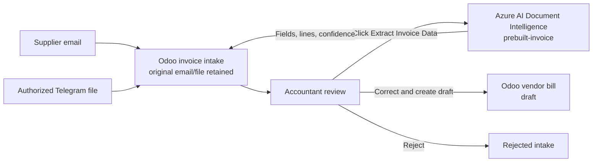
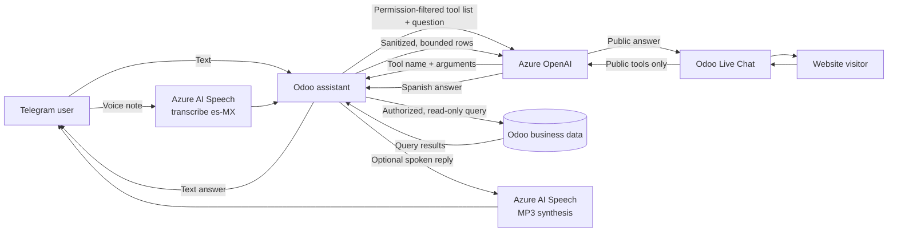
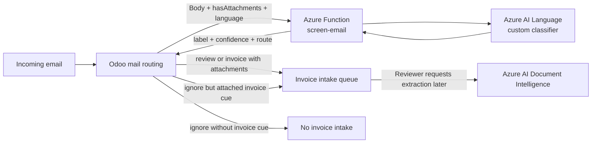

# Río Claro Invoice Inbox

**Version:** 20.0.1.3.0
**Category:** Accounting
**License:** LGPL-3
**Author:** Distribuidora Río Claro

## Overview

`rioclaro_invoice_inbox` is a custom Odoo 20 addon that centralizes supplier invoice reception, an AI-assisted Telegram chatbot, and an AI-powered Live Chat assistant, all in one module.

It receives supplier invoices by **email** or **Telegram** (PDF, JPEG, or PNG), keeps them in an Odoo review queue, and can extract invoice data with **Azure AI Document Intelligence** when an accountant requests it. It also provides permission-scoped natural-language queries for authorized Telegram contacts and a separate public-content assistant for website Live Chat.



Extraction does not happen on receipt. AI-extracted values are suggestions for
review; a person decides whether to retry, correct the data, reject the intake,
or create a draft vendor bill. The add-on does not validate CFDI documents or
connect to Mexico's SAT.

## Microsoft Azure services and how they are used

The add-on calls Azure services from Odoo over HTTPS. Odoo remains the system
of record and the authority for permissions, company scope, database queries,
and bill creation. The services below do not connect directly to Odoo's
database.

| Microsoft technology | Why it is used | How it is used here |
|---|---|---|
| **Azure AI Document Intelligence** | Reduce manual entry of invoice data. | When a reviewer clicks **Extract Invoice Data**, Odoo sends the first supported PDF, JPEG, or PNG attachment to the `prebuilt-invoice` model (API version `2024-11-30`). Odoo maps returned header fields, line items, and confidence scores into the intake. It does not create a bill automatically. |
| **Azure OpenAI** | Understand natural-language questions and phrase concise answers. | Odoo calls a configured chat-completions deployment (API version `2024-06-01`) to select from a fixed set of tools and arguments. Odoo checks the contact's permissions and company scope, runs the read-only query itself, then sends bounded, sanitized results back for a Spanish summary. Website Live Chat uses the same service with a separate allowlist limited to published catalog and FAQ content. |
| **Azure AI Speech** (Speech service) | Support spoken Telegram interactions. | Odoo sends Telegram OGG/Opus voice notes for Spanish (`es-MX`) transcription. For voice questions, the bot can also turn its response into MP3 speech using the `es-MX-DaliaNeural` voice. Text-only interactions do not require Speech. |
| **Azure Functions** (optional email-screening bridge) | Provide an HTTP endpoint that classifies incoming email before Odoo creates an invoice intake. | When screening is enabled, Odoo sends the plain-text email body, attachment-presence flag, and language to the configured Function URL. Odoo uses the returned `ignore`, `review`, or `inspect_attachments` route to filter only invoice-intake mail routes. |
| **Azure AI Language** (used by the screening Function) | Classify email text as `supplier_invoice` or `not_invoice`. | The Function calls a custom single-label text-classification deployment and combines its label/confidence with the attachment-presence flag to return a routing recommendation. It does not download, inspect, or validate attachments, and does not extract invoice data. This screening foundation is optional and its synthetic practice data is not production accuracy evidence. |
| **Azure Logic Apps** and the **Microsoft 365 (Office 365) Outlook connector** (optional external workflow) | Connect a Microsoft 365 mailbox trigger to an HTTP screening Function in a provider-specific workflow. | They can pass email body and attachment metadata to the Function before a separate routing action. A Gmail connector is an alternative for Gmail mailboxes, not a Microsoft technology. Logic Apps are not required by the add-on: its standard email intake uses Odoo's configured incoming mail (for example, IMAP). Do not let a Logic App and Odoo poll the same mailbox for intake unless duplicate processing is intentionally prevented. |

Azure AI Language and the Function are a separate optional screening path,
not part of invoice extraction. Logic Apps and its Outlook connector are
external orchestration options, not Odoo add-on dependencies. Azure hosting is
also a deployment choice rather than a runtime requirement of the add-on.
For local Function development, **Azure Functions Core Tools** runs the HTTP
host and **Azurite** provides its local storage emulator. The Language project
uses connected Azure Storage for training/evaluation documents. In Azure, the
Function can use a managed identity granted the **Cognitive Services User**
role on the Language resource; local development can use
`DefaultAzureCredential` with an Azure CLI sign-in. These are screening
development/identity components, not additional Odoo services.

### Assistant query flow



Azure OpenAI selects a tool; it does **not** execute SQL or call Odoo models.
Odoo applies the Telegram contact ACL and company/partner restrictions before
running private tools. The Live Chat route only exposes published website
products, public prices, and published pages; it cannot query private business
records.

### Optional email-screening flow



Screening and extraction are intentionally separate: screening sees email
text and whether an attachment exists; Document Intelligence receives a
supported attachment only after a reviewer requests extraction.

---

## Features

### 📥 Invoice Intake

- Receives supplier invoice emails through a dedicated **mail alias** and creates a `rioclaro.invoice.intake` record per unique message.
- Accepts invoices sent via **Telegram** (PDF, JPEG, PNG) from authorized contacts.
- **Idempotent**: duplicate emails (same `Message-ID`) and duplicate Telegram messages are silently deduplicated.
- Tracks the lifecycle of each intake through states: `Received → In Review → Invoiced / Rejected`.
- Auto-matches **supplier RFC (VAT)** to an existing Odoo partner.
- Links the finalized intake to the resulting `account.move` (Vendor Bill).

### 🤖 Azure Document Intelligence Integration

- Extracts invoice header fields on reviewer request: supplier RFC, supplier name, invoice number, invoice date, currency, subtotal, taxes, and total.
- Extracts **line items** (description, quantity, unit price, amount) with per-field confidence scores.
- Supported formats: **PDF**, **JPEG**, **PNG**.
- Uses the `prebuilt-invoice` model from Azure AI Document Intelligence (API version `2024-11-30`).
- Extraction results are suggestions; reviewers verify them and explicitly create any resulting draft vendor bill.

### 💬 Telegram Chatbot

- Supports two delivery modes:
  - **Long-polling** via a scheduled cron job (`cron_poll_telegram`).
  - **Webhook** via a public HTTP endpoint at `/rioclaro/telegram/webhook` (mutually exclusive with polling).
- **Onboarding flow**: new contacts are asked for their name and optional email before accessing any feature.
- **Invoice submission**: authorized contacts can send a document file; the bot acknowledges receipt and creates an intake record.
- **Natural-language queries** (text or voice note, up to 60 s) over private business data, routed by Azure OpenAI to the appropriate read-only tool:

| Tool | Description |
|---|---|
| `stock_by_product` | Inventory on-hand and available |
| `search_products` / `get_product_stock` | Product lookup + stock detail |
| `recent_purchases` | Recent purchase orders |
| `recent_sales` | Recent sales orders |
| `recent_invoices` | Published invoices |
| `aggregate_sales` | Total confirmed sales by currency and date range |
| `aggregate_purchases` | Total confirmed purchases by currency and date range |
| `aggregate_invoices` | Total invoices (credit notes deducted) by type and date range |
| `order_status` | Status of an order by reference |
| `top_products` | Top-5 products by revenue and units sold |
| `compare_sales` | Period-over-period sales comparison |
| `product_margin` | Gross margin by product category |
| `open_balances` | Open receivables and payables |
| `public_catalog` | Published website products and public prices |
| `public_faq` | Published website pages |

- **Rate limiting**: configurable maximum queries per user within a rolling time window.
- **Voice transcription**: voice notes are transcribed via **Azure Speech Services** (Spanish `es-MX`).
- **Configurable response style**: choose the AI tone from predefined styles or provide custom instructions.
- All queries and their outcomes are recorded in `rioclaro.assisted.query.audit` for auditing.

### 🌐 Live Chat AI Assistant

- Opt-in per Live Chat channel (`rioclaro_ai_enabled`).
- Answers anonymous visitor questions using **published website catalog and FAQ pages only** — never accesses stock, costs, margins, orders, or customer records.
- Automatically inserts clickable product links into catalog answers.
- Yields to human agents: stops replying once a human operator has posted after the first visitor message.
- Rate-limited: at most 5 questions per visitor in a 5-minute rolling window.

---

## Dependencies

| Odoo Module | Purpose |
|---|---|
| `account` | Vendor bills and accounting |
| `mail` | Email alias, chatter, threading |
| `purchase` | Purchase order queries |
| `sale_management` | Sales order queries |
| `stock` | Inventory queries |
| `website_livechat` | Live Chat AI assistant |
| `website_sale` | Public product catalog |

---

## Installation

1. Copy this addon to your Odoo `addons` path (or `custom_addons/`).
2. Update the app list and install **Río Claro Invoice Inbox**.
3. Set the required environment variables (see [Configuration](#configuration)).
4. Configure the mail alias and scheduled actions as needed.

---

## Configuration

### Environment Variables

| Variable | Required | Description |
|---|---|---|
| `RIOCLARO_TELEGRAM_BOT_TOKEN` | For Telegram | Telegram Bot API token |
| `RIOCLARO_TELEGRAM_WEBHOOK_SECRET` | For webhook mode | Secret token for `X-Telegram-Bot-Api-Secret-Token` header. When set, polling is disabled. |
| `RIOCLARO_AOAI_ENDPOINT` | For AI queries | Azure OpenAI HTTPS endpoint |
| `RIOCLARO_AOAI_API_KEY` | For AI queries | Azure OpenAI API key |
| `RIOCLARO_AOAI_DEPLOYMENT` | For AI queries | Azure OpenAI deployment name |
| `RIOCLARO_DOCUMENT_INTELLIGENCE_ENDPOINT` | For auto-extraction | Azure Document Intelligence HTTPS endpoint |
| `RIOCLARO_DOCUMENT_INTELLIGENCE_KEY` | For auto-extraction | Azure Document Intelligence API key |
| `RIOCLARO_SPEECH_ENDPOINT` | For voice notes | Azure Speech Services HTTPS endpoint |
| `RIOCLARO_SPEECH_REGION` | For voice notes | Azure Speech Services region |
| `RIOCLARO_SPEECH_KEY` | For voice notes | Azure Speech Services API key |
| `RIOCLARO_SCREENING_FUNCTION_KEY` | For a protected screening Function | Azure Functions key sent in the `x-functions-key` header; optional for a local Functions host. |

Azure AI Language resource settings (endpoint, project, deployment, identity,
and confidence threshold) belong to the separate email-screening Function App,
not to Odoo's environment. See the [email-screening setup guide](../../../azure/email-screening/README.md).

Keep all service keys and bot tokens in the deployment's secret-management
mechanism or an ignored local environment file. Do not store API keys in Odoo
system parameters or commit them to source control.

### System Parameters (`ir.config_parameter`)

| Key | Description | Default |
|---|---|---|
| `rioclaro_invoice_inbox.company_id` | Company to assign incoming invoices to | Current company |
| `rioclaro_invoice_inbox.telegram_polling_enabled` | Enable polling in this database (must be `True` in production only) | `False` |
| `rioclaro_invoice_inbox.telegram_update_offset` | Tracks the last acknowledged Telegram update | 0 |
| `rioclaro_invoice_inbox.telegram_query_rate_limit` | Max queries per user per window | 5 |
| `rioclaro_invoice_inbox.telegram_query_window_minutes` | Rate-limit window in minutes | 5 |
| `rioclaro_invoice_inbox.screening_enabled` | Call the optional email-screening Function before processing invoice mail routes | `False` |
| `rioclaro_invoice_inbox.screening_url` | HTTP endpoint for the Function's `screen-email` route | Empty |

When enabling screening, configure both screening parameters and make sure
the Odoo server can reach the endpoint. A hosted Function may require
`RIOCLARO_SCREENING_FUNCTION_KEY` in the Odoo process environment. If the
screening call fails or returns an invalid response, Odoo reports an error
rather than silently treating the email as safe.

### Settings UI (`Settings → Technical`)

The following options are exposed in Odoo's Settings form:

- **Telegram queries per user** — maximum queries within the rate-limit window.
- **Telegram rate-limit window (minutes)** — length of the rolling window.
- **Telegram response style** — predefined AI tone selection.
- **Custom response style instructions** — optional free-text guidance for AI tone (≤ 500 chars).
- **Custom first-contact greeting** — optional replacement for the default onboarding prompt (≤ 500 chars).

---

## Telegram Webhook Setup

If you prefer webhook delivery over polling:

1. Set `RIOCLARO_TELEGRAM_WEBHOOK_SECRET` to a strong random secret.
2. Register the webhook with Telegram:
   ```
   POST https://api.telegram.org/bot<TOKEN>/setWebhook
   {
     "url": "https://<your-domain>/rioclaro/telegram/webhook",
     "secret_token": "<RIOCLARO_TELEGRAM_WEBHOOK_SECRET>",
     "allowed_updates": ["message"]
   }
   ```
3. Make sure `RIOCLARO_TELEGRAM_BOT_TOKEN` is **not** set, or the polling cron will skip automatically when the webhook secret is detected.

---

## Access Rights

| Group | Model | Permissions |
|---|---|---|
| `account.group_account_invoice` (Accountants) | `rioclaro.invoice.intake` | Create, Read, Update |
| `account.group_account_invoice` (Accountants) | `rioclaro.invoice.intake.line` | Create, Read, Update |
| `base.group_system` (Administrators) | `rioclaro.telegram.contact` | Full CRUD |
| `base.group_system` (Administrators) | `rioclaro.assisted.query.audit` | Full CRUD |
| `base.group_system` (Administrators) | `rioclaro.telegram.update` | Full CRUD |

Accountants see only intake records belonging to their own company.

---

## Module Structure

```
rioclaro_invoice_inbox/
├── controllers/
│   └── telegram_webhook.py      # Webhook endpoint (/rioclaro/telegram/webhook)
├── data/
│   ├── ir_cron_telegram.xml          # Scheduled action: Telegram polling
│   ├── ir_cron_telegram_updates.xml  # Scheduled action: process webhook queue
│   └── mail_alias.xml               # Invoice email alias
├── migrations/
│   └── 20.0.1.2.0/
│       └── post-migrate.py      # Migrate contacts to multi-company access
├── models/
│   ├── account_move.py          # Extensions to account.move
│   ├── assisted_query_ai.py     # Azure OpenAI tool-picker and answer summarizer
│   ├── chat_help.py             # Capability help-request detection
│   ├── company_scope.py         # Multi-company query scope resolution
│   ├── date_range.py            # Spanish date-range parser for query tools
│   ├── document_intelligence.py # Azure Document Intelligence client
│   ├── invoice_intake.py        # SupplierInvoiceIntake model and Telegram logic
│   ├── invoice_intake_line.py   # Extracted invoice line items
│   ├── livechat_ai.py           # Public Live Chat AI assistant
│   ├── mail_thread.py           # Mail thread extensions
│   ├── public_product_links.py  # Hyperlink injection for catalog answers
│   ├── query_audit.py           # Assisted query audit log
│   ├── query_service.py         # Read-only query tools (private + public)
│   ├── res_config_settings.py   # Settings form extensions
│   ├── speech_client.py         # Azure Speech Services client
│   ├── telegram_client.py       # Telegram Bot API client
│   ├── telegram_contact.py      # Telegram contact ACL and onboarding
│   ├── telegram_response_style.py # Response style definitions
│   └── telegram_update.py       # Webhook update queue model
├── security/
│   └── ir.access.csv
├── tests/                       # Unit and integration tests
├── views/
│   ├── invoice_intake_views.xml
│   ├── livechat_ai_views.xml
│   ├── query_audit_views.xml
│   ├── res_config_settings_views.xml
│   └── telegram_contact_views.xml
└── __manifest__.py
```

---

## Security Notes

- Telegram webhook requests are authenticated via HMAC comparison of the `X-Telegram-Bot-Api-Secret-Token` header.
- All query tools are **read-only**; no tool can mutate Odoo data.
- Private query tools respect per-contact permission flags and company scope; public tools expose only published website content.
- Business data passed to the AI model is sanitized (control characters stripped, strings truncated) before reaching Azure OpenAI.
- The AI system prompt explicitly instructs the model to treat user and tool data as untrusted and to ignore any embedded instructions (prompt-injection mitigation).
- Telegram polling is guarded by `rioclaro_invoice_inbox.telegram_polling_enabled` so test or duplicated databases cannot accidentally consume the same bot's update queue.

---

## Scheduled Actions

| Action | Model | Default Interval |
|---|---|---|
| Poll Telegram for updates | `rioclaro.invoice.intake` → `cron_poll_telegram` | Every 1 minute |
| Process Telegram webhook queue | `rioclaro.telegram.update` → `cron_process_updates` | Every 1 minute |

Both crons are defined in `data/` and can be adjusted from **Settings → Technical → Scheduled Actions**.
