# Receta para crear y entregar un proyecto Python

Guía reutilizable para empezar un proyecto pequeño y llevarlo, paso a paso, a un
flujo de trabajo profesional. Está pensada para personas que están aprendiendo.
Los comandos están escritos para macOS/Linux; cuando hay una diferencia
importante para Windows se indica también.

## Antes de empezar

Necesitas:

- Python 3.11 o posterior.
- Git.
- Visual Studio Code (opcional, pero recomendado).
- Una cuenta de GitHub si quieres guardar el proyecto en línea y usar GitHub
  Actions.
- Docker solo si el proyecto necesita ejecutarse en contenedores.
- Una cuenta de Azure solo si el destino de despliegue será Azure.

No instales herramientas o servicios que el proyecto todavía no necesita. Por
ejemplo, una aplicación sin base de datos no necesita PostgreSQL ni Redis.

## Aplicación de esta receta al proyecto Río Claro

Odoo Community 20.0 es el scaffold y sistema operativo principal para compras,
ventas, inventario y contabilidad. El proyecto añadirá una aplicación propia
dentro de Odoo para recibir facturas de proveedores por correo electrónico y
WhatsApp, revisar su información y mantener trazabilidad. No se desarrollará
una aplicación externa independiente para este flujo.

### Git naming convention

Branch names, pull request titles, and pull request descriptions must be in
English, brief, and clear.

### Architecture and scope

- Odoo is the source of truth for suppliers, products, stock, purchases, sales,
  and accounting workflows.
- Invoice ingestion from email and WhatsApp will be implemented as an Odoo
  application/module and will use Odoo's standard models and permissions.
- The custom module must not duplicate standard ERP workflows or access
  PostgreSQL directly outside Odoo's ORM.
- CFDI validation and any connection to Mexico's SAT are out of scope.
- The local development stack is Odoo Community 20.0 and PostgreSQL 16,
  configured through Docker Compose.
- The user has created and checked a purchase and a sale in the Odoo database.
- The user's latest report confirmed that Odoo invoice PDFs render with the
  configured styling after setting the database parameter `report.url` to
  `http://127.0.0.1:8069` and freeing host port 8069 from an unrelated Odoo
  container. Río Claro is accessed from the host at
  `http://127.0.0.1:8079`.
- Azure AI email screening is the next planned increment. The company inboxes
  include Microsoft 365 and Gmail, so the design must support both providers.

### Next project step: filter email before Odoo

The user wants Microsoft technologies to identify supplier invoice emails and
avoid importing unrelated messages. The source inboxes include both Microsoft
365 and Gmail, and Azure processing of email content and attachments is
acceptable. The proposed architecture is an Azure Logic App with provider
connectors for both email systems, Azure AI Language custom text classification
of the email body, and attachment checks only for likely invoices. PDFs and
images can be checked with Azure AI Document Intelligence; XML files need
separate parsing. Invoice-like messages with no attachments, uncertain
classification, or inconclusive attachments should go to a review folder.
Clearly unrelated messages should not be sent to Odoo. Only confirmed invoices
should reach the Odoo intake.

Do not treat an unvalidated confidence threshold as proof that a message is an
invoice. Build and evaluate the classifier using sanitized examples of both
invoice and non-invoice email bodies before enabling automatic routing.

A review-first Azure Function foundation now exists under
`azure/email-screening/`. It calls a configured Azure AI Language custom
single-label classifier and returns only `ignore`, `review`, or
`inspect_attachments`. The default confidence threshold is configurable but
not validated. The foundation does not forward mail to Odoo or move/delete
source messages.

After reliable filtering, continue with the reviewed-intake-to-draft-vendor-bill
workflow, then consider WhatsApp/Telegram after selecting their official APIs
and credentials. The current Odoo intake does not perform invoice extraction,
OCR, or accounting entry creation.

### Cleanup status

The standalone Python invoice-capture service, its dependencies, migrations,
tests, and CI workflow have been removed from the repository. The local
`.venv`, its caches, the stored invoice attachment, and the standalone
`rioclarodev` PostgreSQL database and `rioclaroapp` role were deleted after the
user confirmed removal. The ignored `.env` remains with only Odoo settings.
Odoo's Compose containers and persistent volumes were not modified.
The removal was merged into `main` by squash in PR #4 (commit `436bca9`); the
local `main` branch is synchronized with `origin/main`.

### First Odoo add-on increment: email inbox

The user requested an Odoo-native invoice ingestion module, starting with the
easiest channel. Email was selected because Odoo Community already supports
incoming mail servers and aliases; WhatsApp and Telegram require separate
external API/webhook setup. The feature branch is
`feature/email-invoice-ingestion`.

The `rioclaro_invoice_inbox` add-on adds an accounting-user menu, an intake
record with received/in-review/rejected states, company-scoped access, and
Odoo chatter for retaining the original incoming email and its attachments.
Configure one Odoo incoming mail server per company inbox and set its **Create
a New Record** model to **Supplier Invoice Email**; all mailboxes feed the same
queue. Each intake record stores the incoming server name in **Received In**.
Duplicate email Message-IDs resolve to the existing intake record. It does not
yet determine whether a message is an invoice, OCR invoice details, or create
vendor bills. README instructions explain configuring incoming IMAP servers
in Odoo.

The Compose service mounts `custom_addons/` read-only and includes it in the
Odoo add-on path. Odoo 20 uses the `ir.access` security model and its
`message_new` hook returns a recordset; implementation follows these current
contracts. Python compilation and XML parsing pass. Odoo installed the add-on
and ran its tests against a disposable PostgreSQL database; all 7 selected
tests passed (5 add-on tests plus framework tests), including a check that
messages from two incoming mail servers land in the same queue and retain their
source names. The existing
`distribuidora_rio_claro_dev` database was not used for the test run. The
temporary test database was dropped afterward. The add-on was then installed
into `distribuidora_rio_claro_dev` without changing its existing purchase or
sale data. The Compose Odoo service restarted and returned HTTP 200 at
`http://127.0.0.1:8079/web/login`. The multi-mailbox update was applied to the
development database. A Gmail IMAP server was confirmed and fetched existing
mail into the intake, demonstrating connectivity, but it also imported
unrelated messages from the general-purpose inbox. There were 47 intake
records from that test when checked. The Odoo service was temporarily stopped
to pause polling and subsequently restarted by the user. Use a dedicated or
filtered invoice mailbox before further live testing.

The milestone was committed on `feature/email-invoice-ingestion` as
`d5b2741` (`Add multi-mailbox invoice intake`). The branch had not been pushed
at the time this note was updated.

### Azure email screening setup completed so far

The following steps have been completed successfully in the **Azure for
Students** subscription.

#### 1. Prepare practice examples

The fictional Spanish dataset is in
`azure/email-screening/data/synthetic_examples.jsonl`. It contains 50
`supplier_invoice` and 50 `not_invoice` training examples, plus 10 holdout
examples for each class. From `azure/email-screening/`, run:

```bash
python3 prepare_dataset.py
```

This validated and exported all 120 examples to
`build/synthetic-language-dataset/` as individual UTF-8 `.txt` documents and
`manifest.csv`. Keep the holdout files separate from training. The examples
are synthetic and are suitable only for practicing Azure's import and
evaluation workflow, not for proving production classifier accuracy.

#### 2. Create the Azure resources

1. Create resource group `rg-rioclaro-ai-dev`.
2. Create the Azure **Language** resource `rioclaro-language-dev` in
   **Canada Central**.
3. Select **Custom text classification & custom named entity recognition** as
   the custom feature, and choose the **Free F0** pricing tier.
4. Set **all networks** for Language resource network access and enable its
   **system-assigned managed identity**.
5. Create a separate storage account named `rioclaroaiscreen02` in the same
   resource group and **Canada Central** region. Use **StorageV2
   (general-purpose v2)**, **Standard** performance, and **Locally redundant
   storage (LRS)**. Select **Azure Blob Storage or Azure Data Lake Storage** as
   the primary service, **General purpose** as the workload, and **Hot** as
   the access tier.

#### 3. Storage account settings

- Networking: public network access enabled for all networks; Microsoft
  network routing; no private endpoint.
- Security: secure transfer required; anonymous blob access disabled; storage
  account key access enabled; minimum TLS 1.2.
- Encryption: Microsoft-managed keys; customer-managed key support set to
  **Blobs and files only**; infrastructure encryption disabled.
- Blob features: hierarchical namespace, NFS v3, SFTP, cross-tenant
  replication, versioning, change feed, point-in-time restore, and
  version-level immutability disabled. Access tier is **Hot**.
- Recovery: blob soft delete and container soft delete enabled with seven-day
  retention.
- Azure Files options left at their defaults. Tags left blank.

Anonymous blob access is disabled. The storage-account association to a
Language resource cannot be changed later, so keep this account dedicated to
`rioclaro-language-dev`.

#### 4. Grant access and enable custom classification

1. On `rioclaroaiscreen02` → **Access Control (IAM)**, add the
   **Storage Blob Data Contributor** role for the **managed identity**
   `rioclaro-language-dev`, scoped to this storage account.
2. On `rioclaro-language-dev` → **Resource Management → Features**, enable
   **Custom text classification / Custom Named Entity Recognition**, select
   `rioclaroaiscreen02`, and click **Apply**.
3. Confirm the portal reports a successful update, the feature checkbox remains
   checked, and there are no pending changes.

#### 5. Configure Blob CORS and user permissions

Language Studio initially displayed a CORS warning and could not load the
project's blobs. In `rioclaroaiscreen02` → **Settings → Resource sharing
(CORS)** → **Blob service**, add these two rules:

| Allowed origin | Allowed methods | Allowed headers | Exposed headers | Max age |
| --- | --- | --- | --- | --- |
| `https://ai.azure.com` | `GET`, `PUT`, `DELETE` | `*` | Leave blank | `500` |
| `https://language.cognitive.azure.com` | `GET`, `PUT`, `DELETE` | `*` | Leave blank | `500` |

Save the rules. Also assign **Storage Blob Data Contributor** to the signed-in
Azure user on `rioclaroaiscreen02` → **Access Control (IAM)**, scoped to **This
resource**. The managed identity and the signed-in user are separate
principals; both were assigned this role. Allow time for the user permission to
propagate, then refresh Language Studio or sign in again if it still reports
an access error. Once configured, the CORS warning disappeared and the project
documents loaded.

#### 6. Create the Language Studio project

In Language Studio → **Custom Text Classification** → **Create a project**:

1. Connect the existing Language resource `rioclaro-language-dev` and its
   storage account `rioclaroaiscreen02`.
2. Choose **Single label classification**.
3. Set the project name to `supplier-invoice-email`, primary language to
   **Spanish**, and leave **Multiple languages** disabled.
4. Use the description `Classify supplier invoice emails for Río Claro`.
5. Select the `invoice-email-training` blob container and choose **No, I need
   to label my documents as part of this project**.
6. Review the configuration and create the project.

#### 7. Label the documents

In the project's **Data labeling** page:

1. Add the classes `supplier_invoice` and `not_invoice`.
2. Label `invoice_train_001.txt` through `invoice_train_050.txt` as
   `supplier_invoice`; label `other_train_001.txt` through
   `other_train_050.txt` as `not_invoice`.
3. Keep all 100 documents assigned to **Training the custom model (default)**.
   The 20 `*_test_*.txt` holdout documents were not uploaded or labeled in this
   project.
4. Save the labels. The class distribution showed 50 labeled documents per
   class and 100 training documents total.

#### 8. Train and review the practice model

1. Open **Training jobs → Start a training job** and choose **Train a new
   model**. The practice model was named
   `supplier-invoice-email-practice-01`.
2. Select **Automatically split the test set from training data** and retain
   the default **80% training / 20% testing** split. Start the training job.
3. Wait for **Training succeeded**, then open the model in **Model performance
   (Preview)**.
4. Verify **Dataset distribution**. This run showed 40 training and 10 test
   documents for each class (80 training and 20 test total), with zero
   unlabelled (`None`) documents.
5. Review **Overview** and **Confusion matrix**. This practice run reported
   100% F1, precision, and recall, with both classes on the confusion-matrix
   diagonal for the 20 test documents.

Azure also displayed guidance warnings for unbalanced classes and uneven
class distribution, even though the run's distribution table showed 40/10
documents per class and zero unlabelled documents. Treat the metrics as a
successful practice exercise only: this is a small synthetic dataset, and
these results do not establish accuracy on real supplier emails. Do not
deploy this model or enable automatic email routing based on these results.

#### 9. Create a test deployment

In **Deploying a model**, add a new deployment with:

- Deployment name: `practice-screening-deployment`.
- Model: `supplier-invoice-email-practice-01`.
- Region: **Canada Central**.

The deployment list confirmed the deployment was created in Canada Central.
Its displayed expiration date was **October 25, 2029**. A deployment makes a
prediction endpoint available, but does not connect email or Odoo by itself.
The F0 tier permits one deployment for this project; keep it for practice.

#### 10. Test the deployment with holdout examples

In **Testing deployments**, select `practice-screening-deployment` and upload
one `.txt` holdout file at a time from
`azure/email-screening/build/synthetic-language-dataset/test/`. Compare the
predicted class with the `label` column for that filename in
`manifest.csv`. Do not use training files for this check.

All 20 holdout predictions reportedly matched their expected labels. The two
results directly observed during this walkthrough were:

| File | Expected label | Predicted label | Confidence |
| --- | --- | --- | --- |
| `invoice_test_010.txt` | `supplier_invoice` | `supplier_invoice` | 100% |
| `other_test_001.txt` | `not_invoice` | `not_invoice` | 100% |

The other 18 results were confirmed by the user as matches; their individual
confidence scores were not recorded here. This is **20 of 20** correct on the
small synthetic holdout set, not evidence of real-world accuracy.

#### 11. Connect the local Function handler to the deployment

The Function calls the custom classification model through the official
`azure-ai-textanalytics` Python SDK. The initial raw REST request returned
HTTP 400 because API version `2022-05-01` does not support the
`CustomSingleLabelClassification` task in the general analyze-text endpoint.
The code was changed to use the SDK's long-running
`begin_single_label_classify` operation.

For the local integration check, sign in to Azure CLI with `az login` and use
the resource endpoint
`https://rioclaro-language-dev.cognitiveservices.azure.com`, project
`supplier-invoice-email`, deployment `practice-screening-deployment`, and
threshold `0.90`. The Function handler was invoked locally with two holdout
documents through `DefaultAzureCredential`; both calls reached Azure and
returned HTTP 200:

| File | Expected label | Function route | Confidence |
| --- | --- | --- | --- |
| `invoice_test_010.txt` | `supplier_invoice` | `inspect_attachments` | 100% |
| `other_test_001.txt` | `not_invoice` | `ignore` | 100% |

This tested the Python handler against the deployed Language model; it did not
start the Azure Functions HTTP host or deploy a Function App. No email was
read, forwarded, moved, or deleted.

#### 12. Run and test the local HTTP Function

The first Functions host startup returned 404 because the HTTP trigger
parameter was named `request`; the Python Functions decorator expects `req`.
Renaming it to `req` allowed the host to register the `POST /api/screen-email`
route.

Azurite was started locally with its data under `/tmp/rioclaro-azurite`, and
the Functions host was started on `127.0.0.1:7071` using Azure Functions Core
Tools 4. The ignored `local.settings.json` points to
`https://rioclaro-language-dev.cognitiveservices.azure.com`, project
`supplier-invoice-email`, deployment `practice-screening-deployment`, and
threshold `0.90`. Azure CLI credentials authenticated the local process; no
key or credential was added to the repository.

Two synthetic HTTP requests reached the local host and Azure deployment and
returned HTTP 200:

| Synthetic message | Has attachments | Result |
| --- | --- | --- |
| Invoice-like Spanish text | Yes | `supplier_invoice`, `inspect_attachments`, confidence 100% |
| Shipping notification | No | `not_invoice`, `ignore`, confidence 100% |

The 11 automated Azure tests pass, and the dataset validator still exports all
120 synthetic examples. The host and Azurite are local development processes;
this did not deploy an Azure Function App or connect Odoo, Logic Apps, or a
mailbox.

#### 13. Integrate Odoo with the local screening Function

The `rioclaro_invoice_inbox` add-on now screens a message before processing an
Odoo route for `rioclaro.invoice.intake`. Screening is disabled by default.
When enabled, the add-on sends the plaintext body (or subject if the body is
empty), attachment-presence metadata, and language `es` to the configured
Function URL. It retains the intake route only when the Function returns
`supplier_invoice` and `inspect_attachments`; other results do not create an
intake record. Email contents are sent to the configured Azure Language
deployment.

For this local test, the Odoo system parameters are:

- `rioclaro_invoice_inbox.screening_enabled=True`
- `rioclaro_invoice_inbox.screening_url=http://172.21.0.1:7071/api/screen-email`

The local Functions host must bind to the Compose gateway address
`172.21.0.1`, not only `127.0.0.1`, for the Odoo container to reach it. A
synthetic POST from inside the Odoo container returned HTTP 200. The existing
scheduled fetchmail cron was paused before updating the add-on and remains
paused; do not run **Fetch Now** against the existing general-purpose mailbox
until the user has placed only the intended test messages there. Its incoming
server itself remains active for a controlled manual test.

The add-on upgrade and all 10 Odoo module tests passed. A direct
`message_process` integration check then sent two synthetic messages through
Odoo, the local Function, and the Azure deployment:

| Synthetic message | Result |
| --- | --- |
| Invoice-like Spanish body with a synthetic PDF attachment | Created one temporary intake record; attachment retained |
| Shipping notification without attachment | Excluded from the invoice-intake route; no intake record |

The temporary records were rolled back, leaving the intake record count
unchanged. This confirms email-body screening plus attachment-presence
handling only; it does **not** inspect PDF contents or confirm that an
attachment is a valid invoice. Classifier errors fail closed, but Odoo's
fetchmail path may still mark a failed message as handled; resend a message
after correcting a screening outage.

The user confirmed that only the two intended test messages were unread. One
manual fetch of the existing incoming-mail server reported **2 fetched, 2
succeeded, 0 failed**. Odoo created one new intake record with an attachment;
the unrelated message was excluded by the classifier and did not create an
intake. No email body, sender, or attachment content was copied into this
guide. The Functions host was stopped after the test, and the scheduled
fetchmail cron remains paused. Start the Function and verify it is reachable
from Odoo before any later manual fetch. If screening fails, Odoo's fetchmail
path can still mark that message as handled.

This live check establishes only how these two messages were classified. The
Function screens email text and attachment presence; it does **not** inspect
the attachment or confirm it is a valid invoice. Do not generalize these two
results into a classifier accuracy claim.

#### 14. Fix intake visibility across companies

The user could not see the newly fetched invoice in the intake list. Database
inspection confirmed the record existed, but Odoo had assigned it to the
default processing company `My Company (San Francisco)` (company ID 1), while
the Odoo UI was showing `Distribuidora Rio Claro` (company ID 2). The add-on's
access domain filters records to the user's allowed companies.

The existing test intake `Factura de servicios 002` was reassigned to
`Distribuidora Rio Claro`; refresh the intake list to see it. The add-on now
supports `rioclaro_invoice_inbox.company_id` as the explicit company ID for
incoming invoice records, falling back to the processing user's company only
when the parameter is unset. It is configured in this local database as
`2` (`Distribuidora Rio Claro`), and the add-on's 11 tests pass. The setting
applies to all mailboxes until per-mailbox company mapping is implemented.
The scheduled fetchmail cron remains paused.

#### 15. Live end-to-end integration test (email fetching and screening)

A final live integration check was performed with the complete stack running:
1. Docker Compose services (`odoo-db` and `odoo`) were verified healthy and serving HTTP traffic at `http://127.0.0.1:8079`.
2. Local Azurite storage emulator was running on `127.0.0.1`.
3. Local Azure Functions host was started on the Docker bridge gateway (`172.21.0.1:7071`) connected to Azure AI Language deployment `practice-screening-deployment`.
4. Direct synthetic tests from inside the Odoo container confirmed classification responses:
   - Invoice body with attachment: `route=inspect_attachments`, `label=supplier_invoice`, confidence `1.0`.
   - Shipping update without attachment: `route=ignore`, `label=not_invoice`, confidence `1.0`.
5. Two live unread emails were placed in `tepardo.1@gmail.com`:
   - An invoice email (*Factura de servicios 003*) with XML and PDF attachments.
   - An unrelated non-invoice message.
6. A manual **Fetch Now** on the configured IMAP server returned:
   - `Fetched 2 email(s) on imap server tepardo.1@gmail.com; 2 succeeded, 0 failed.`
   - The non-invoice message was filtered out: `Screening excluded incoming email Message-ID ... (route=ignore, label=not_invoice)`.
   - The invoice message was created as intake record ID `5725` assigned to `Distribuidora Rio Claro` (`company_id=2`), with both attachments (`f78f8db5-c690-4410-9d94-c10a01ea5dc8.xml` and `.pdf`) stored in the filestore and rendered in the Odoo chatter.

#### 16. Commit screening milestone, publish pull request, and merge into main

All changes corresponding to the Azure screening integration, multi-company intake routing, synthetic datasets, and unit test suites were staged and committed following project standards:

- Commit on feature branch: `d07ef5d` (`Add Azure email screening and multi-company invoice intake routing`).
- Staged files: `.env.example`, `.gitignore`, `README.md`, `compose.yaml`, `AGENTS.md`, `azure/email-screening/`, and `custom_addons/rioclaro_invoice_inbox/`.
- Ignored files remained properly protected: local `.env`, `odoo.conf`, `azure/email-screening/local.settings.json`, synthetic datasets build directory, and `guia.md`.
- Pull Request #5 was opened on GitHub and merged into `main` via Squash and Merge.
- Squash merge commit on `main`: `d5b1161` (`Add Azure email screening and multi-company invoice intake routing (#5)`).
- Local synchronization: switched to `main`, updated to `origin/main` (`git reset --hard origin/main`), and deleted the local feature branch `feature/email-invoice-ingestion`. Local `main` is completely clean and synchronized with `origin/main`.

**Último paso completado:** se fusionó el PR #5 en `main` mediante Squash and Merge (commit `d5b1161`), se sincronizó la rama local `main` con `origin/main` y se eliminó la rama local de funcionalidad; el working tree se encuentra limpio. **Siguiente paso:** crear una nueva rama de funcionalidad (`feature/...`) para el siguiente incremento del Blueprint: integración con Azure AI Document Intelligence (`prebuilt-invoice`) y creación del borrador de factura de proveedor (`account.move`) en Odoo.

## Deuda técnica

### Revisar mensajes leídos y no leídos sin volver a clasificarlos

El proceso actual de recepción IMAP puede limitarse a mensajes no leídos. Esto
no basta para el uso esperado: los usuarios pueden abrir un correo en su
buzón para consultar su información antes de que Odoo lo procese. En un
incremento futuro, Odoo deberá poder considerar tanto mensajes leídos como no
leídos, sin cambiar innecesariamente su estado de lectura y sin clasificar ni
crear registros duplicados cada vez que vuelva a consultar el buzón.

Antes de iniciar la clasificación, consultar un registro persistente de
procesamiento en Odoo. La clave debe permitir reconocer el mismo correo aunque
llegue a más de un buzón de la empresa; usar el `Message-ID` normalizado cuando
esté disponible y definir una alternativa estable cuando falte. Guardar el
resultado (`supplier_invoice` o `not_invoice`) y el estado de procesamiento
solo cuando el paso correspondiente se complete. Si falla la clasificación o
el procesamiento, permitir reintentar en vez de registrar un éxito falso.
Aplicar la deduplicación entre buzones para que el mismo mensaje no genere
clasificaciones repetidas ni más de un intake.

**Criterios de aceptación para cuando se implemente:**

- Odoo considera correos leídos y no leídos.
- Consultar un buzón no altera el estado de lectura del correo, salvo que se
  acuerde explícitamente lo contrario.
- Un mensaje ya procesado se omite antes de llamar al clasificador, incluso si
  aparece en otro buzón configurado.
- Mensajes clasificados como `supplier_invoice` y `not_invoice` quedan
  registrados; un fallo permite reintentar.
- El mismo correo no produce más de un intake, aunque se entregue a varios
  buzones.
- La identidad por `Message-ID` y cualquier huella alternativa se prueba con
  mensajes reenviados, encabezados ausentes y copias entre buzones para evitar
  descartar facturas distintas por error.

## 1. Define qué vas a construir

Antes de programar, escribe una descripción breve del problema que resolverá la
aplicación y quién la utilizará. Divide el trabajo en funcionalidades pequeñas.
Para cada una, anota cómo sabrás que funciona. Basa estas decisiones en el
documento de contexto y acuerda los criterios pendientes con las personas
responsables del negocio.

Elige también el tipo de aplicación, su versión de Python y los servicios que
realmente necesita. Estas decisiones determinan las dependencias y el despliegue;
no copies una lista de paquetes de otro proyecto sin comprobar para qué sirve
cada uno.

## 2. Crea la carpeta y el entorno de Python

Abre una terminal en la carpeta donde guardarás el proyecto y ejecuta:

```bash
mkdir mi-proyecto
cd mi-proyecto
python --version
python -m venv .venv
```

Activa el entorno virtual para que los paquetes del proyecto no se mezclen con
los de otros proyectos:

```bash
# macOS/Linux
source .venv/bin/activate

# Windows PowerShell
.venv\Scripts\Activate.ps1
```

Al activarlo, normalmente verás `(.venv)` al principio de la línea de la
terminal. Si el comando `python` no existe en tu sistema, prueba `python3`.

Instala únicamente las dependencias necesarias. Por ejemplo, si vas a escribir
pruebas con `pytest` y revisar el estilo con `ruff`:

```bash
python -m pip install pytest ruff
python -m pip freeze > requirements.txt
```

Cada vez que añadas o quites dependencias, actualiza `requirements.txt`. Para
reinstalarlas en otra computadora, usa:

```bash
python -m pip install -r requirements.txt
```

## 3. Prepara los archivos básicos

Una estructura inicial sencilla puede ser:

```text
mi-proyecto/
├── .github/
│   └── workflows/
├── tests/
├── .env.example
├── .gitignore
├── README.md
└── requirements.txt
```

Crea las carpetas y archivos con VS Code o con el explorador de archivos. El
archivo `README.md` debe explicar, como mínimo, qué hace el proyecto, cómo
instalar sus dependencias, cómo ejecutarlo y cómo correr sus pruebas. Actualiza
esas instrucciones conforme evolucione la aplicación.

Añade los archivos de la aplicación cuando hayas elegido su estructura; por
ejemplo, un módulo `app.py` para una aplicación pequeña. No es necesario crear
carpetas para capas o servicios que todavía no existen. Si la aplicación no usa
variables de entorno, no necesitas crear `.env` ni `.env.example`.

Incluye en `.gitignore` los archivos locales, generados o sensibles:

```gitignore
.venv/
__pycache__/
.pytest_cache/
.ruff_cache/
.env
.coverage
htmlcov/
```

El archivo `.env` contiene valores privados de la computadora o del entorno y
no se debe subir al repositorio. Crea `.env.example` con los nombres de las
variables necesarias y valores ilustrativos no secretos, por ejemplo:

```dotenv
API_URL=https://example.invalid
```

No incluyas contraseñas, claves reales ni tokens en `.env.example`, el código,
los registros de ejecución o los commits.

## 4. Escribe código y pruebas

Implementa una funcionalidad a la vez. Prefiere funciones pequeñas, nombres
claros, tipos explícitos y documentación breve cuando ayude a entender el
propósito o las restricciones.

Escribe pruebas que comprueben el comportamiento esperado y los casos límite.
Por ejemplo, una prueba de `pytest` puede verificar un resultado con valores
normales y otra el comportamiento cuando una dimensión es cero.

Ejecuta las verificaciones desde la raíz del proyecto, con el entorno virtual
activado:

```bash
python -m pytest
python -m ruff check .
python -m ruff format --check .
```

Si el formato necesita corrección, ejecuta `python -m ruff format .` y revisa
los cambios. No ignores una prueba fallida para hacer que el proceso aparezca
como exitoso: entiende y corrige la causa.

## 5. Usa Git desde el primer cambio

Inicializa el repositorio y comprueba qué archivos se incluirán. Revisa
`git status` antes de añadir archivos; confirma que los archivos locales y
secretos están ignorados.

```bash
git init
git branch -M main
git status
git add .gitignore README.md requirements.txt
git status
```

Si el proyecto usa variables de entorno, añade también su plantilla con
`git add .env.example`.

Añade también el código, las pruebas y otros archivos del proyecto antes del
primer commit. Para cada cambio, añade los archivos relacionados y revisa
cuidadosamente qué quedó preparado. Antes de cada commit, asegúrate de no
incluir secretos ni archivos generados:

```bash
git diff --staged
git commit -m "Inicializa la estructura del proyecto"
```

Usa commits pequeños con mensajes que describan el cambio. Para cada
funcionalidad nueva, crea una rama y abre un Pull Request (PR) para revisar los
cambios antes de integrarlos:

```bash
git switch -c feature/nombre-descriptivo
```

En GitHub, crea un repositorio vacío (sin generar otro README) y conecta el
repositorio local con la URL que GitHub muestra al crearlo. Publica la rama
principal:

```bash
git remote add origin <URL-del-repositorio>
git push -u origin main
```

Si aún estás trabajando en una rama de funcionalidad, publícala también:

```bash
git push -u origin feature/nombre-descriptivo
```

Luego abre un PR en GitHub desde esa rama hacia la principal. Si tu rama
principal tiene otro nombre, sustituye `main` por ese nombre. No subas `.env` ni
secretos al repositorio, aunque sea privado. Si un secreto se
sube por error, revócalo o rótalo de inmediato; borrar el archivo en un commit
posterior no elimina el secreto del historial.

## 6. Configura el trabajo en equipo y Copilot (opcional)

Instala y autentícate en la extensión oficial de GitHub Copilot en VS Code si
vas a utilizarla. Puedes añadir `.github/copilot-instructions.md` para explicar
al asistente las convenciones, la estructura y los comandos de prueba del
proyecto.

Usa Copilot para proponer análisis, código o pruebas, pero revisa cada cambio:
comprueba que cumple los criterios de aceptación, ejecuta las pruebas y verifica
que no haya incorporado dependencias, permisos o secretos innecesarios. Los
nombres y comandos disponibles en Copilot pueden cambiar; sigue la
documentación vigente de VS Code en lugar de depender de una lista fija de
comandos o de supuestos “roles” del asistente.

## 7. Automatiza las verificaciones con CI

La integración continua (CI) ejecuta automáticamente comprobaciones al subir
cambios o abrir un PR. Crea `.github/workflows/ci.yml`:

```yaml
name: CI

on:
  push:
    branches: [main]
  pull_request:
    branches: [main]

permissions:
  contents: read

jobs:
  test:
    runs-on: ubuntu-latest
    steps:
      - uses: actions/checkout@v4
      - uses: actions/setup-python@v5
        with:
          python-version: "3.12"
          cache: pip
      - run: python -m pip install -r requirements.txt
      - run: python -m pytest
      - run: python -m ruff check .
      - run: python -m ruff format --check .
```

Si el proyecto aún no tiene pruebas, crea al menos una prueba antes de hacer
obligatoria su ejecución en CI. Ajusta la versión de Python y los comandos a
las necesidades reales del proyecto. Después de subir el archivo, revisa la
pestaña **Actions** de GitHub y confirma que el workflow termina correctamente.

Cuando el equipo esté listo, configura en GitHub una regla para proteger la
rama principal: exigir PR y que las verificaciones de CI pasen antes de
integrar cambios. Así, una persona no puede saltarse accidentalmente las
comprobaciones.

## 8. Añade Docker solo si hace falta

Docker permite empaquetar la aplicación y ejecutarla en un entorno reproducible.
Añádelo cuando simplifique el desarrollo, la distribución o el despliegue; no
es un requisito para todos los proyectos.

Si la aplicación necesita una base de datos u otro servicio, Docker Compose
puede levantarlos juntos para el desarrollo local. No publiques puertos,
contraseñas ni servicios de desarrollo innecesarios. Sigue las recomendaciones
de seguridad de las imágenes que utilices y evita ejecutar la aplicación como
administrador dentro del contenedor.

Antes de integrar los archivos de Docker, verifica que puedes construir la
imagen y que la aplicación inicia y responde como se espera. Agrega la
construcción de la imagen a CI solo cuando exista un `Dockerfile` y el equipo
pueda mantener esa verificación.

## 9. Planifica la entrega continua (CD) por separado

La entrega continua (CD) publica o despliega una versión. Es distinta de CI:
primero confirma que las pruebas pasan; luego decide dónde se desplegará, quién
puede autorizarlo y cómo volver a una versión anterior.

Antes de activar un despliegue automático:

1. Elige el entorno de destino (por ejemplo, pruebas y producción) y documenta
   el procedimiento de recuperación.
2. Separa la configuración y los permisos de cada entorno. No pongas claves en
   el repositorio ni en los archivos de workflow.
3. En Azure, prefiere la federación de identidad de GitHub Actions (OIDC) para
   autenticar el workflow sin una contraseña de larga duración. Limita sus
   permisos al recurso y entorno necesarios; usa un gestor de secretos para
   los secretos que la aplicación realmente necesite en tiempo de ejecución.
4. Despliega primero a un entorno de pruebas, valida la aplicación y añade una
   aprobación antes de producción si el riesgo lo requiere.
5. Etiqueta las imágenes con una versión o el identificador del commit. Evita
   usar `latest` como única referencia para producción.
6. Comprueba registros, estado de salud y una forma probada de revertir el
   despliegue.

No configures despliegues a Azure, ACR, App Service o Container Apps si el
proyecto no usa esos servicios. La plataforma y el flujo exactos dependen de la
arquitectura y deben documentarse antes de habilitar producción.

## 10. Checklist para repetir en otro proyecto

- [ ] Describir el problema, los usuarios y los criterios de aceptación.
- [ ] Elegir Python, el tipo de aplicación y únicamente los servicios
  necesarios.
- [ ] Crear y activar `.venv`; instalar y registrar las dependencias.
- [ ] Crear `.gitignore`, `.env.example`, README y una estructura sencilla.
- [ ] Implementar una funcionalidad pequeña y cubrirla con pruebas.
- [ ] Ejecutar pruebas, lint y formato localmente.
- [ ] Revisar los cambios, crear un commit y subir una rama.
- [ ] Configurar CI y confirmar que pasa en GitHub.
- [ ] Proteger la rama principal antes de integrar PR.
- [ ] Añadir contenedores solo si aportan valor al proyecto.
- [ ] Diseñar, proteger y probar CD y recuperación antes de producción.

## Referencias oficiales

- [Python: entornos virtuales](https://docs.python.org/3/library/venv.html)
- [pytest: documentación](https://docs.pytest.org/)
- [Ruff: documentación](https://docs.astral.sh/ruff/)
- [GitHub Actions: documentación](https://docs.github.com/actions)
- [GitHub: proteger ramas](https://docs.github.com/repositories/configuring-branches-and-merges-in-your-repository/managing-protected-branches)
- [GitHub: instrucciones para Copilot](https://code.visualstudio.com/docs/copilot/customization/custom-instructions)
- [Azure: inicio de sesión de GitHub Actions con OpenID Connect](https://learn.microsoft.com/azure/developer/github/connect-from-azure-openid-connect)
- [Docker: buenas prácticas para construir imágenes](https://docs.docker.com/build/building/best-practices/)

## 17. Draft vendor bill feature verification

- Started Odoo containers (`docker compose up -d`).
- Ran unit tests for `rioclaro_invoice_inbox` with proper DB credentials and addon path:
  ```bash
  docker compose exec odoo odoo -c /etc/odoo/odoo.conf -d test_db --test-enable -i rioclaro_invoice_inbox -t rioclaro_invoice_inbox --stop-after-init --db_host=odoo-db --db_user=odoo --db_password=rioclaroapp --addons-path=/usr/lib/python3/dist-packages/odoo/addons,/usr/lib/python3/dist-packages/addons,/mnt/extra-addons --http-port=0
  ```
- All 19 tests passed (0 failures, 0 errors).
- Verified UI actions: “Create Vendor Bill” creates a draft `account.move` with copied attachments; “View Vendor Bill” opens the same bill.
- **Último paso completado:** tests verified; ready to push the `feature/invoice-extraction-draft-bill` branch and open a Pull Request.

## 18. Blueprint milestone progress

**LAST_COMPLETED_STEP:** `M3-STEP-05` — M1 (PR #7) and M2 (PR #8) merged; Telegram contact ACL, scoped read-only queries, Azure OpenAI selection, and text/voice flows implemented and tested on `feature/telegram-acl-queries`. Milestone 3 closeout remains pending because the live stock query for a specific product is unresolved.

### Milestone 1, step 1: Document Intelligence client

- Created Azure resource `rioclaro-docintel-dev` in `rg-rioclaro-ai-dev`,
  region Canada Central, Free F0 tier.
- Connected Document Intelligence Studio to the resource and successfully
  ran its built-in invoice sample using the `prebuilt-invoice` model.
- Implemented a typed client that submits PDF, JPEG, and PNG bytes to the
  `prebuilt-invoice` REST API, polls for completion, and parses invoice fields,
  confidence scores, and line items.
- Added `VendorName` parsing separately from `VendorTaxId`, based on the
  successful Studio sample output.
- The client rejects unsupported document types and operation URLs outside the
  configured Azure host. Failures and timeouts raise explicit errors.
- Verification: all 20 Odoo add-on tests passed with 0 failures and 0 errors.
  A live request from the Odoo container to Azure also succeeded with the
  public invoice sample: invoice `INV-100`, date `2019-11-15`, subtotal
  `100.0`, tax `10.0`, total `110.0`, and one extracted line item.
- Extraction is not yet connected to incoming Odoo attachments, and its
  results are not yet saved on intake records.
- Extraction will be triggered by a reviewer button after the email is saved,
  so Azure failures do not prevent the original email and attachment from
  being retained.

#### Portal walkthrough: create Document Intelligence (verified)

1. Open the resource group and press **Create** (or go to Marketplace). The
   group `rg-rioclaro-ai-dev` already held the Language and Storage resources.
   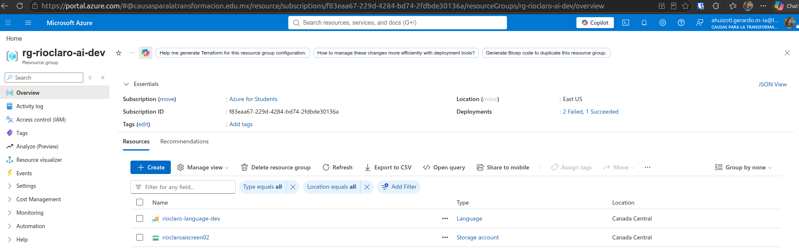
2. In Marketplace search for **Document intelligence (form recognizer)**.
   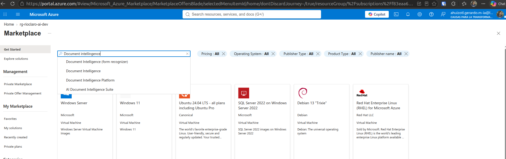
3. Open the Microsoft service, keep the subscription (Azure for Students) and
   press **Create**.
   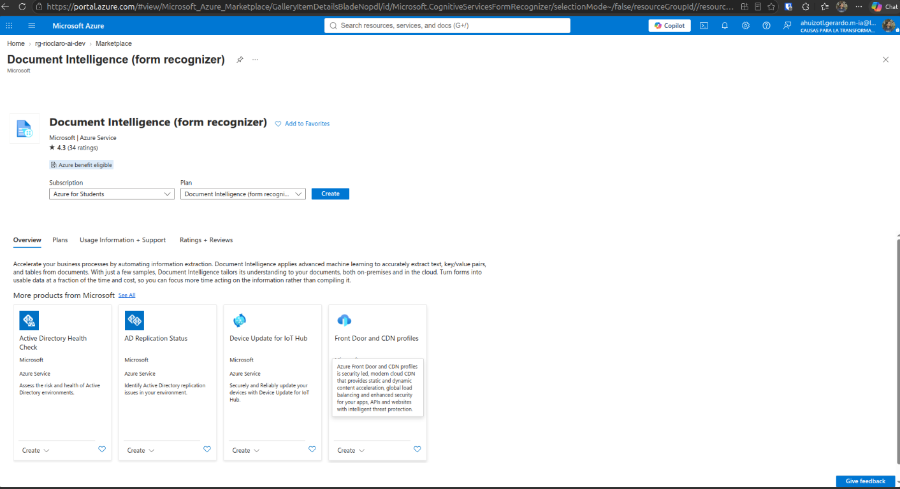
4. On Basics choose the resource group, region **Canada Central** and open
   the pricing tier list. Leaving the tier empty blocks the form. Choose
   **Free F0** (500 pages/month, 20 calls/minute) for development.
   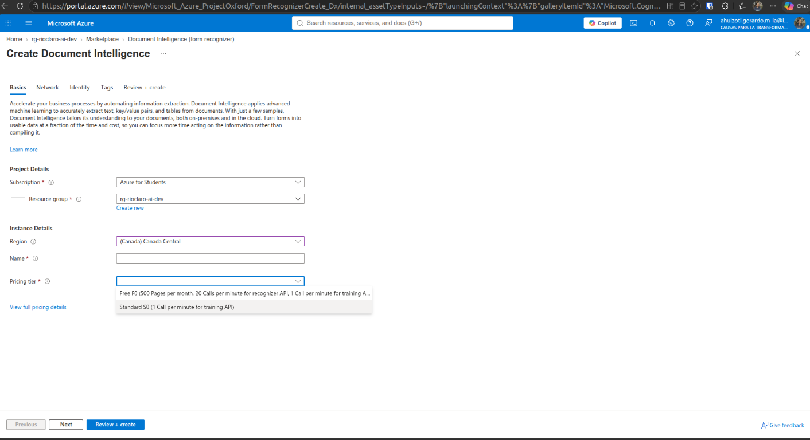
5. Name it `rioclaro-docintel-dev`.
   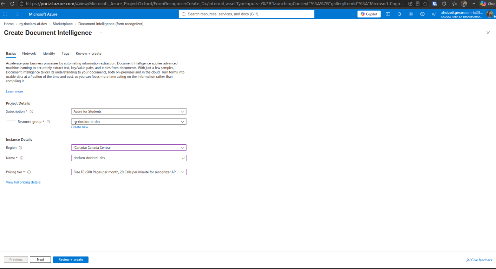
6. Press **Review + create**, check the summary (network: all networks,
   identity: none) and press **Create**.
   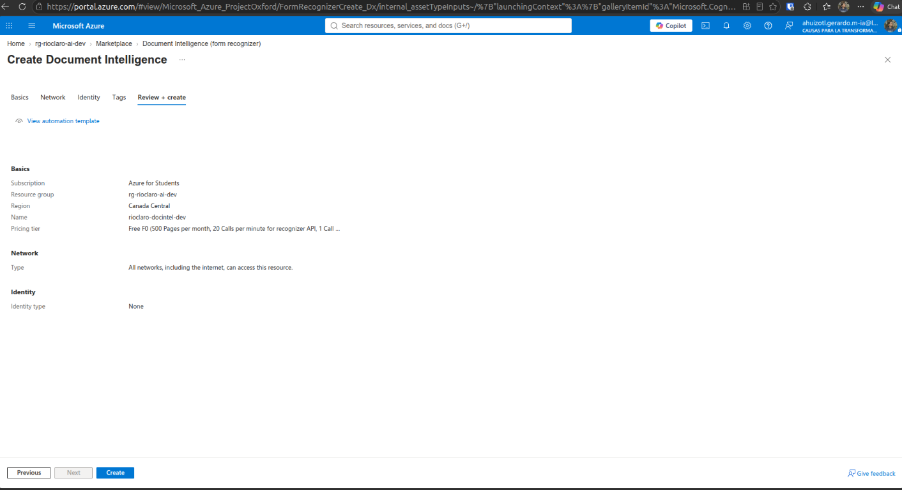
7. Wait for "Your deployment is complete".
   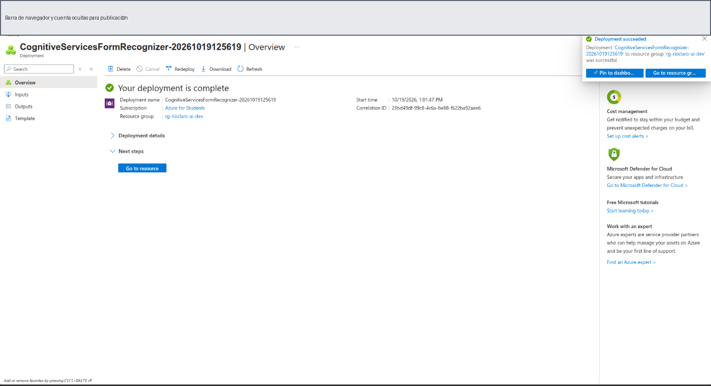
8. The resource group now lists the Document Intelligence, Language and
   Storage resources.
   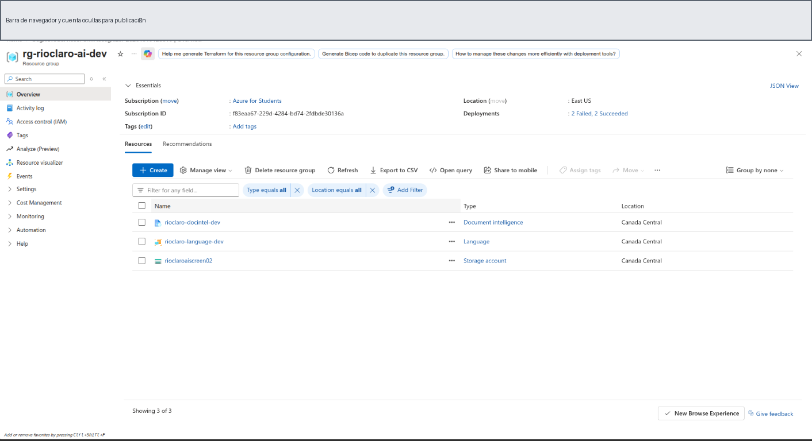
9. Open the resource. **Keys and endpoint** (Show Keys) provides the endpoint
   (`https://<name>.cognitiveservices.azure.com/`) and KEY 1. Put them in
   `.env` as `RIOCLARO_DOCUMENT_INTELLIGENCE_ENDPOINT` and `..._KEY`. Never
   commit or paste the key.
   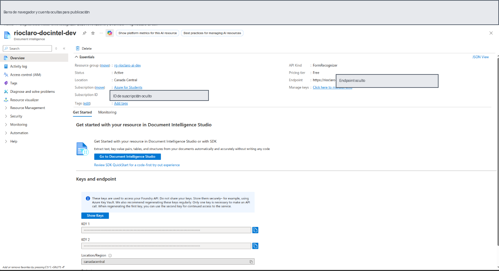

#### Portal walkthrough: try the prebuilt invoice model in Studio (verified)

1. Press **Go to Document Intelligence Studio** (or open
   `documentintelligence/studio`).
   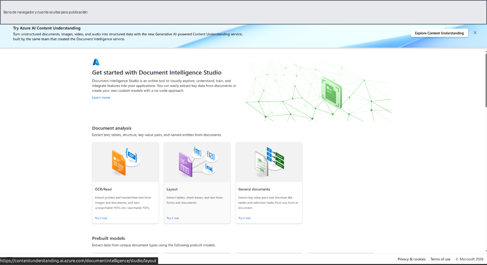
2. Scroll to **Prebuilt models** and open **Invoices**.
   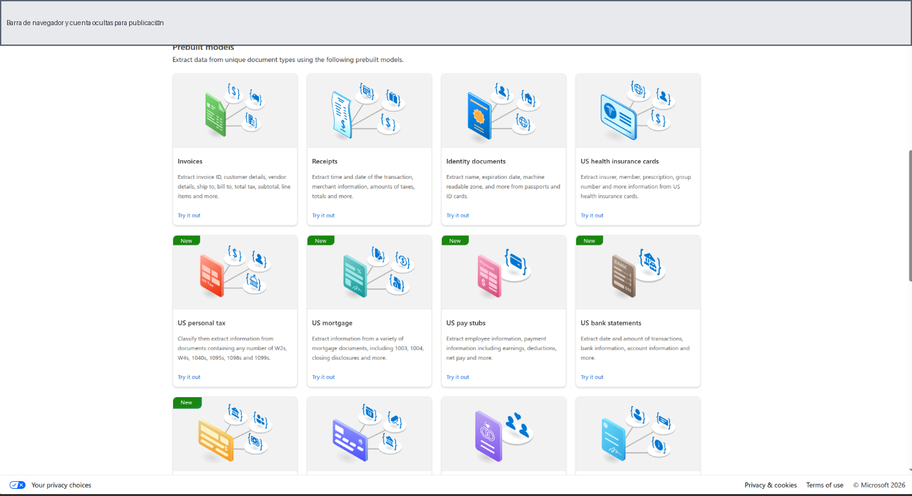
3. On first use, the "Configure service resource" dialog appears. Select
   the subscription, resource group and the `rioclaro-docintel-dev` resource,
   then **Continue**.
   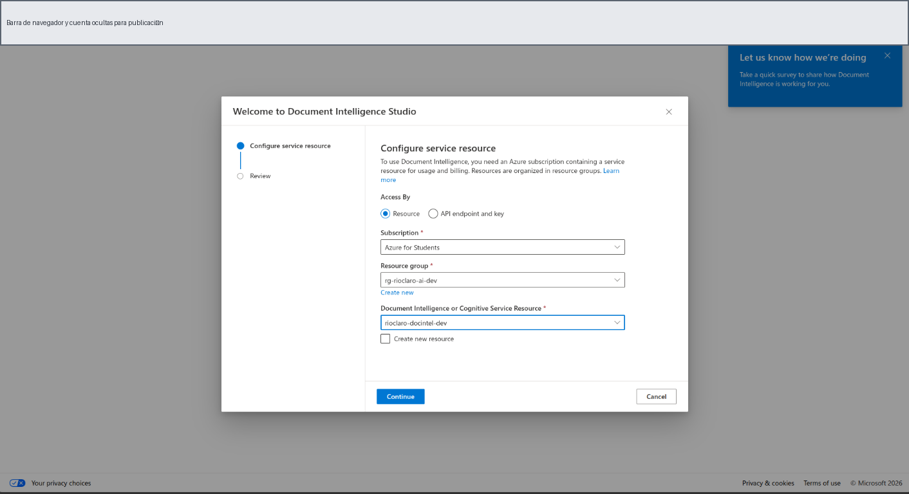
4. Review the selection and press **Finish**.
   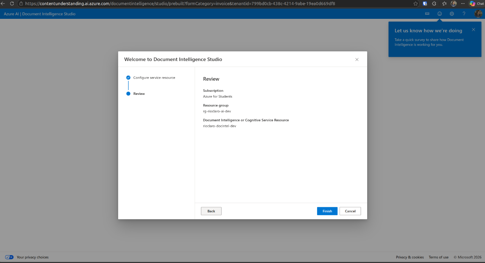
5. Choose a sample invoice and press **Run analysis**.
   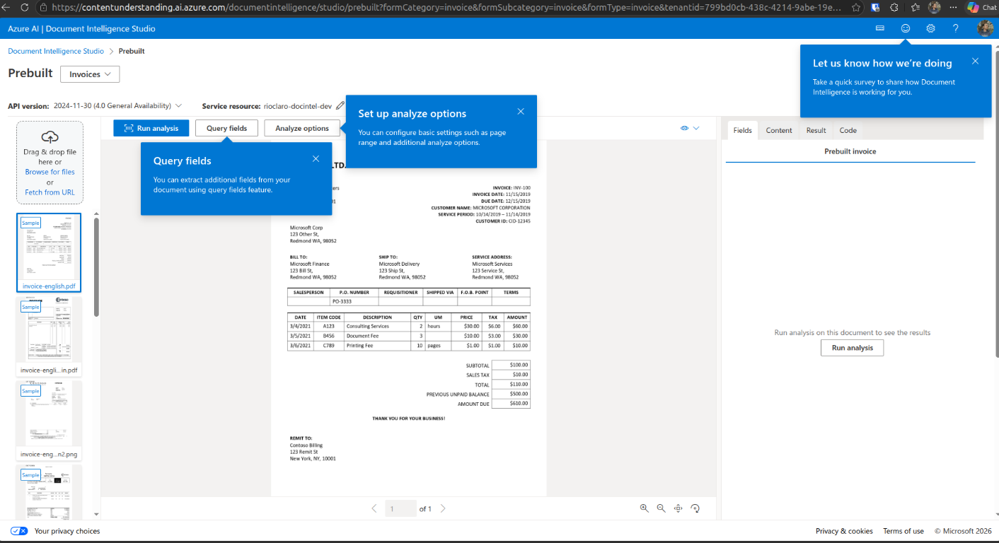
6. The **Fields** tab lists each extracted field with a confidence score
   (AmountDue, BillingAddress, ...). The same fields are read by the Odoo
   client.
   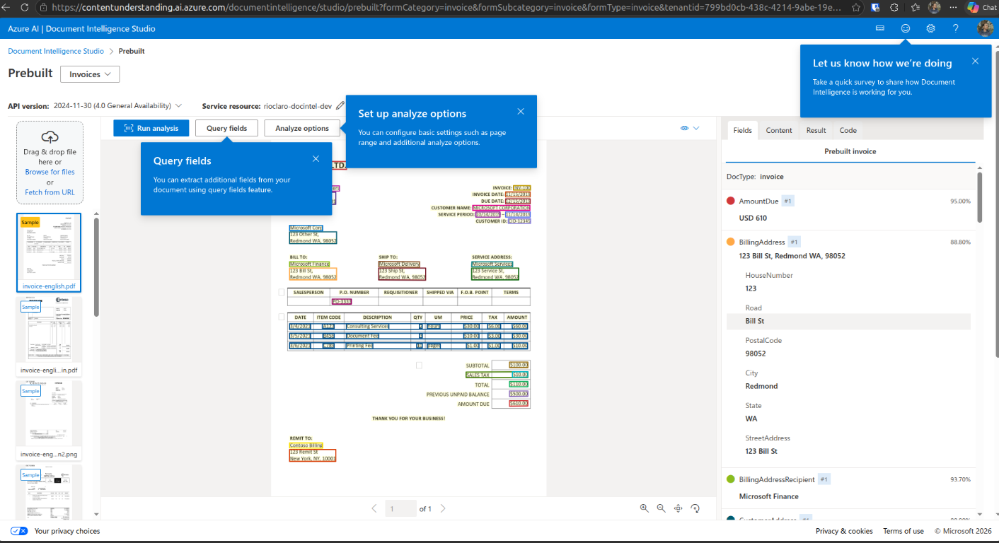

### Milestone 1, step 2: Review status

- Added an extraction status to intake records with pending, extracted, and
  error states. The status is visible as read-only in the intake form.
- Verification: the add-on updated successfully in the disposable `test_db`;
  all 20 tests passed with 0 failures and 0 errors.

### Milestone 1, steps 3-6: Extraction action, lines, and bill

- M1-STEP-03: added the `rioclaro.invoice.intake.line` model (description,
  quantity, unit price, amount, confidence), the `extracted_line_ids` field,
  and its access row. In Odoo 20 `ir.access.csv` the `model_id` column takes
  the dotted model name (`rioclaro.invoice.intake.line`), not a `model_...`
  external ID.
- M1-STEP-04: added `action_extract_invoice_data` on the intake. It reads
  `RIOCLARO_DOCUMENT_INTELLIGENCE_ENDPOINT` / `_KEY`, sends the first PDF,
  JPEG, or PNG attachment to Azure, and saves header fields, currency, and
  lines. Azure failures set the status to `error`, post a chatter note, and
  keep the email and attachments. Missing configuration or attachment raises
  a `UserError`.
- M1-STEP-05: added the "Extract Invoice Data" form button, the read-only
  extracted-lines list, and 4 mocked tests (success, Azure error, no
  attachment, missing configuration). 24 tests passed.
- M1-STEP-06: `action_create_vendor_bill` builds one bill line per extracted
  line, and falls back to the single subtotal line when there are none. Added
  a test. 25 tests passed, 0 failures, 0 errors.

### Milestone 1, step 7: Manual UI verification and docs

- Made **Source Message** editable only while creating a record, so manual
  test records can be created. Upgraded the dev database with
  `-u rioclaro_invoice_inbox` and restarted Odoo.
- Manual test in the Odoo UI with the public sample invoice image: the
  **Extract Invoice Data** button filled the invoice fields from Azure.
- Updated `README.md` with the extraction workflow and env variables.

### Milestone 1 completion marker

**M1-DONE:** Milestone 1 was merged to `main` via PR #7 (Azure extraction and draft vendor bills).

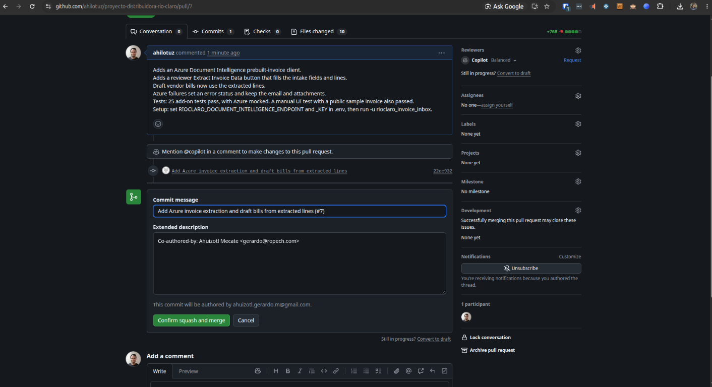

#### Odoo incoming mail server (IMAP) and intake views (verified)

In Odoo go to Settings > Technical > Incoming Mail Servers and create one:
server type **IMAP**, server `imap.gmail.com`, port `993`, **SSL/TLS** on,
username and (Gmail app) password, and the action **Create a New Record =
Supplier Invoice Email**. Press **Confirm**; **Fetch Now** reads unread mail.
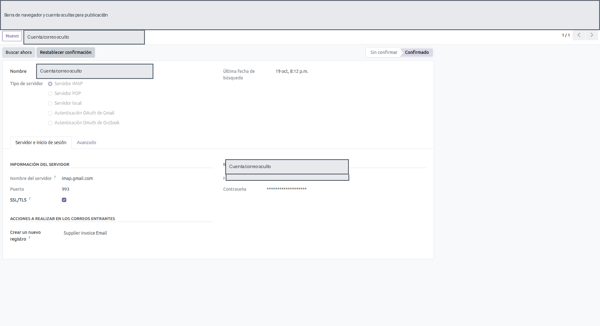

Each email or Telegram message becomes a row under Invoice Intake > Supplier
Invoice Emails (source `telegram:<id>` for Telegram).
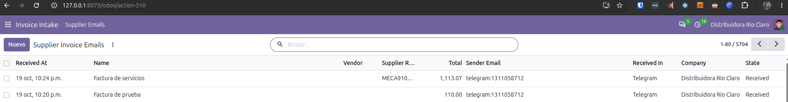

To test queries you need product stock in Odoo (Inventory > Products).
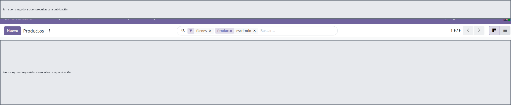

**LAST_COMPLETED_STEP (M1 record):** `M1-STEP-07`

### Milestone 2 decision: Telegram instead of WhatsApp

- Decision (user): Milestone 2 now implements **Telegram** invoice intake
  because it is easier to set up and test. **WhatsApp is deferred** to a later
  milestone; the blueprint still names it as the target channel.
- Milestone 2 is not started yet; the first step is a design for approval.
- Design decision (user): use Telegram **polling** (`getUpdates` from an Odoo
  scheduled job) instead of a webhook, because it needs no public URL or
  tunnel. A webhook can be added later behind the same message handler.
  The MVP priority is a working demo of the Microsoft AI-900/AI-901/AB-730
  skills, so security is kept simple (a sender allowlist only).

### Milestone 2, step 1: Telegram bot and token

- Branch: `feature/telegram-invoice-intake`.
- Created the bot `rioclaro_facturas_dev_bot` with @BotFather. The token is
  stored only in the ignored `.env` as `RIOCLARO_TELEGRAM_BOT_TOKEN`.
- Added the variable to the Odoo service in `compose.yaml` and a blank entry
  to `.env.example`.
- Verification: `docker compose config --quiet` passed, the container sees the
  token (printed only `True`), and Telegram `getMe` returned `ok: True` for the
  bot username.

### Milestone 2, step 2: Telegram API client

- Added `models/telegram_client.py`: a typed `TelegramClient` with
  `get_updates` (returns the next offset plus messages with a PDF/JPEG/PNG
  document or a photo), `download_file` (20 MB cap) and `send_message`.
  Errors raise `TelegramError` and never include the bot token.
- Added `tests/test_telegram_client.py` with 7 mocked tests (no network).
- Verification: 32 add-on tests, 0 failed, 0 errors.
- Live proof: a photo sent to `@rioclaro_facturas_dev_bot` was received by
  `get_updates` (sender, caption "Factura de prueba") and downloaded with
  `download_file` as a real JPEG (184,670 bytes, signature `ff d8 ff e0`).
  Nothing was acknowledged, so the message stays pending for step 3.

### Milestone 2, step 3: Telegram message to intake record

- Added `create_from_telegram(message, content)` and
  `_is_telegram_sender_allowed(sender_id)` to the intake model. The allowlist
  is the comma-separated system parameter
  `rioclaro_invoice_inbox.telegram_allowed_user_ids` (empty allows nobody).
- Records get `source_message_id = telegram:<chat_id>:<message_id>`, so repeated
  deliveries return the existing record and do not duplicate the attachment.
  The file is saved as an `ir.attachment` linked to the record, so the
  existing **Extract Invoice Data** button works on it.
- Added `tests/test_telegram_intake.py` with 5 tests.
- Odoo 20 notes: `ir.config_parameter` uses `get_str`/`set_str` (no
  `get_param`/`set_param`), and `attachment.raw` is a lazy bytes-like value.
- Verification: 37 add-on tests, 0 failed, 0 errors.

### Milestone 2, step 4: Telegram polling job

- Added `cron_poll_telegram()` to the intake model and a scheduled action
  (`data/ir_cron_telegram.xml`, every 1 minute). It reads updates with the
  bot token from the environment, creates intake records through
  `create_from_telegram`, and replies "Recibido. Registro: ..." or
  "No autorizado.". The offset is stored in
  `rioclaro_invoice_inbox.telegram_update_offset` and is saved only after the
  batch was processed; a failed download keeps the offset so it is retried.
- Added 4 mocked tests (no token, success with offset and replies, download
  failure keeps the offset, Telegram outage). 41 add-on tests passed.
- Live proof: after upgrading the dev database and setting the allowlist to
  the owner's Telegram ID, the cron created intake record
  `Factura de prueba` (`telegram:1311058712:3`, status pending extraction)
  from the photo sent to the bot, and saved the offset.

- Bug found in the live test: the bot also replied "No autorizado." because
  the disposable `test_db` also had the polling cron active (empty
  allowlist, own offset) and polled the same bot, so it could also consume
  messages meant for the dev database. Fix: polling now runs only in databases
  where `rioclaro_invoice_inbox.telegram_polling_enabled` is true (default
  off). It was enabled in the dev database only. Added a test; 42 add-on
  tests passed. Rule: one bot token must be polled by one database only.

### Milestone 2, step 5: Live verification and docs

Live check in Telegram: send `/start`, a text and an invoice image or PDF
with a caption to the bot. The bot answers "Recibido. Registro: <caption>" and
an intake record is created. ("No autorizado" appears for text queries until
the sender has a Telegram contact with permissions, see Milestone 3.)
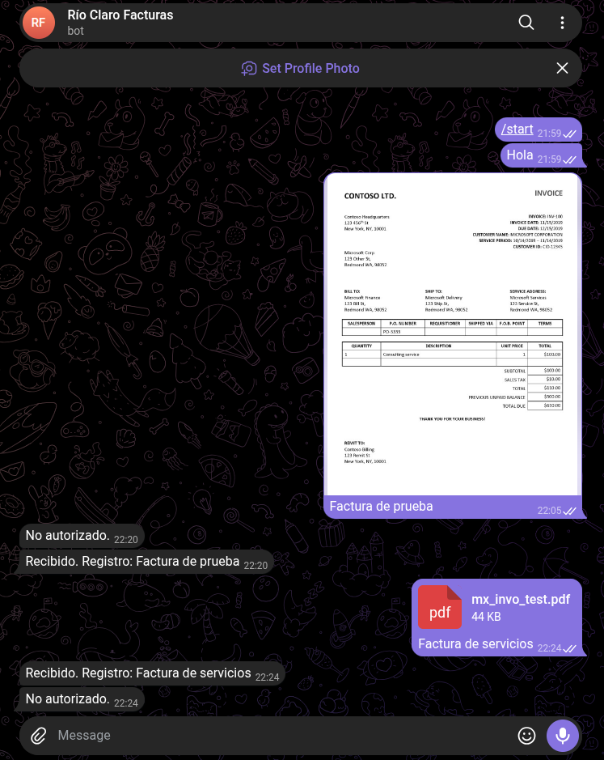
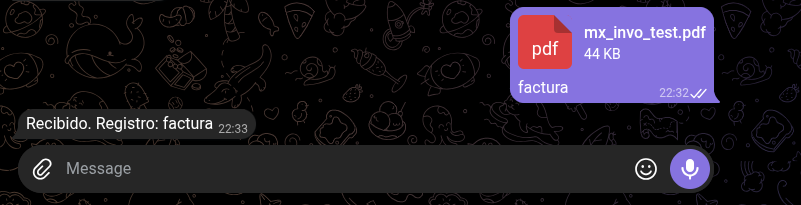

- Live check after the polling fix: a PDF sent to the bot produced one
  "Recibido" reply and no "No autorizado." reply.
- Both earlier Telegram records were extracted with Azure (110.00 for the
  sample photo; 1,113.07 and an RFC for the Mexican test PDF).
- Updated `README.md` with the Telegram setup (token, allowlist, polling flag).

**LAST_COMPLETED_STEP (M2 record):** `M2-STEP-05`

**M2-DONE:** Milestone 2 (Telegram intake) was merged to `main` via PR #8.
WhatsApp remains deferred.

**Next step, pending confirmation:** see the Milestone 3 design below.

### Milestone 3 design (approved decisions)

- Scope now: an ACL plus read-only assisted queries over Telegram text and
  voice. Quotation requests and customer-invoice issuing are a later
  increment because they write data. Supplier invoice submission (Milestone 2)
  is gated by the same ACL.
- No Azure OpenAI deployment exists yet; the user will create one later. The
  first step is the ACL, which needs no Azure.
- ACL model: a Telegram contact links a numeric Telegram ID to one role
  (`supplier`, `internal`, `customer`), optionally an Odoo partner, an active
  flag, and per-contact permissions: `query_inventory`, `query_purchases`,
  `query_sales`, `query_billing`, `check_order_status`, `request_quotation`,
  `submit_vendor_invoice`, `issue_customer_invoice`. Roles give default
  permissions that can be adjusted. It replaces the
  `telegram_allowed_user_ids` parameter (the owner's ID becomes an internal
  contact).
- Security rules: identify by numeric Telegram ID only; private chats only;
  contacts created by an administrator only; deny by default; permission and
  data scope (supplier/customer = own partner, internal = company) are
  enforced in Odoo code, never in the prompt; the model cannot pass partner or
  domain parameters; tools return a fixed list of fields; OCR/invoice text is
  never sent to the chat model; only authorized rows are sent to Azure OpenAI;
  every request is logged (who, tool, allowed/denied); rate limit per
  contact; minimal service user with explicit domains instead of full `sudo`.
  Later, public published-product/website queries were opened to all active
  Telegram contacts; private data remains permission-gated.
- Steps: (1) ACL model and permissions, (2) read-only query tools without AI,
  (3) Azure OpenAI tool-picker, (4) Telegram text wiring with log,
  (5) voice with Azure AI Speech, (6) docs and PR.

### Milestone 3, step 1: Telegram contact ACL

- Branch: `feature/telegram-acl-queries`.
- Added model `rioclaro.telegram.contact` (numeric Telegram ID, role
  supplier/internal/customer, partner, company, active flag, 8 permission
  flags). Roles preload default permissions that can be adjusted per contact.
  Deny by default: unknown, inactive, or non-permitted senders are refused,
  and unknown permission names are refused.
- Validation: numeric Telegram IDs only (no usernames), unique ID, suppliers
  and customers require a partner. Access rights: system administrators only,
  with an admin-only menu **Invoice Intake → Telegram Contacts**.
- Polling now uses this ACL (`can_submit_vendor_invoice`) instead of the
  `telegram_allowed_user_ids` parameter, which is no longer used.
- Added `tests/test_telegram_contact.py` (11 tests) and updated the Telegram
  intake tests. 54 add-on tests, 0 failed, 0 errors.
- Dev database upgraded; the owner (Telegram ID 1311058712) was created as an
  internal contact.

**LAST_COMPLETED_STEP:** `M3-STEP-01` — Telegram contact ACL implemented and tested.

**Technical debt (TD-M3-01, deferred):** all users must be managed from the
native Odoo **Contacts** module (`res.partner`), including their WhatsApp and
Telegram identifiers and roles/permissions. Today Telegram access lives in the
separate `rioclaro.telegram.contact` model (admin-only menu). Migrate it to
partner-based management and add WhatsApp when that channel is implemented.

### Milestone 3, step 2: read-only query tools (no AI)

- Added `models/query_service.py` (`rioclaro.query.service.run_tool`) with
  five tools: `stock_by_product`, `recent_purchases`, `recent_sales`,
  `recent_invoices`, `order_status`.
- Enforced in code: the contact's permission (deny by default), partner scope
  (suppliers and customers only see their own partner's records, internal sees
  all), company scope, fixed output fields, max 5 rows, text input limited to
  80 characters. Callers cannot pass a partner, domain, or fields.
- Manifest now depends on `purchase`, `sale_management`, `stock`.
- 17 new tests (including cross-partner leak checks). 71 add-on tests, 0 failed.

**LAST_COMPLETED_STEP:** `M3-STEP-02` — query tools implemented and tested.

### Milestone 3, step 3: Azure OpenAI tool-picker

- Added `models/assisted_query_ai.py`:
  - `AzureOpenAIClient` for Azure chat completions over one deployment.
  - enforced function calling to one fixed tool from `TOOL_REGISTRY`.
  - final answer summarization from authorized rows only.
  - explicit error paths (`ai_not_configured`, `ai_unavailable`,
    `invalid_question`, and propagated query-service deny errors).
- Added `rioclaro.assisted.query.ai.answer(telegram_user_id, question)`.
  It selects one tool, executes `rioclaro.query.service.run_tool`, and asks
  Azure OpenAI to format the final Spanish response.
- Added tests in `tests/test_assisted_query_ai.py` and updated test registry.
- Updated README with AOAI env vars and scope note for this increment.
- Passed AOAI endpoint, API key, and deployment to the Odoo container through
  `compose.yaml`; documented placeholders in `.env.example`.
- Azure deployment `gpt-chat-latest` is Succeeded in `rioclaro-aoai-dev`.
- Live test from the Odoo container successfully called Azure OpenAI function
  calling and selected `stock_by_product`.
- Adjusted the request to the deployed model's API requirements:
  `max_completion_tokens` and default temperature (omit explicit temperature).
- 77 add-on tests passed (0 failures, 0 errors); includes a regression check
  for the model-compatible request format.

**LAST_COMPLETED_STEP:** `M3-STEP-03` — tool-picker implemented, tested, and
verified against the live Azure deployment.

#### Portal walkthrough: create Azure OpenAI and deploy a model (verified)

1. In Marketplace search **Azure OpenAI** and press **Create** on the
   Microsoft "Azure OpenAI" service.
   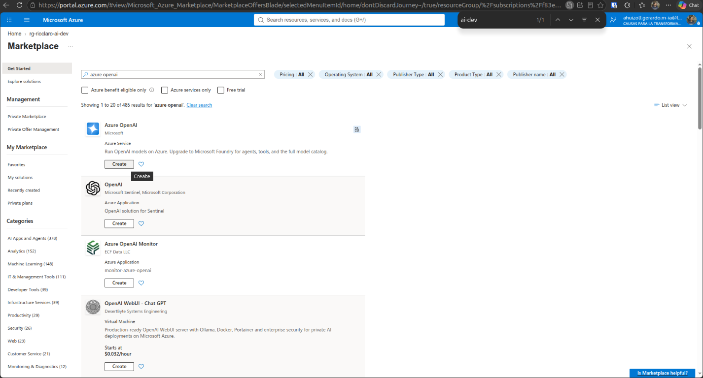
2. Basics: resource group `rg-rioclaro-ai-dev`, region **Canada Central**,
   name `rioclaro-aoai-dev`, tier **Standard S0**.
   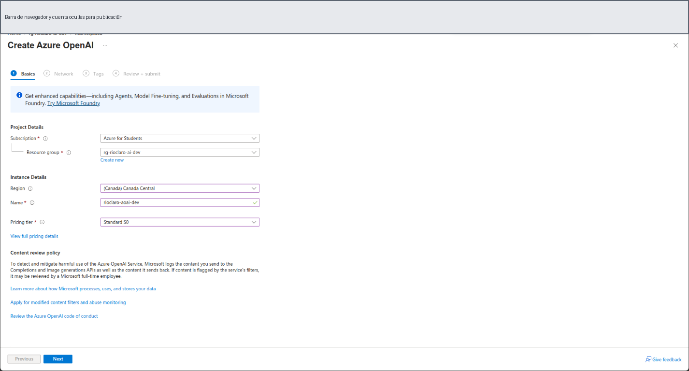
3. Network: keep "All networks" (development). Skip Tags.
   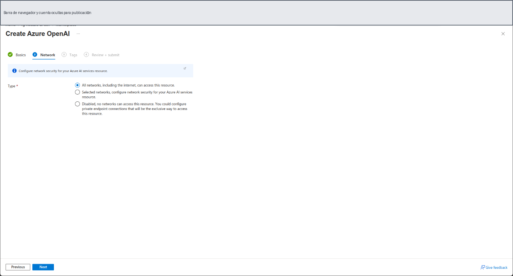
4. Review and **Create**.
   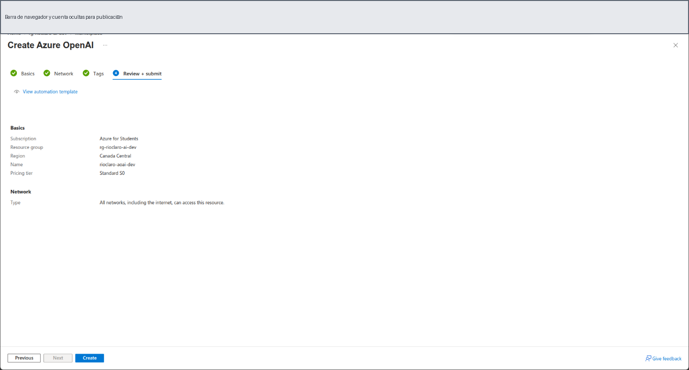
5. Deployment complete, then **Go to resource**.
   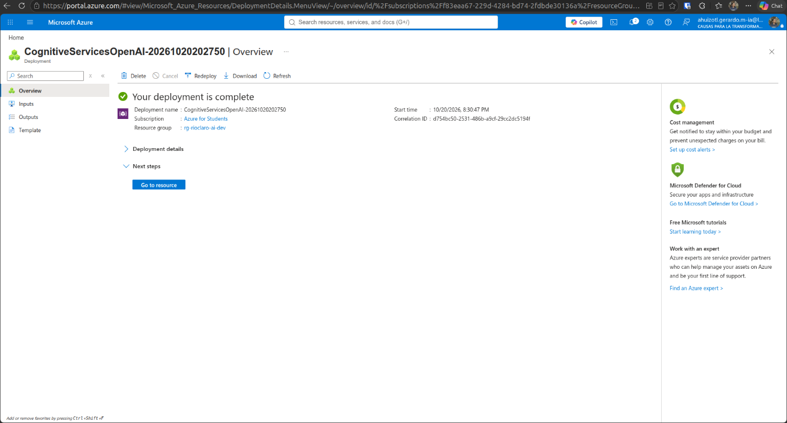
   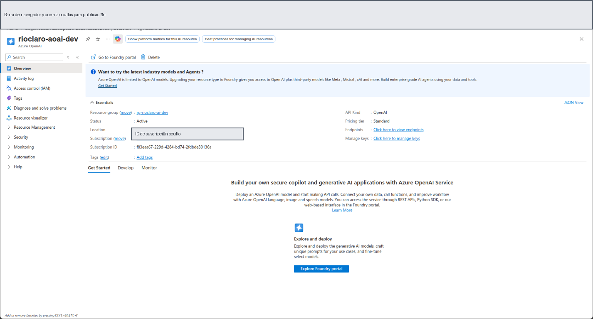
6. Press **Go to Foundry portal**. The welcome page shows the endpoint
   (`https://rioclaro-aoai-dev.openai.azure.com/`) and API key 1 (reveal with
   the eye icon). These become `RIOCLARO_AOAI_ENDPOINT` and the key.
   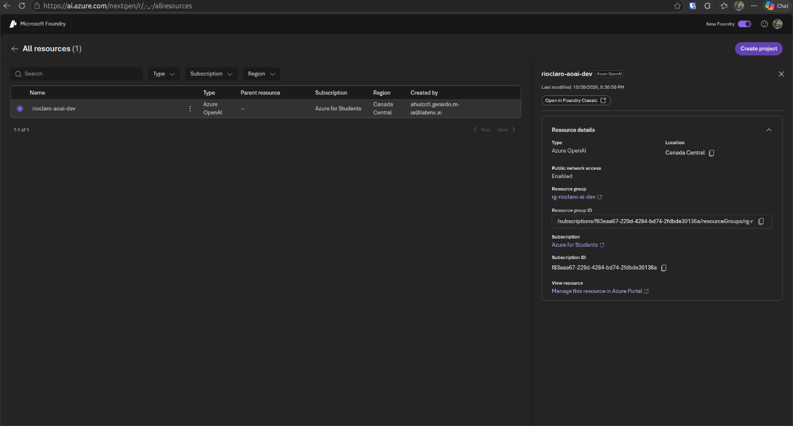
7. Open **Deployments**; a new resource has none.
   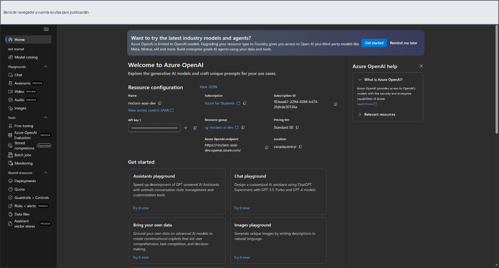
8. **Deploy model** and pick a chat model with function calling. We deployed
   `gpt-chat-latest` with type **Global Standard** (150K TPM). `gpt-4o-mini`
   is the alternative but it tried to create a new resource in another region
   because of quota, so it was not used.
   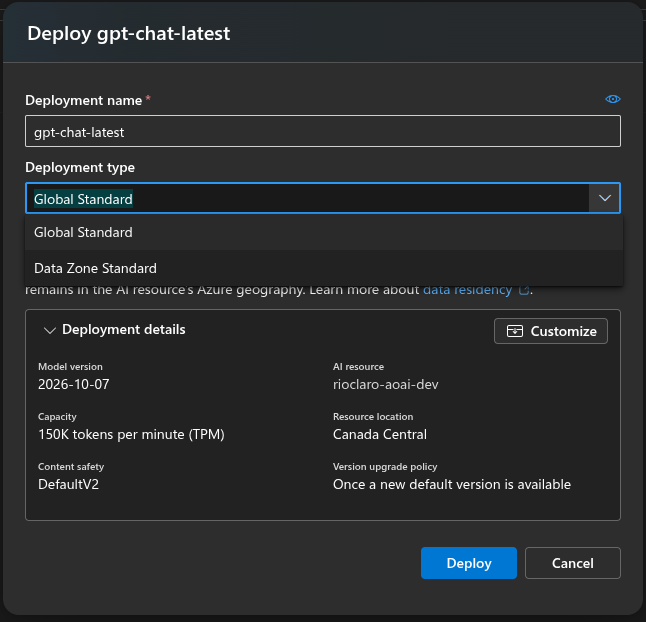
9. The deployment page shows state **Succeeded**, rate limits and the target
   URI. The deployment name is `RIOCLARO_AOAI_DEPLOYMENT`.
   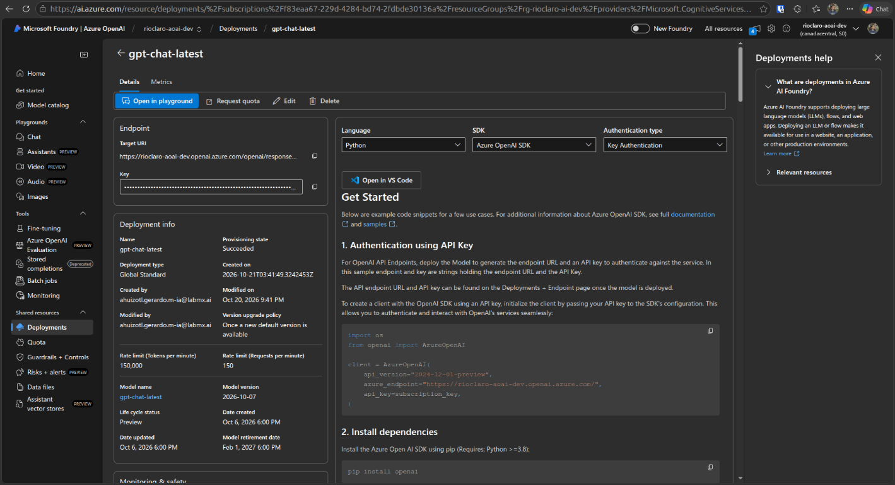

#### Portal walkthrough: Speech service for voice notes (verified)

Create **Speech Services** in `rg-rioclaro-ai-dev`, region Canada Central,
name `rioclaro-speech-dev`, tier **Free F0**, network all, identity none.
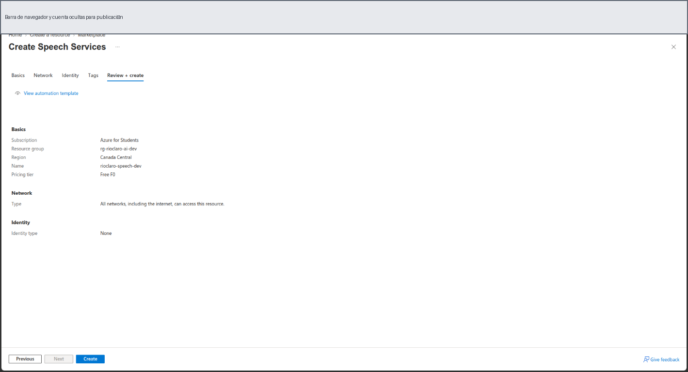
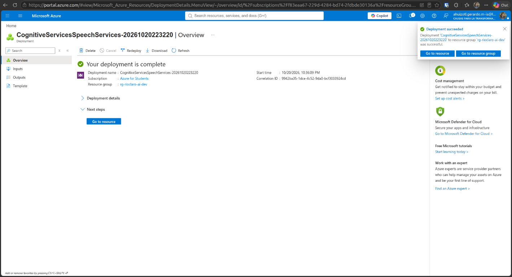
Under **Keys and endpoint** copy KEY 1 and the region (`canadacentral`) for
the Speech settings in `.env`.
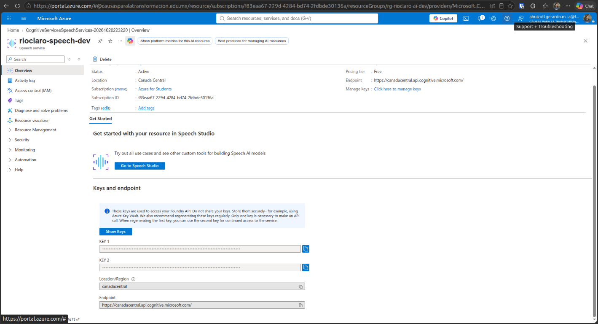

### Milestone 3, step 4: Telegram text queries, audit, and rate limit

- Telegram parser now accepts plain text only from private chats; group-chat
  messages are ignored. Existing invoice-file intake remains supported.
- Polling routes private text through `rioclaro.assisted.query.ai.answer`.
  Unknown and inactive contacts are denied before calling Azure OpenAI. Active
  contacts without private-query permissions can use only published website
  content (added in Milestone 21 below).
- Added admin-only `rioclaro.assisted.query.audit` model and menu
  **Invoice Intake → Assisted Query Audit**. It stores sender ID, contact,
  company, selected tool, outcome, Telegram message ID, and timestamp; it
  does not store the question, answer, or invoice text.
- Rate limit: 5 requests per contact per rolling 5-minute window. Audited
  duplicate Telegram message IDs are not processed twice.
- Replies explicitly cover denied access, invalid questions, rate limit, and
  unavailable AI. Query replies are capped at Telegram's safe message length.
- Tightened inventory search so it returns storable products matching the
  requested name or internal reference, rather than unrelated stock items.
- Updated the README and added tests for private-text parsing, group filtering,
  successful query/audit, unauthorized sender, rate limiting, and duplicate
  update handling. 81 add-on tests passed (0 failures, 0 errors).
- Upgraded the dev database and restarted Odoo; the web login returned HTTP
  303 after restart.
- User verified end-to-end in the dev bot: the private text question received
  a reply and its audit row appeared in Odoo.

**LAST_COMPLETED_STEP:** `M3-STEP-04` — Telegram text-query flow implemented,
tested, activated in the dev database, and verified live by the user.

This step was verified live by the user; see the completed voice-query step
below.

### Milestone 3, step 5: voice notes and spoken replies (complete)

- Added `models/speech_client.py` with Azure AI Speech REST calls for Spanish
  (Mexico) OGG/Opus transcription and MP3 synthesis.
- Telegram recognizes private voice notes, enforces a 60-second maximum,
  transcribes them, sends the transcription through the existing ACL-scoped
  query tools, and sends the answer as MP3 voice. If synthesis or audio
  delivery fails, it falls back to text.
- Voice queries share the per-contact 5 requests / 5 minutes limit and are
  marked as voice in the admin audit view. Neither audio nor transcript is
  stored in the audit record.
- Speech settings are passed into the Odoo container through Compose.
- Added mocked Speech REST, Telegram voice parsing/upload, voice-query,
  transcription-failure, and overlength tests. 89 add-on tests passed (0
  failures, 0 errors).
- Upgraded the dev database and restarted Odoo with the Speech configuration;
  the web login returned HTTP 303. A live Azure Speech synthesis request from
  the Odoo container succeeded.
- User verified the complete Telegram voice flow: a private voice note
  received a spoken reply, and the audit row showed **Input Type = Voice** and
  **Outcome = Allowed**.

**LAST_COMPLETED_STEP:** `M3-STEP-05` — voice transcription, scoped query,
spoken response, and audit flow implemented, tested, activated, and verified
live by the user.

### Milestone 3, stock-query regression follow-up

- User reported that “¿Cuántas unidades hay de escritorio para cuatro
  personas?” returned no results, despite the Odoo catalog showing
  **Escritorio para cuatro personas** as storable with 20 units on hand.
- The user authorized a limited, read-only catalog check. It found active
  product `FURN_8220`, **Escritorio para cuatro personas**, `is_storable=True`,
  with 20 on hand and 6 available. No questions, transcripts, or `.env` values
  were read.
- The user reported both voice and text attempts returned no results. The
  latest reported audit row was **Text / stock_by_product / Allowed**.
- Implemented and pushed stock-search improvements:
  - Ignore common Spanish query words and match meaningful product terms.
  - Support common singular/plural variants and Spanish number words/digits.
  - When strict matching fails, rank storable-product candidates using
    substring matching and allow one unmatched term, while returning only the
    highest-scoring candidates.
  - For inventory queries, pass the original user question to Odoo rather than
    a model-rewritten product phrase.
  - Add privacy-safe diagnostics containing only input type, outcome, row
    count, candidate count, and numeric match scores.
- Added regression coverage for the full Spanish question, plural wording,
  digit/word forms, near matches, and preservation of the original question.
  The latest full add-on suite passed: **91 tests, 0 failures, 0 errors**.
- Read-only dev checks confirmed direct stock-tool and full assistant-pipeline
  queries can return `FURN_8220` with 20 on hand and 6 available. A partial
  word query also returned the product.
- The live Telegram path is **still unresolved**: after the original-question
  routing change, a new request still returned “No hay resultados.” Its
  content-free log recorded `stock_by_product`, `Allowed`, and `0` rows. A
  separate numeric fallback diagnostic recorded 3 terms, 2 candidates, best
  score 1, minimum score 2; that diagnostic did not reveal the search text.
- The user chose to stop further troubleshooting. Do not add question-text
  logging or continue database inspection unless the user authorizes it.
- Follow-up commits are on `feature/telegram-acl-queries`; latest recorded
  branch head is `fe57f71`. The user created the Milestone 3 PR earlier; its
  number and merge status have not been confirmed in this session.

**Resume point:** if authorized to continue, begin by reproducing the live
stock-query discrepancy without storing or logging message content. Do not
begin Milestone 4 until the user confirms Milestone 3 succeeded.

**Historical sequencing note:** read-only query tools (inventory, purchases,
sales, billing, and order status) were subsequently implemented in Milestone 3,
step 2 above.

### Milestone 1, end-to-end email test

- Sent a test email with a sample invoice image to the configured Gmail IMAP
  mailbox, used **Fetch Now**, and clicked **Extract Invoice Data** on the
  created intake record. Everything worked.
- The local screening Azure Function was not running (port 7071), so
  `rioclaro_invoice_inbox.screening_enabled` was set to `False` in the dev
  database during the test, and was turned back on afterwards at the user's
  request. The local function is still not running, so new emails will not
  become intake records until it is started (or screening is disabled again).
  Deploy the function in Milestone 4.

## 19. Chatbot milestones M5 to M6 (blueprint `TELEGRAM_ODOO_AZURE_AI_ARCHITECTURE.md`)

Working rules: one step at a time, test every feature **locally before the VM**,
the user verifies, then creates and merges the PR (branches are pushed, never
merged by the assistant). Never print or commit secrets.

> Supersedes the "still unresolved" stock-query note above: the language bug
> behind it was fixed in M6 (see below) and verified live.

### M5: bounded orchestrator, grounding and prompt-injection safety (PR #15, merged)

- Tool calls are bounded, answers are grounded in tool output, and untrusted
  text cannot change tool arguments or permissions.

### M5b: production on an Azure VM with HTTPS (PR #16, merged)

1. Portal: VM `vm-rioclaro`, resource group `rg-rioclaro-prod`, Canada
   Central, Ubuntu 24.04 **Arm64**, `Standard_B2pls_v2`, 64 GiB disk, user
   `azureuser`, SSH key `~/.ssh/vm-rioclaro_key.pem`. Static public IP.

   Portal walkthrough (expected result of each screen; only screens of steps
   that worked are shown):

   1. **Virtual machines → Create → Virtual machine.**
      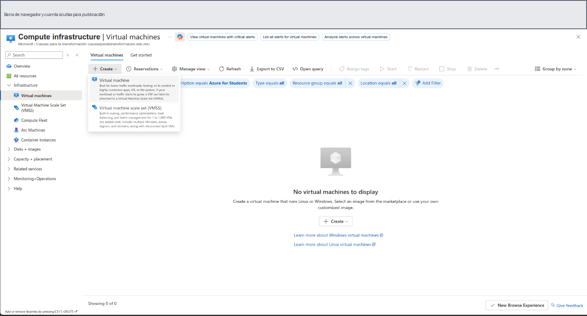
   2. **Basics:** subscription Azure for Students, new resource group
      `rg-rioclaro-prod`, name `vm-rioclaro`, Canada Central, Ubuntu Server
      24.04 LTS.
      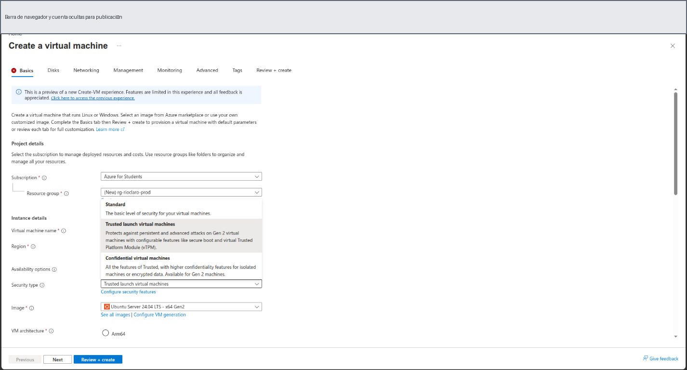
   3. **Architecture Arm64, then Size.** `Standard_D2s_v3` is not available
      for this subscription; with Arm64 selected, pick `B2pls_v2` (2 vCPU,
      4 GiB, about $26.86/month).
      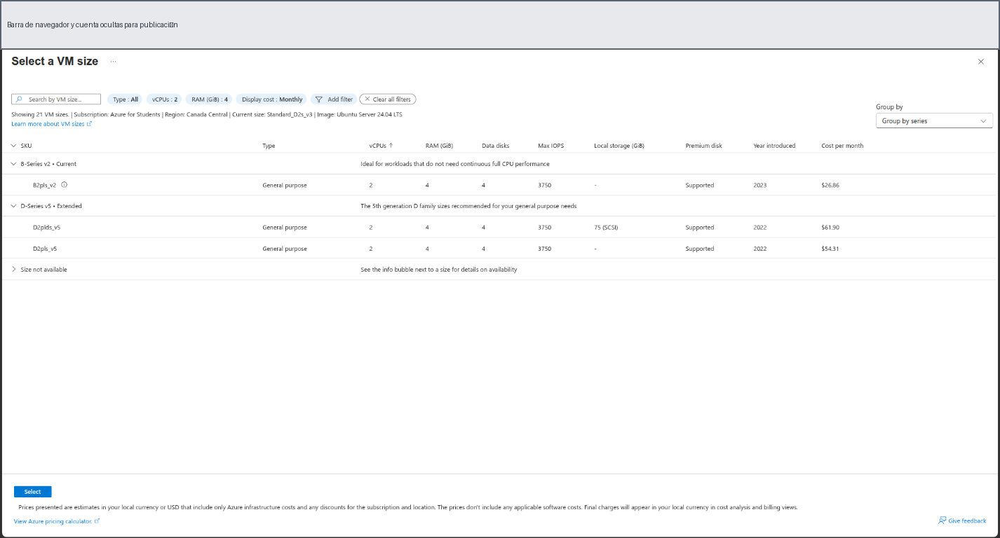
   4. **Administrator account and ports:** SSH public key, user `azureuser`,
      generate a new RSA key pair named `vm-rioclaro_key`, allow HTTP (80),
      HTTPS (443) and SSH (22). Download the `.pem` file when prompted.
      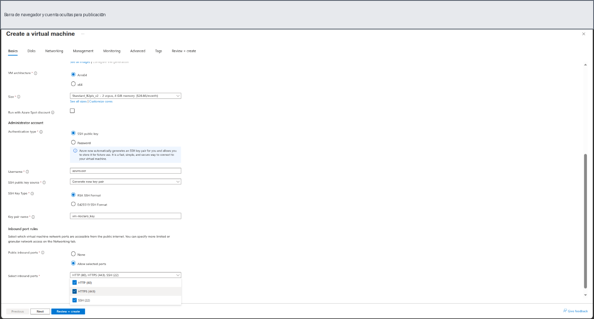
   5. **Disks:** OS disk type **Standard SSD** (the default was Premium SSD),
      64 GiB.
      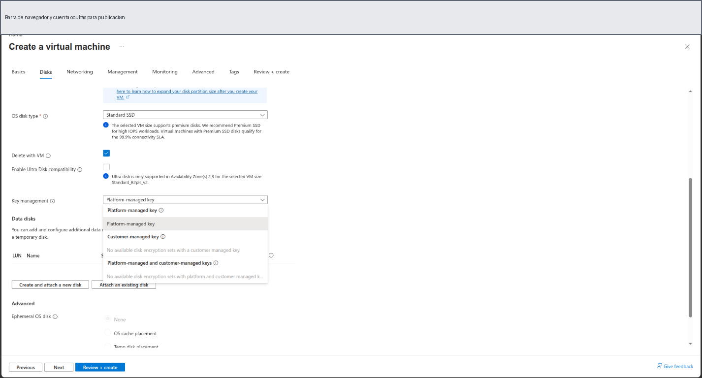
   6. **Networking:** new virtual network and subnet in `rg-rioclaro-prod`,
      new public IP `vm-rioclaro-ip`, basic NSG with ports 80, 443 and 22.
      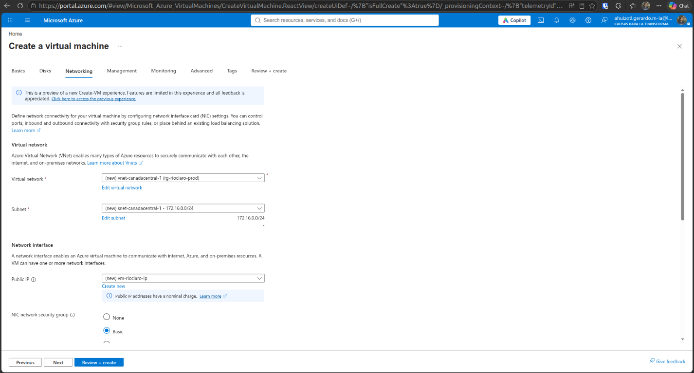
      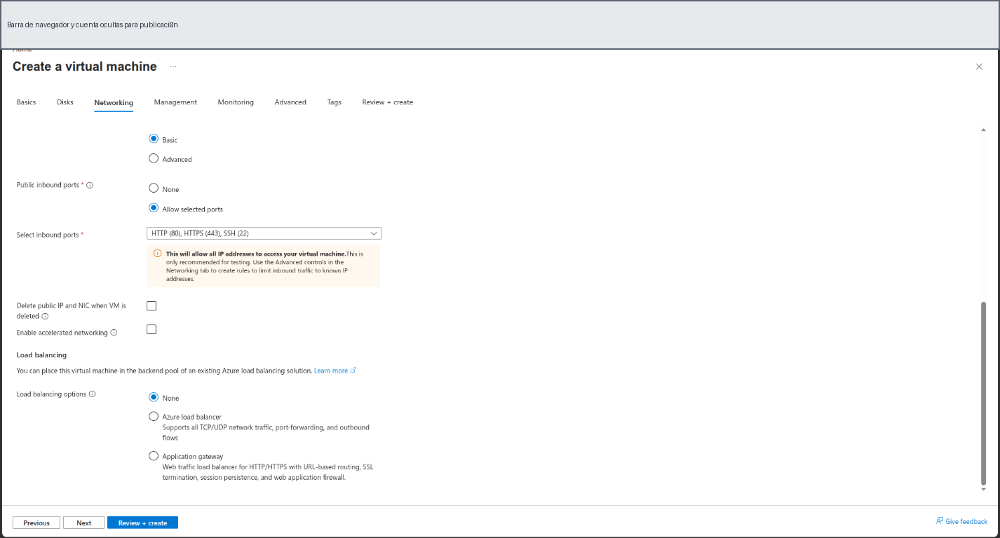
   7. **Management, Monitoring and Advanced:** keep the defaults (boot
      diagnostics on, everything else off).
      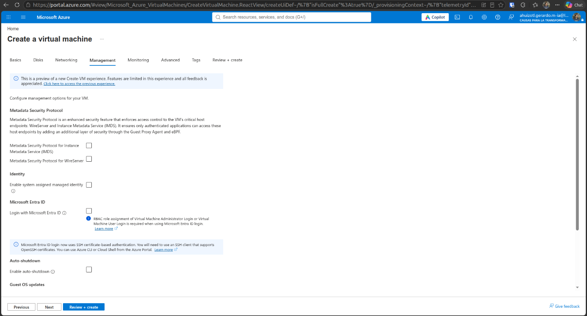
      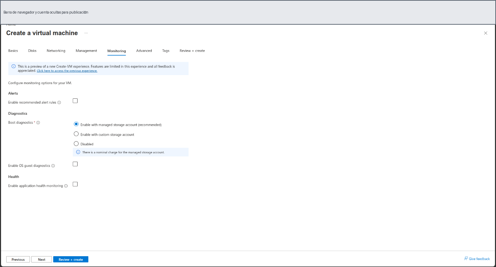
      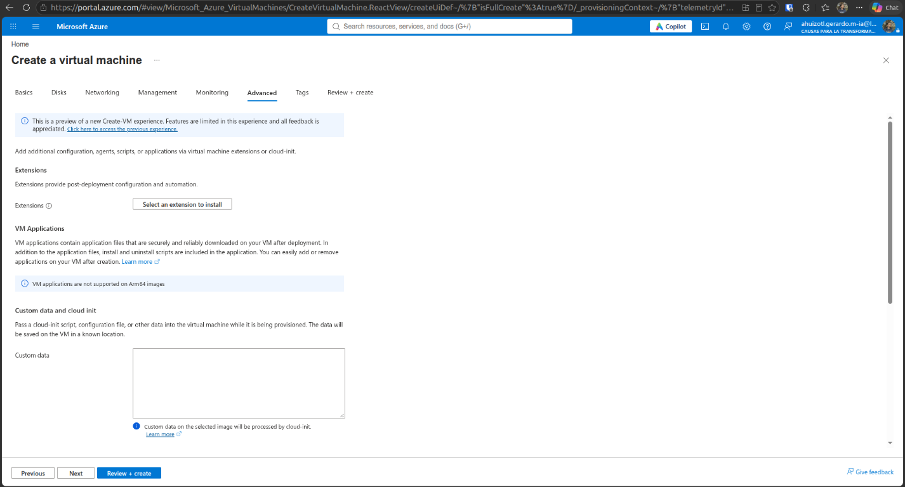
   8. **Review + create:** check image, size (B2pls_v2, ARM64), disk
      (StandardSSD_LRS, 64 GiB) and networking, then **Create**.
      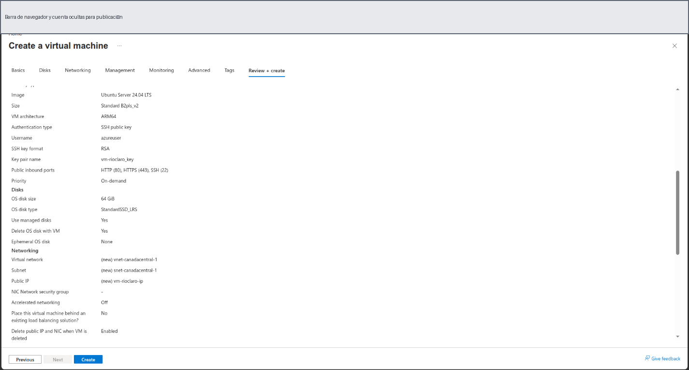
   9. **Deployment complete.**
      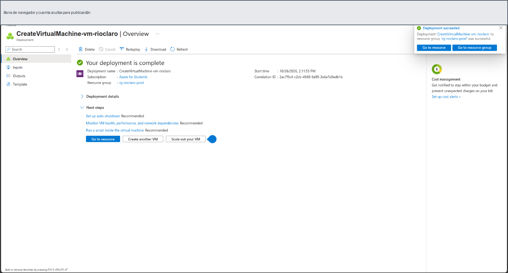
   10. **Public IP:** open `vm-rioclaro-ip`; the assignment is **Static**
       (this is the IP for the DNS A record).
       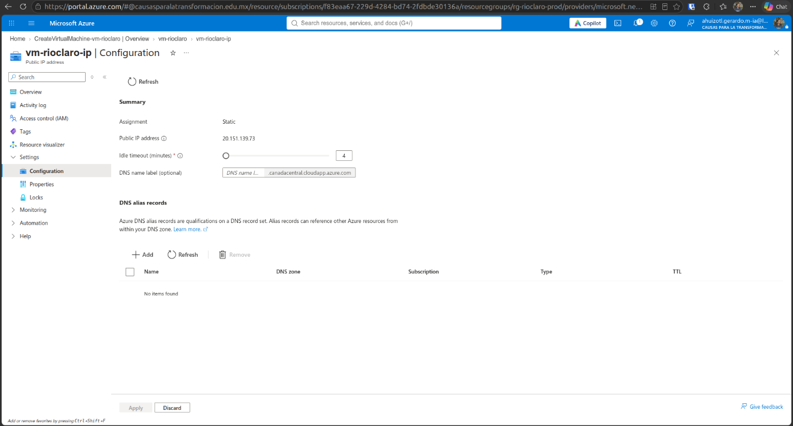
2. DNS: A record `rioclaro.ropech.com` to the VM IP.
3. VM hardening: Docker + Compose, `ufw` (22, 80, 443 only), `fail2ban`,
   key-only SSH (`PasswordAuthentication no`).

   First SSH login (accept the host key, then check `uname -m` shows
   `aarch64`):
   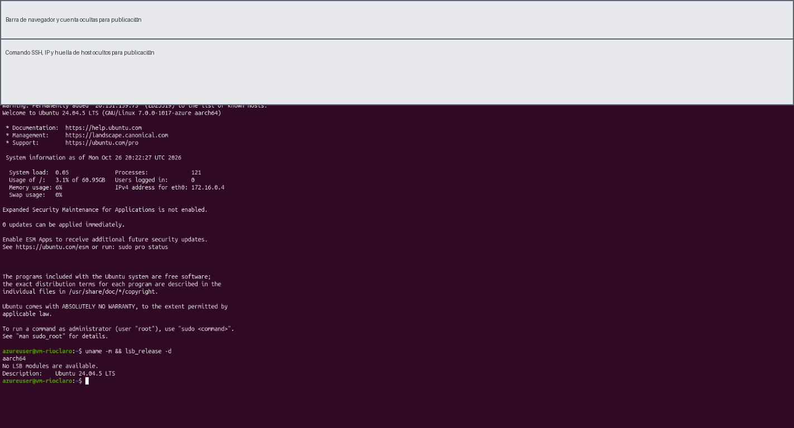

   Docker and Compose working on Arm64 (`hello-world` runs):
   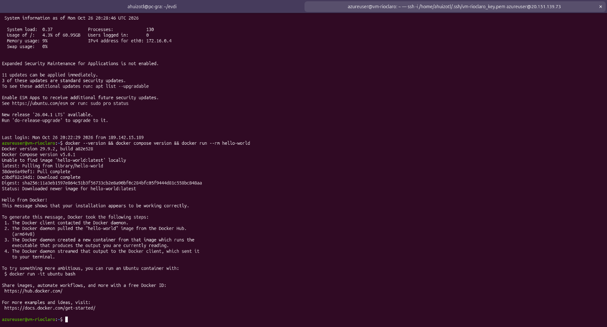
4. Code sync: private repo cloned to `~/app` with a read-only GitHub **deploy
   key**; update with `git pull`.

   GitHub → repository **Settings → Deploy keys**, with the VM key added as
   **read-only**:
   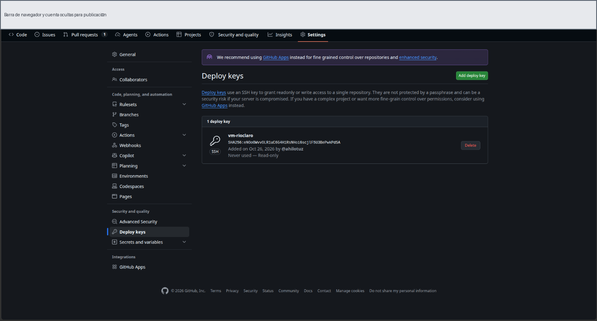
5. Stack: `deploy/compose.prod.yaml` (odoo, odoo-db, Caddy), `deploy/Caddyfile`
   (automatic Let's Encrypt, `/web/database/*` returns 404),
   `deploy/odoo.prod.conf` from the `.example` (`list_db=False`,
   `proxy_mode=True`, `db_filter=^rioclaro$`).
6. Pitfalls: `odoo.prod.conf` must be `chown 100:101`; `docker compose run`
   replaces `command:`, so repeat `--addons-path`.
7. Verified: HTTPS 200, DB manager blocked, ports closed, survives reboot.

   Odoo served over HTTPS at the real domain:
   

### M6: Telegram webhook (PR #17, merged)


- `POST /rioclaro/telegram/webhook`: secret header
  `X-Telegram-Bot-Api-Secret-Token` compared with `hmac.compare_digest`
  against `RIOCLARO_TELEGRAM_WEBHOOK_SECRET` (403 if wrong or missing, 400 if
  malformed or over 256 KB), fast 200, idempotent queue
  `rioclaro.telegram.update` processed by a one-minute cron.
- Polling is skipped automatically when the webhook secret is set. Only one
  mode may own the bot token; keep the local stack **stopped** while the VM
  uses the webhook.
- Bug found locally: background callers have no language, so product-name
  search matched only English names. Fixed with `QUERY_LANG="es_MX"` (applied
  only if that language is installed and active).
- Local test needs `--db-filter=^<dev db>$` or the route returns 404.

### M6 deployment to the VM (verified)

1. `cd ~/app && git pull`, then upgrade the module (needs the DB flags):
   `docker compose -f compose.prod.yaml run --rm --no-deps -T odoo odoo -c /etc/odoo/odoo.conf -d rioclaro -u rioclaro_invoice_inbox --stop-after-init --db_host=odoo-db --db_user=odoo --db_password="$PW" --addons-path=/usr/lib/python3/dist-packages/odoo/addons,/usr/lib/python3/dist-packages/addons,/mnt/extra-addons --http-port=0`
2. Copy the `RIOCLARO_*` keys from the local `.env` to `deploy/.env` by piping
   over SSH (never paste them in chat). `chmod 600 .env`.
3. Append `RIOCLARO_TELEGRAM_WEBHOOK_SECRET=$(openssl rand -hex 32)` to
   `deploy/.env`, then `docker compose -f compose.prod.yaml up -d --force-recreate odoo`.
4. Register the webhook with `scripts/telegram_webhook.py` (`ACTION=set`,
   `info` or `delete`) through `odoo shell` using `exec -T`. **Always pass
   `--db_host=odoo-db --db_user=odoo --db_password="$PW"`**, otherwise the shell
   fails with a Postgres socket error. Expect `WEBHOOK {'url':
   'https://rioclaro.ropech.com/rioclaro/telegram/webhook', ...,
   'last_error_message': None}`.
5. Create the Owner contact (`rioclaro.telegram.contact`: Telegram ID, role
   `internal`, company, query permissions) from an `odoo shell` script or the
   Odoo UI. Without it the bot answers "No autorizado para consultas."
6. Test from Telegram: a stock question returned the correct reply from the
   VM database. Forged and missing secret both return 403; GET returns 405;
   Telegram shows 0 pending updates and no errors.

   Expected reply to a stock question (note the literal `**`, see below):

   
7. Rollback: `ACTION=delete`, remove the secret, enable parameter
   `rioclaro_invoice_inbox.telegram_polling_enabled`.

### Behaviours worth knowing

- Rate limit: configurable in **Settings > Río Claro Chatbot**. Defaults to 5
  queries per contact per 5 minutes. Values below 1 are treated as 1.
  Rate-limited attempts are audited and count toward the window.
- Telegram answers are plain text. Markdown emphasis and code ticks are
  removed, and list markers are normalised to `•`.
- Tools show only the contact's own company; a contact in another company gets
  "No encontré resultados".

### Email invoice ingestion on the VM (verified)

Goal: an invoice emailed to a mailbox becomes an intake record in the
production Odoo, screened by an Azure Function and extracted by Document
Intelligence. Prerequisites: the Language project and deployment from
section 18 (`supplier-invoice-email`, `practice-screening-deployment`), the
Document Intelligence keys already in the VM `.env`, and a disposable mailbox
(**Fetch Now processes every unread message**).

#### A. Create the screening Function App (portal)

Use the production resource group (`rg-rioclaro-prod`) so that everything
deployed to production lives together. Roles can still be granted on resources
in another group.

1. Create a **Function App** with the **Flex Consumption** plan. Basics:
   resource group `rg-rioclaro-prod`, name `rioclaro-screening-942`, region
   Canada Central, runtime **Python 3.11**, instance size **2048 MB**, zone
   redundancy **Disabled**.
   
2. Storage: choose **(New)** storage account (a Function App needs its own
   host storage; do not reuse the Language training storage). Blob diagnostics:
   **Configure later**.
   
3. Azure OpenAI: leave unchecked (not used by the screening Function).
   
4. Networking: public access **On**, virtual network integration **Off**. Odoo
   calls the Function over the internet and the function key protects it.
   
5. Monitoring: Application Insights **Yes**, keep the **(New)** one.
   
6. Durable Functions, Deployment and Authentication: keep defaults. Basic
   authentication stays disabled because the code is deployed with the Azure
   CLI.
   
   
7. Review + create, check that the summary matches, then **Create**.
   
8. Wait for "Your deployment is complete" (about 1 minute for the resources,
   a bit longer for the app).
   

#### B. Identity, settings, code and key (Azure CLI)

```bash
RG=rg-rioclaro-prod; APP=rioclaro-screening-942
# 1. Managed identity + role on the Language resource
PID=$(az functionapp identity assign -g $RG -n $APP --query principalId -o tsv)
LID=$(az cognitiveservices account show -g rg-rioclaro-ai-dev -n rioclaro-language-dev --query id -o tsv)
az role assignment create --assignee-object-id $PID --assignee-principal-type ServicePrincipal \
  --role "Cognitive Services User" --scope $LID
# 2. App settings read by azure/email-screening/screening.py
az functionapp config appsettings set -g $RG -n $APP --settings \
  LANGUAGE_ENDPOINT=https://rioclaro-language-dev.cognitiveservices.azure.com \
  LANGUAGE_PROJECT_NAME=supplier-invoice-email \
  LANGUAGE_DEPLOYMENT_NAME=practice-screening-deployment \
  INVOICE_CONFIDENCE_THRESHOLD=0.90
# 3. Publish only the runtime files (no tests, data or local settings)
cd azure/email-screening
zip /tmp/screening.zip function_app.py screening.py host.json requirements.txt
az functionapp deployment source config-zip -g $RG -n $APP --src /tmp/screening.zip
# 4. Function key (never commit or print it)
az functionapp keys list -g $RG -n $APP --query functionKeys.default -o tsv
```

Test the endpoint (route `screen-email`, auth level FUNCTION):

- Without `?code=<key>` it answers **401**.
- With the key, a supplier-invoice text and `"hasAttachments": true` returns
  `{"route": "inspect_attachments", "label": "supplier_invoice", ...}` and a
  non-invoice text returns `{"route": "ignore", ...}`.
- The classifier was trained on a small synthetic set, so use phrasings similar
  to `azure/email-screening/data/synthetic_examples.jsonl` when testing.

#### C. Configure the VM

1. Append `RIOCLARO_SCREENING_FUNCTION_KEY=<key>` to `~/app/deploy/.env` (pipe
   it over SSH instead of typing it into shell history), then
   `docker compose -f compose.prod.yaml up -d --force-recreate odoo`.
2. Set the system parameters with `odoo shell` (use the DB flags from the
   checklist above). In Odoo 20 the helpers are typed:
   ```python
   P = env["ir.config_parameter"].sudo()
   P.set_bool("rioclaro_invoice_inbox.screening_enabled", True)
   P.set_str("rioclaro_invoice_inbox.screening_url",
             "https://<app-host>.azurewebsites.net/api/screen-email")
   P.set_int("rioclaro_invoice_inbox.company_id", 1)
   env.cr.commit()
   ```
   (`set_param` / `get_param` no longer exist.)
3. In Gmail, with 2-Step Verification on, create an **app password** at
   https://myaccount.google.com/apppasswords. Use it, never the account
   password.
4. In Odoo (developer mode): Settings > Technical > Incoming Mail Servers >
   New. IMAP, `imap.gmail.com`, port `993`, SSL/TLS, the mailbox user, the app
   password, action **Supplier Invoice Email**. Press **Confirm**. A
   "last fetch" time appears once the scheduled fetch runs.
   

#### D. Live test

1. From another account, email the mailbox with an invoice-like body and a PDF
   invoice attached.
2. Press **Fetch Now** on the mail server (or wait for the cron). A record
   appears in Invoice Intake > Supplier Invoice Emails with the sender, the
   mailbox and the received time.
   
3. Open it: the email body and attachments are in the chatter, the extraction
   status is *Pending Extraction* and the amounts are 0.
   
4. Press **Extract Invoice Data**. Vendor tax ID, invoice number, date,
   subtotal, taxes, total and the line items are filled, and the chatter logs
   each changed field.
   

Lesson learned: the first attempt left everything at 0.00 because the email
had a signature image before the PDF and extraction read the oldest attachment.
PR #18 now tries PDFs first, then images, and keeps the first result that
contains an invoice number or total. Always keep the PDF/XML as attachments
and make sure the VM runs the merged `main`.

### E. Negative test and vendor bill

5. Negative test: email a non-invoice message (for example "te invito a comer
   el viernes") to the mailbox and press **Fetch Now**. No record appears in
   **Supplier Emails**; the screening Function returned `ignore`.
6. On an extracted record press **Create Vendor Bill**. The draft bill carries
   the vendor, invoice number, date, the extracted line and the purchase tax
   (IVA 16% = $5.60, total $40.60), plus copies of the attachments.
   

Lessons learned:
- PR #19: the first bill had no taxes because the lines were created without
  `tax_ids`. The tax rate is now derived from taxes / subtotal and matched to
  the company's percent purchase tax. Several 16% purchase taxes can exist; the
  first match is used.
- PR #20: deleting a bill left the intake at `Invoiced`, hiding the button.
  Deleting a bill now returns the intake to `In Review` and logs a chatter note.
- After code changes on the VM run `git pull`, `odoo -u rioclaro_invoice_inbox`
  with the DB flags, then restart the container.

### F. M7 first slice: plain-text replies, runbook flags, editable rate limit

- Model answers are post-processed by `plain_text()` so Telegram no longer shows
  literal `**bold**`; bullets are normalised to `•` and the prompt asks for plain text.
- `deploy/README.md` and `scripts/telegram_webhook.py` now show the required
  `--db_host/--db_user/--db_password/--addons-path/--http-port=0` flags for
  `odoo shell` and `odoo -u` (without them they fail with a Postgres socket error).
- The per-contact query limit is editable in **Settings > Río Claro Chatbot**
  (administrators only): *Queries per contact* (default 5) and *Window (minutes)*
  (default 5). They are stored as the system parameters
  `rioclaro_invoice_inbox.telegram_query_rate_limit` and
  `rioclaro_invoice_inbox.telegram_query_window_minutes`; values below 1 are
  treated as 1. After deploying run `odoo -u rioclaro_invoice_inbox` so the
  Settings view loads.

**LAST_COMPLETED_STEP:** email ingestion verified on the VM (screening Function,
IMAP, extraction, vendor bill with taxes, negative test).
**Next:** rest of M7 (correlation ID and latency per query, kill switch, budget alert, spend cap, incident owner).

### Query date periods

The read-only sales, purchase, invoice, top-products, and margin tools accept
an empty period (last 30 days), a day count, an explicit
`YYYY-MM-DD,YYYY-MM-DD` range, or common natural periods: `hoy`, `ayer`,
`esta semana`, `semana pasada`, `este mes`, `mes pasado`, `este año`, and
`últimos N días`. Natural periods use the `America/Mexico_City` business date.
For example, `este mes` means the first day of the current month through today.

### M9 Owner queries: production verification

Verified from the Owner Telegram contact on the VM:

- Top products returned the top three products by untaxed sales, units sold,
  and currency.
- Week-over-week sales comparison returned the current and previous weeks and
  their difference.
- Open balances returned accounts receivable/payable and overdue amounts.
- Asking for the highest-margin category in `este mes` returned no results
  because there were no confirmed sales in the current month. Asking for the
  last 30 days returned **Mercancías para Reventa / Limpieza e Higiene /
  Cuidado del Hogar y Superficies**, with margin **$76.00 MXN (49%)**, revenue
  **$155.00 MXN**, and cost **$79.00 MXN**.


## 17. Draft vendor bill feature verification

- Started Odoo containers (`docker compose up -d`).
- Ran unit tests for `rioclaro_invoice_inbox` with proper DB credentials and addon path:
  ```bash
  docker compose exec odoo odoo -c /etc/odoo/odoo.conf -d test_db --test-enable -i rioclaro_invoice_inbox -t rioclaro_invoice_inbox --stop-after-init --db_host=odoo-db --db_user=odoo --db_password=rioclaroapp --addons-path=/usr/lib/python3/dist-packages/odoo/addons,/usr/lib/python3/dist-packages/addons,/mnt/extra-addons --http-port=0
  ```
- All 19 tests passed (0 failures, 0 errors).
- Verified UI actions: “Create Vendor Bill” creates a draft `account.move` with copied attachments; “View Vendor Bill” opens the same bill.
- **Último paso completado:** tests verified; ready to push the `feature/invoice-extraction-draft-bill` branch and open a Pull Request.

## 20. Website Live Chat AI: public-content assistant

The `feature/website-livechat-ai` increment connects Odoo Website Live Chat
(`website_livechat`) to the existing Azure OpenAI agent. It serves anonymous
website visitors; it does not connect the Discuss inbox or expose Telegram
contact permissions.

### Scope and safeguards

- The assistant can search only published product names/descriptions and
  published website pages. Product recommendations link product names to their
  public Odoo shop pages and may include the price shown to an anonymous visitor
  under the default public website pricelist, currency, fiscal position, and tax
  display. It cannot access inventory, costs, margins, customer records, orders,
  invoices, sales, or purchases.
- Anonymous visitors can ask `/help`, `/ayuda`, or `¿Qué puedes hacer?` to
  receive a deterministic summary of public capabilities. The response does
  not list or imply access to Telegram's permission-gated private features.
- The feature is disabled by default. Enable it only on the Live Chat channel
  intended for website visitors. Native-chatbot conversations are left to the
  chatbot. Odoo shows the chat bubble and starts a session only while at least
  one human operator is online on the channel, so add and keep an operator
  online. The AI answers until that operator writes a message after the
  visitor's first message (the automatic welcome message does not count); after
  that the AI stays silent.
- Each guest or partner is limited to five visitor questions in a rolling
  five-minute window across Live Chat conversations. This is not a global Azure
  spend limit; monitor Azure usage and quotas separately.
- Azure OpenAI uses the existing `RIOCLARO_AOAI_ENDPOINT`,
  `RIOCLARO_AOAI_API_KEY`, and `RIOCLARO_AOAI_DEPLOYMENT` settings. No new Azure
  resource is required. Each request has an eight-second timeout; a complete
  answer can use two requests, so a response may take up to about 16 seconds.
  If AI is unavailable, the visitor sees a message asking them to leave their
  question for a human agent.
- Useful answers require published product descriptions and useful, published
  FAQ/help pages. At the time this increment was scoped, the live site had four
  published products without descriptions and only standard website pages, so
  add public content before enabling the assistant.

### Enable and verify after deployment

1. Upgrade `rioclaro_invoice_inbox` on the Odoo instance. The module depends on
   `website_livechat` and `website_sale`; installing/upgrading it installs any
   missing Odoo dependencies.
2. In Odoo, open the **Live Chat** app, select the channel used by the website,
   and open its **Options** tab. Enable **Río Claro AI assistant** and save.
   Leave other channels disabled unless they are meant to serve public
   visitors.
3. Open the public website in a private/incognito browser window and start a
   new Live Chat conversation. Ask a question answered directly by a published
   product description or FAQ page, and confirm the reply appears in the chat.
4. Ask for a product price and then for the cheapest product among a matching
   group. Confirm the reply uses the public shop price and identifies its
   currency and tax display. Ask for stock or private order details; the
   assistant must not provide them. Send six questions within five minutes to
   verify that the sixth receives the rate-limit message.
5. Disable **Río Claro AI assistant**, start a fresh conversation, and confirm
   the AI no longer replies. Native-chatbot conversations, and conversations
   where a human agent has replied, should not receive competing AI replies.

### Production verification (2026-11-02)

Verified on the production Odoo site after deploying commit `3eb8154`; the
general catalog-list behavior was retested after deploying `e10e514`. These
checks predate public price support:

- An anonymous visitor received a product recommendation for Limpia Pisos
  Multiusos 1L. The assistant correctly said the available catalog text did not
  confirm lavender scent.
- At that time, when asked for prices and stock, the assistant stated that the
  catalog did not show those details. Public prices are now supported; stock
  remains private.
- The sixth question sent within the five-minute window received
  `Espera unos minutos antes de volver a consultar.`
- After the human operator replied, the visitor's next question received no AI
  response, as intended.
- Initially, the broad question `¿Qué productos tienen?` returned
  `No encontré resultados para tu consulta.` After deploying the general catalog
  search fix (`e10e514`), a fresh anonymous chat returned a list including
  Limpia Pisos Multiusos 1L, Detergente Multiusos 1kg, Cloro Clorox Original,
  Harpic Power Ultra, and Cloralex Total Power. At that time the reply included
  no prices or stock quantities.

### Local verification

Run the add-on test suite using the repository's Odoo 20/PostgreSQL Compose
stack. As with other module tests, use a fresh test database and the complete
add-ons path. Compose injects the configured database password into the
one-off Odoo container; the shell passes it to Odoo without printing it:

```bash
docker compose up -d odoo-db
docker compose run --rm --no-deps -T odoo sh -c \
  'exec odoo -c /etc/odoo/odoo.conf -d livechat_ai_test \
  --test-enable -i rioclaro_invoice_inbox -t rioclaro_invoice_inbox \
  --stop-after-init --db_host=odoo-db --db_user=odoo \
  --db_password="$PASSWORD" \
  --addons-path=/usr/lib/python3/dist-packages/odoo/addons,/usr/lib/python3/dist-packages/addons,/mnt/extra-addons \
  --http-port=0'
```

The tests cover published-content filtering, rejection of private tool names,
the public-only Azure tool allow-list, visitor replies, default-off behavior,
and per-visitor rate limiting.

## 21. Telegram public product recommendations

Telegram text and voice questions can now use the same published product
catalog and FAQ content as Website Live Chat. For example, an active Telegram
contact can ask `¿Qué producto me sirve para lavar trastes?`; the catalog
search matches published product names and public website descriptions, such
as product descriptions mentioning dishwashing.

- Any **active Telegram contact** may ask questions answered from published
  product or website content. The bot still denies unknown and inactive IDs.
- Private business tools are offered only when the contact has the matching
  permission enabled on its Odoo Telegram contact. The query service checks
  that permission again and retains its existing partner and company scopes.
- Public recommendations include only published names, website descriptions,
  and the price displayed to an anonymous visitor under the default public
  website pricelist, currency, fiscal position, and tax display. Cheapest-price
  questions compare matching public website prices. Unpublished products,
  stock, costs, margins, sales, invoices, and customer data remain excluded.
  In Telegram, exact product names link to their published shop pages using
  Odoo's configured `web.base.url`; only `/shop/...` paths are linked.
- Existing Telegram query auditing and per-contact rate limits also apply to
  public questions.

Active Telegram contacts can use `/start`, `/help`, `/ayuda`, or ask
`¿Qué puedes hacer?` to see a capability summary. It always includes public
product and website-content questions, then lists only private queries and
invoice submission enabled for that contact in Odoo. Unknown or inactive
contacts remain denied, and the help response does not use Azure OpenAI.

### Verify after deployment

1. Upgrade `rioclaro_invoice_inbox` on the Odoo instance.
2. In Telegram, ask `¿Qué producto me sirve para lavar trastes?` from an active
   contact. Confirm the reply recommends a product whose published
   description matches the use, such as Salvo. Confirm its product name is a
   clickable link to the shop page. Ask for the cheapest laundry product and
   verify the public sale price, currency, and tax note match its shop page.
   Confirm the bot does not disclose stock, costs, or margins.
3. Use a second active contact with all private query permissions disabled.
   Confirm it can ask the same public question but cannot retrieve private
   sales, inventory, invoice, or order data.
4. From a contact with a private permission granted in Odoo, ask a public
   catalog question and a question covered by that permission. Confirm both
   work; then revoke the private permission and confirm that private query is
   denied while public recommendations still work.
5. Confirm an unknown or inactive Telegram ID remains denied.
