# Guía para crear un proyecto nuevo

Guía reutilizable para empezar un proyecto pequeño y llevarlo, paso a paso, a un
flujo de trabajo profesional. Está pensada para personas que están aprendiendo.
Los comandos están escritos para macOS/Linux; cuando hay una diferencia
importante para Windows se indica también.

## Antes de empezar

Necesitas:

- Python 3.11 o posterior.
- Git.
- Visual Studio Code (opcional, pero recomendado).
- Una cuenta de GitHub si quieres guardar el proyecto en línea y usar GitHub
  Actions.
- Docker solo si el proyecto necesita ejecutarse en contenedores.
- Una cuenta de Azure solo si el destino de despliegue será Azure.

No instales herramientas o servicios que el proyecto todavía no necesita. Por
ejemplo, una aplicación sin base de datos no necesita PostgreSQL ni Redis.

## Aplicación de esta receta al proyecto Río Claro

Odoo Community 20.0 es el scaffold y sistema operativo principal para compras,
ventas, inventario y contabilidad. El proyecto añadirá una aplicación propia
dentro de Odoo para recibir facturas de proveedores por correo electrónico y
WhatsApp, revisar su información y mantener trazabilidad. No se desarrollará
una aplicación externa independiente para este flujo.

## Arquitectura y alcance
- Odoo administra la información de proveedores, productos, inventario, compras, ventas y procesos contables.
- La recepción de facturas por correo electrónico y Telegram se implementa como una aplicación/módulo de Odoo y utiliza los modelos y permisos estándar de Odoo.
- El módulo personalizado no duplica los flujos estándar del ERP ni accede directamente a PostgreSQL fuera del ORM de Odoo.
- La validación de CFDI y cualquier conexión con el SAT quedan fuera del alcance.
- El entorno local de desarrollo utiliza Odoo Community 20.0 y PostgreSQL 16, configurados mediante Docker Compose.

## Filtrar correos antes de Odoo

El proyecto utiliza tecnologías de Microsoft para identificar correos con facturas de proveedores y evitar importar mensajes que no tengan relación. Los buzones de origen incluyen Microsoft 365 y Gmail, y se permite procesar el contenido y los adjuntos mediante servicios de Azure.

La arquitectura propuesta consiste en:
- Azure Logic App con conectores para ambos sistemas de correo.
- Azure AI Language con clasificación personalizada de texto sobre el cuerpo del correo.
- Revisión de adjuntos únicamente cuando el mensaje tenga alta probabilidad de ser una factura.
- Azure AI Document Intelligence para revisar PDFs e imágenes.
- Procesamiento independiente para archivos XML.

Los correos que parezcan facturas pero no tengan adjuntos, aquellos con clasificación incierta o con adjuntos no concluyentes, deben enviarse a una carpeta de revisión. Los mensajes claramente no relacionados no deben enviarse a Odoo. Solo las facturas confirmadas deben llegar al flujo de captura en Odoo.

### Configuración de filtrado de correos con Azure completada hasta ahora

Los siguientes pasos se completaron correctamente en la suscripción **Azure
for Students**.

#### 1. Preparar ejemplos de práctica

El conjunto de datos ficticios en español se encuentra en
`azure/email-screening/data/synthetic_examples.jsonl`. Contiene 50 ejemplos
`supplier_invoice` y 50 `not_invoice` para entrenamiento, además de 10
ejemplos de prueba por clase. Desde
`azure/email-screening/`, ejecuta:

```bash
python3 prepare_dataset.py
```

El script validó y exportó los 120 ejemplos a
`build/synthetic-language-dataset/` como documentos `.txt` individuales en
UTF-8 y `manifest.csv`. Mantén separados
los archivos de prueba y los de entrenamiento. Los ejemplos son sintéticos y
solo sirven para practicar el flujo de importación y evaluación de Azure; no
demuestran la precisión del clasificador en producción.

#### 2. Crear los recursos de Azure

1. Crea el grupo de recursos `rg-rioclaro-ai-dev`.
2. Crea el recurso de **Language** de Azure `rioclaro-language-dev` en
   **Canada Central**.
   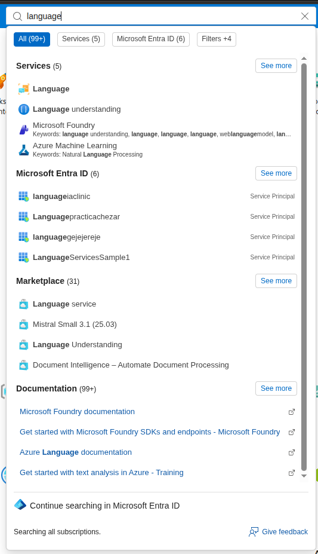

3. Selecciona **Custom text classification & custom named entity recognition**
   como característica personalizada y el nivel de precios **Free F0**.
   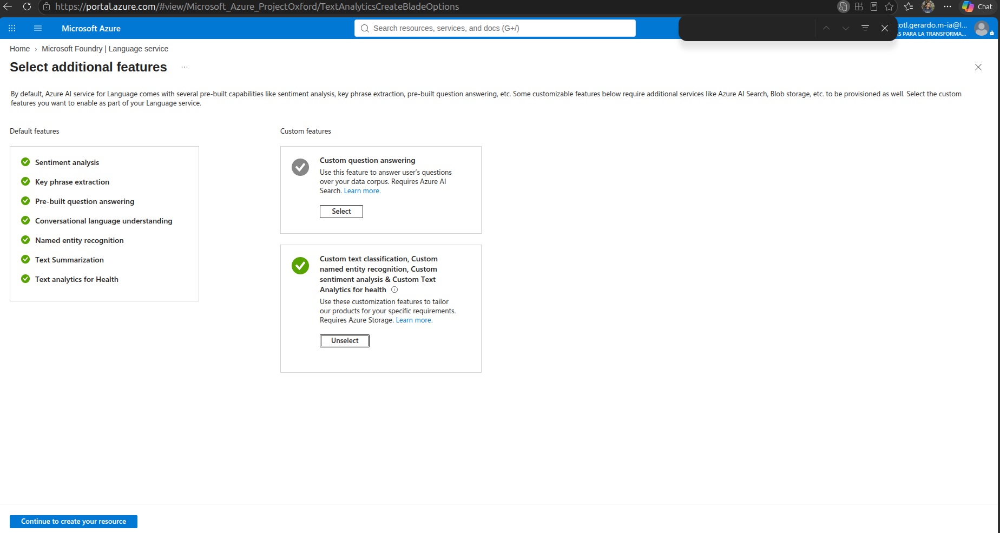
4. Configura el acceso de red del recurso Language para **all networks** y
   habilita su **system-assigned managed identity**.
5. Crea una cuenta de almacenamiento independiente llamada
   `rioclaroaiscreen02` en el mismo grupo de recursos y la región **Canada
   Central**. Usa **StorageV2 (general-purpose v2)**, rendimiento **Standard**
   y **Locally redundant storage (LRS)**. Selecciona **Azure Blob Storage or
   Azure Data Lake Storage** como servicio principal, **General purpose** como
   tipo de carga y **Hot** como nivel de acceso.
   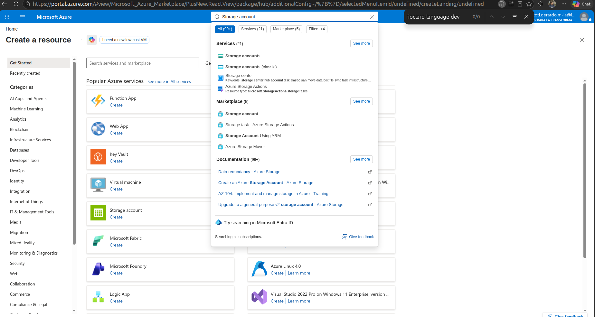
   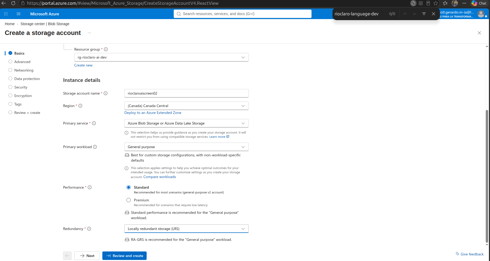
   
   
#### 3. Configurar la cuenta de almacenamiento

- Red: acceso a la red pública habilitado para todas las redes; enrutamiento de
  red de Microsoft; sin punto de conexión privado.
  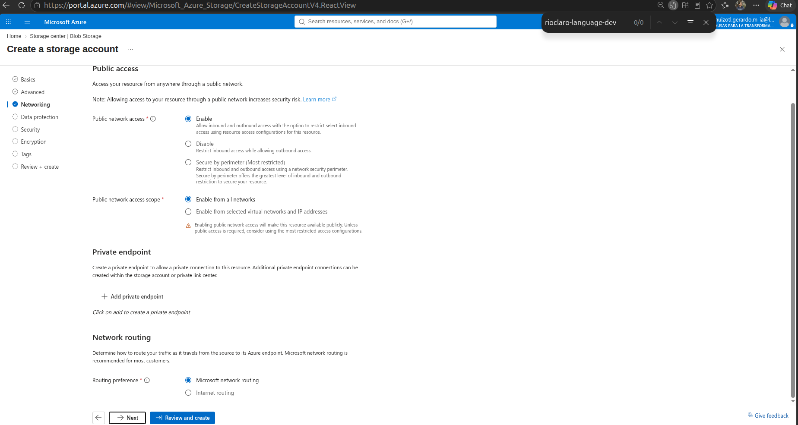
- Seguridad: transferencia segura obligatoria; acceso anónimo a blobs
  deshabilitado; acceso a la clave de la cuenta de almacenamiento habilitado;
  TLS mínimo 1.2.
  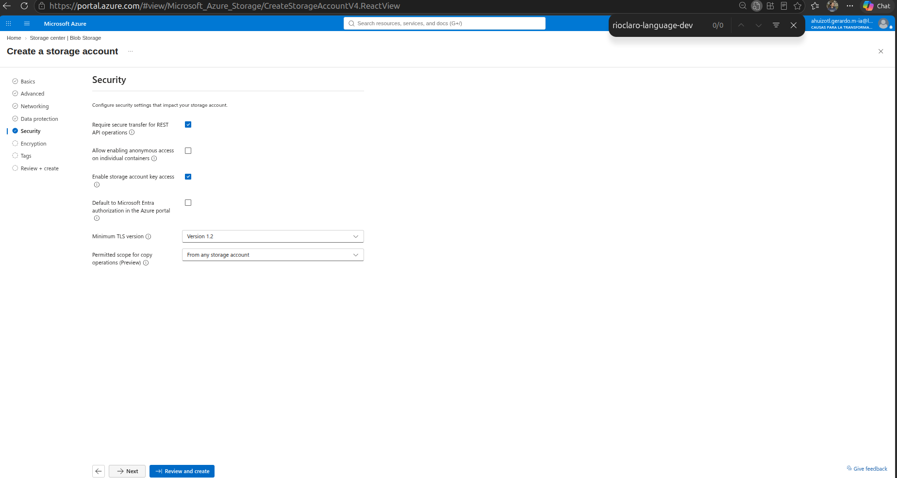
- Cifrado: claves administradas por Microsoft; compatibilidad con claves
  administradas por el cliente configurada en **Blobs and files only**; cifrado
  de infraestructura deshabilitado.
  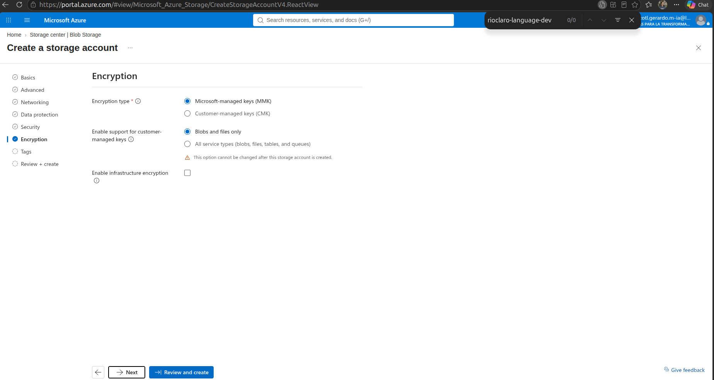
- Características de Blob: espacio de nombres jerárquico, NFS v3, SFTP,
  replicación entre inquilinos, control de versiones, fuente de cambios,
  restauración a un momento dado e inmutabilidad por versión deshabilitados.
  El nivel de acceso es **Hot**.
  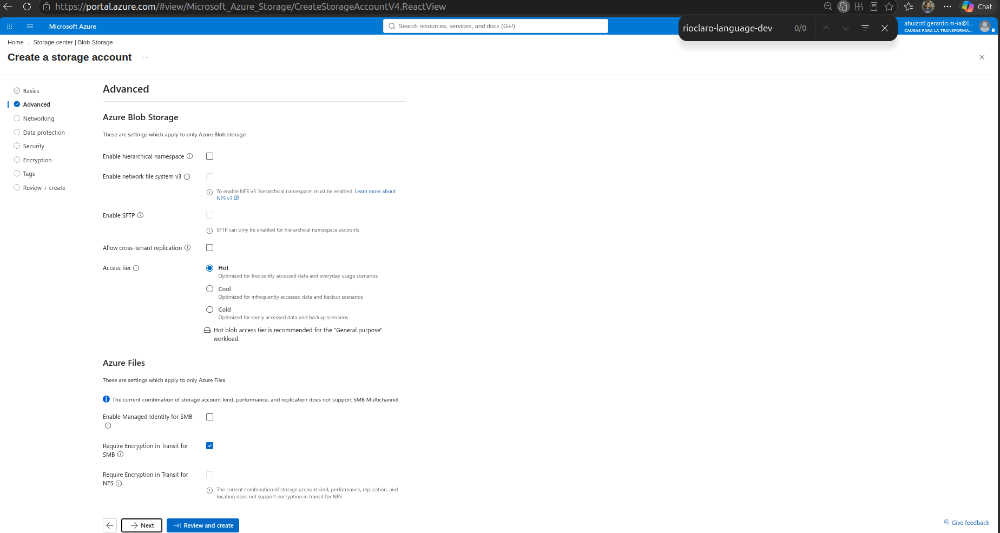
- Recuperación: eliminación temporal de blobs y contenedores habilitada con
  retención de siete días.
  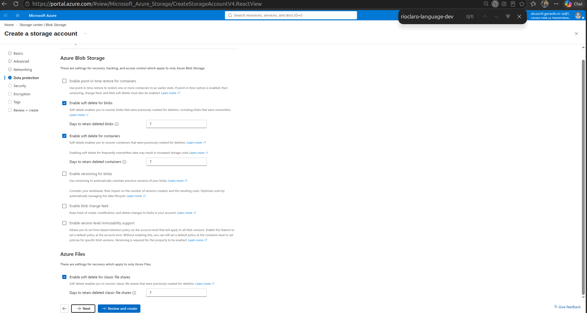
- Se dejaron las opciones de Azure Files con sus valores predeterminados y las
  etiquetas vacías.
El acceso anónimo a blobs está deshabilitado. La asociación de una cuenta de
almacenamiento con un recurso Language no se puede cambiar después; por eso,
reserva esta cuenta para `rioclaro-language-dev`.
  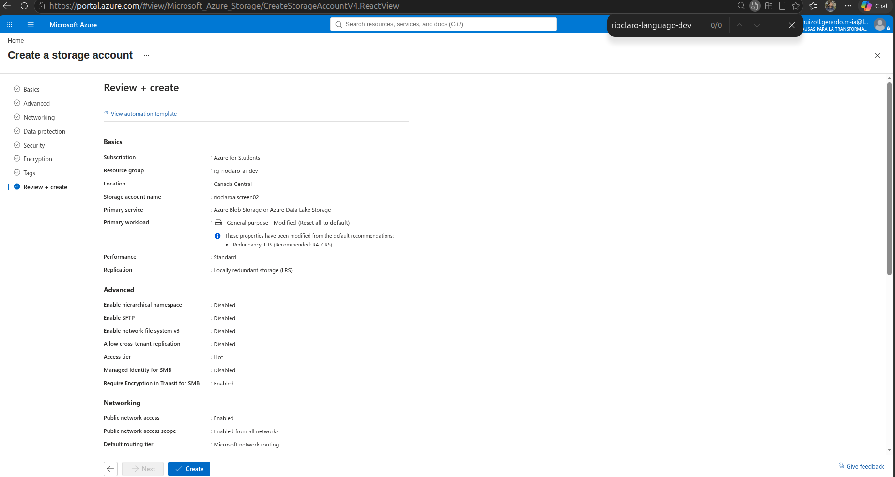
  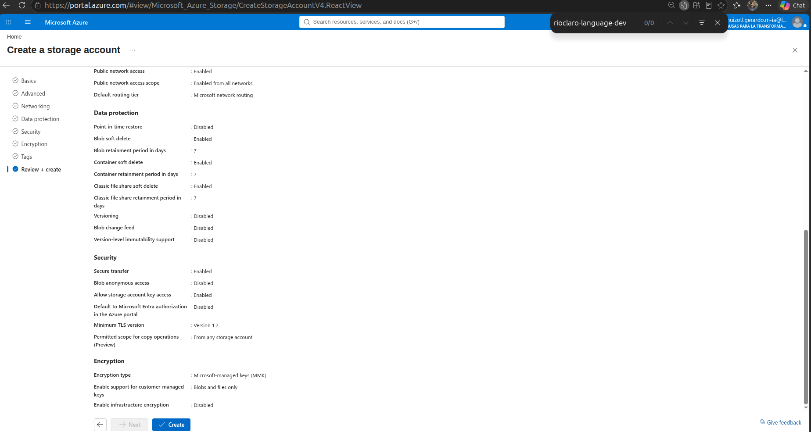
  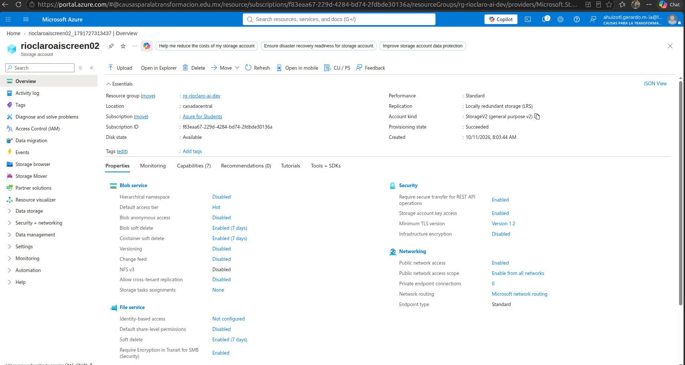
  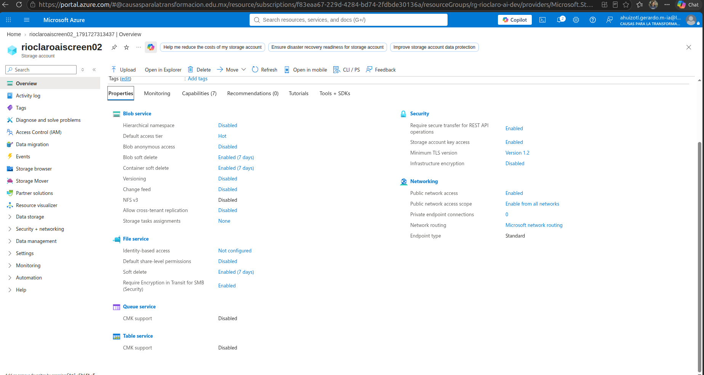

#### 4. Conceder acceso y habilitar la clasificación personalizada

1. En `rioclaroaiscreen02` → **Access Control (IAM)**, asigna el rol
   **Storage Blob Data Contributor** a la **managed identity**
   `rioclaro-language-dev`, con alcance limitado a esta cuenta de
   almacenamiento.
   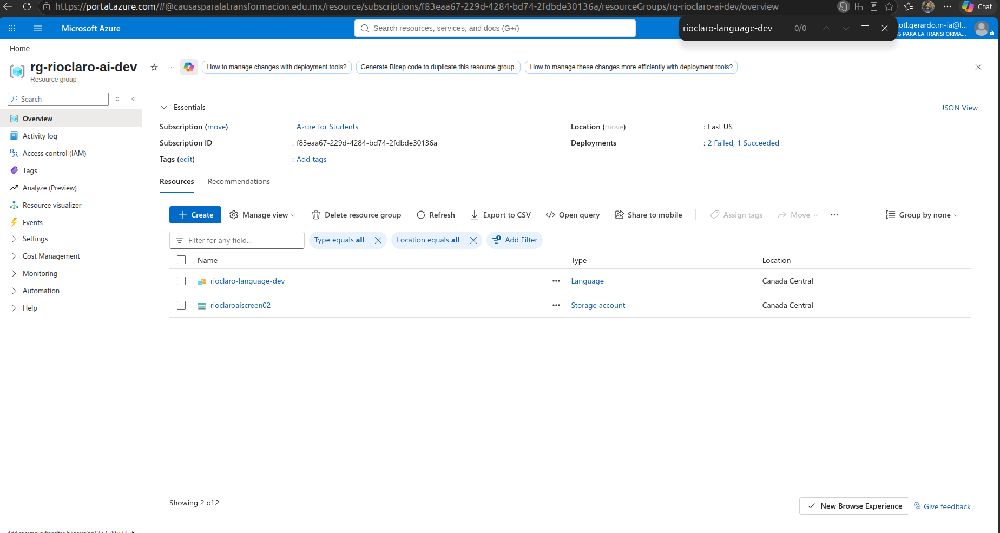
   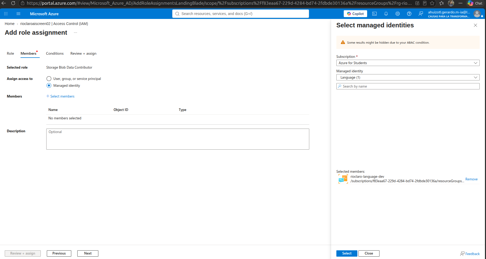
   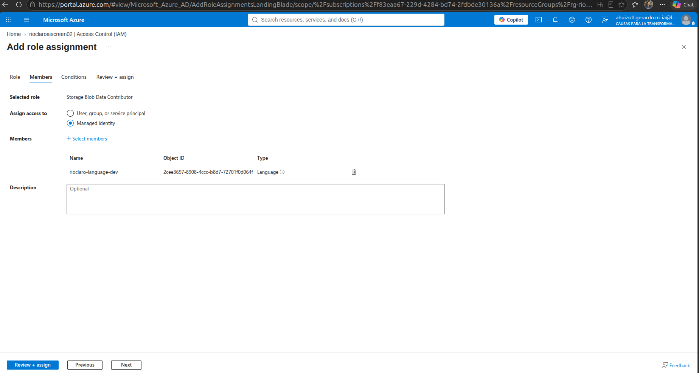
   
2. En `rioclaro-language-dev` → **Resource Management → Features**, habilita
   **Custom text classification / Custom Named Entity Recognition**, selecciona
   `rioclaroaiscreen02` y haz clic en **Apply**.
   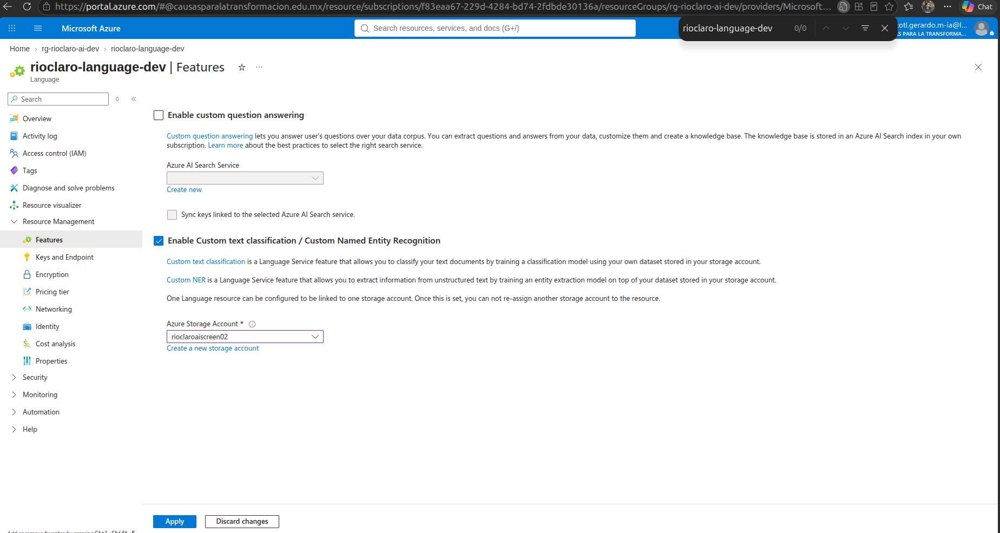
3. Confirma que el portal indique que la actualización se realizó correctamente,
   que la casilla de la característica siga marcada y que no haya cambios
   pendientes.

#### 5. Configurar CORS de Blob y los permisos de usuario

Al principio, Language Studio mostró una advertencia de CORS y no pudo cargar
los blobs del proyecto. En `rioclaroaiscreen02` → **Settings → Resource sharing
(CORS)** → **Blob service**, agrega estas dos reglas:

| Allowed origin | Allowed methods | Allowed headers | Exposed headers | Max age |
| --- | --- | --- | --- | --- |
| `https://ai.azure.com` | `GET`, `PUT`, `DELETE` | `*` | Leave blank | `500` |
| `https://language.cognitive.azure.com` | `GET`, `PUT`, `DELETE` | `*` | Leave blank | `500` |

Guarda las reglas. También asigna **Storage Blob Data Contributor** al usuario
de Azure con sesión iniciada, en `rioclaroaiscreen02` → **Access Control (IAM)**
y con alcance **This resource**. La identidad administrada y el usuario con
sesión iniciada son entidades distintas; a ambas se les asignó este rol. Espera
a que se propaguen los permisos del usuario y luego actualiza Language Studio
o vuelve a iniciar sesión si sigue apareciendo un error de acceso. Una vez
configurado, desapareció la advertencia de CORS y se cargaron los documentos
del proyecto.

#### 6. Crear el proyecto en Language Studio

En Language Studio → **Custom Text Classification** → **Create a project**:

1. Conecta el recurso Language existente `rioclaro-language-dev` y su cuenta
   de almacenamiento `rioclaroaiscreen02`.
2. Elige **Single label classification**.
3. Asigna al proyecto el nombre `supplier-invoice-email`, selecciona
   **Spanish** como idioma principal y deja deshabilitada la opción **Multiple
   languages**.
4. Usa la descripción `Classify supplier invoice emails for Río Claro`.
5. Selecciona el contenedor de blobs `invoice-email-training` y elige **No, I
   need to label my documents as part of this project**.
6. Revisa la configuración y crea el proyecto.

#### 7. Etiquetar los documentos

En la página **Data labeling** del proyecto:

1. Agrega las clases `supplier_invoice` y `not_invoice`.
2. Etiqueta los archivos desde `invoice_train_001.txt` hasta
   `invoice_train_050.txt` como `supplier_invoice`; etiqueta desde
   `other_train_001.txt` hasta `other_train_050.txt` como `not_invoice`.
3. Mantén los 100 documentos asignados a **Training the custom model
   (default)**. Los 20 documentos de prueba `*_test_*.txt` no se cargaron ni
   etiquetaron en este proyecto.
4. Guarda las etiquetas. La distribución mostró 50 documentos etiquetados por
   clase y 100 documentos de entrenamiento en total.

#### 8. Entrenar y revisar el modelo de práctica

1. Abre **Training jobs → Start a training job** y elige **Train a new model**.
   El modelo de práctica se llamó `supplier-invoice-email-practice-01`.
2. Selecciona **Automatically split the test set from training data** y
   conserva la división predeterminada de **80% training / 20% testing**.
   Inicia el entrenamiento.
3. Espera a que aparezca **Training succeeded** y abre el modelo en **Model
   performance (Preview)**.
4. Revisa **Dataset distribution**. Esta ejecución mostró 40 documentos de
   entrenamiento y 10 de prueba por clase (80 de entrenamiento y 20 de prueba
   en total), sin documentos sin etiquetar (`None`).
5. Revisa **Overview** y **Confusion matrix**. En esta práctica se reportaron
   100% de F1, precisión y sensibilidad, con ambas clases en la diagonal de la
   matriz de confusión para los 20 documentos de prueba.

Azure también mostró advertencias sobre clases desequilibradas y una
distribución desigual, aunque la tabla de esta ejecución mostraba 40/10
documentos por clase y ninguno sin etiqueta. Considera estas métricas
únicamente como resultado de una práctica exitosa: el conjunto de datos
sintéticos es pequeño y estos resultados no demuestran la precisión con correos
reales de proveedores. No despliegues este modelo ni habilites el enrutamiento
automático de correos con base en estos resultados.

#### 9. Crear un despliegue de prueba

En **Deploying a model**, agrega un despliegue nuevo con estos datos:

- Nombre del despliegue: `practice-screening-deployment`.
- Modelo: `supplier-invoice-email-practice-01`.
- Región: **Canada Central**.

La lista confirmó que el despliegue se creó en Canada Central. La fecha de
vencimiento que mostraba era **October 25, 2029**. Un despliegue habilita un
endpoint de predicción, pero por sí solo no conecta el correo ni Odoo. El nivel
F0 permite un solo despliegue para este proyecto; consérvalo para practicar.

#### 10. Probar el despliegue con ejemplos de prueba

En **Testing deployments**, selecciona `practice-screening-deployment` y carga
un archivo de prueba `.txt` a la vez desde
`azure/email-screening/build/synthetic-language-dataset/test/`. Compara la
clase predicha con el valor de la columna `label` para ese archivo en
`manifest.csv`. No uses archivos de entrenamiento para esta comprobación.

Según el reporte, las 20 predicciones de prueba coincidieron con sus etiquetas
esperadas. Estos son los dos resultados observados directamente durante este
recorrido:

| Archivo | Etiqueta esperada | Etiqueta predicha | Confianza |
| --- | --- | --- | --- |
| `invoice_test_010.txt` | `supplier_invoice` | `supplier_invoice` | 100% |
| `other_test_001.txt` | `not_invoice` | `not_invoice` | 100% |

El usuario confirmó que los otros 18 resultados también coincidieron; sus
niveles de confianza individuales no se registraron aquí. El resultado fue de
**20 aciertos de 20** en el pequeño conjunto sintético de prueba, lo cual no
demuestra precisión en condiciones reales.

#### 11. Conectar el controlador local de la Function con el despliegue

La Function llama al modelo de clasificación personalizado mediante el SDK
oficial de Python `azure-ai-textanalytics`. La solicitud REST inicial devolvió
HTTP 400 porque la versión de API `2022-05-01` no admite la tarea
`CustomSingleLabelClassification` en el endpoint general de análisis de texto.
Se modificó el código para usar la operación de larga duración
`begin_single_label_classify` del SDK.

Para la prueba de integración local, inicia sesión en Azure CLI con `az login`
y usa el endpoint del recurso
`https://<your-language-resource>.cognitiveservices.azure.com`, project
`supplier-invoice-email`, el despliegue `practice-screening-deployment` y el
umbral `0.90`. El controlador de la Function se ejecutó localmente con dos
documentos de prueba mediante `DefaultAzureCredential`; ambas llamadas
llegaron a Azure y devolvieron HTTP 200:

| Archivo | Etiqueta esperada | Ruta de la Function | Confianza |
| --- | --- | --- | --- |
| `invoice_test_010.txt` | `supplier_invoice` | `inspect_attachments` | 100% |
| `other_test_001.txt` | `not_invoice` | `ignore` | 100% |

Esta prueba verificó el controlador de Python con el modelo de Language
desplegado; no inició el host HTTP de Azure Functions ni desplegó una Function
App. No se leyó, reenvió, movió ni eliminó ningún correo.

#### 12. Ejecutar y probar la Function HTTP local

Al iniciar el host de Functions por primera vez, devolvió 404 porque el
parámetro del activador HTTP se llamaba `request`; el decorador de Python para
Functions espera `req`. Al cambiarle el nombre a `req`, el host pudo registrar
la ruta `POST /api/screen-email`.

Azurite se inició localmente con sus datos en `/tmp/rioclaro-azurite`, y el
host de Functions se inició en `127.0.0.1:7071` con Azure Functions Core Tools
4. El archivo ignorado `local.settings.json` apunta a
`https://<your-language-resource>.cognitiveservices.azure.com`, project
`supplier-invoice-email`, el despliegue `practice-screening-deployment` y el
umbral `0.90`. El proceso local se autenticó con las credenciales de Azure
CLI; no se agregó ninguna clave ni credencial al repositorio.

Dos solicitudes HTTP sintéticas llegaron al host local y al despliegue de
Azure, y devolvieron HTTP 200:

| Mensaje sintético | Tiene adjuntos | Resultado |
| --- | --- | --- |
| Texto en español parecido al de una factura | Sí | `supplier_invoice`, `inspect_attachments`, confianza de 100% |
| Aviso de envío | No | `not_invoice`, `ignore`, confianza de 100% |

Las 11 pruebas automatizadas de Azure pasan y el validador del conjunto de
datos sigue exportando los 120 ejemplos sintéticos. El host y Azurite son
procesos locales de desarrollo; esto no desplegó una Azure Function App ni la
conectó con Odoo, Logic Apps o un buzón.

#### 13. Integrar Odoo con la Function local de filtrado

El módulo `rioclaro_invoice_inbox` ahora filtra los mensajes antes de
procesarlos en una ruta de Odoo para `rioclaro.invoice.intake`. El filtrado
viene deshabilitado de forma predeterminada. Al habilitarlo, el módulo envía a
la URL configurada de la Function el cuerpo en texto plano (o el asunto si el
cuerpo está vacío), los metadatos sobre la presencia de adjuntos y el idioma
`es`. La ruta de ingreso se conserva únicamente cuando la Function devuelve
`supplier_invoice` e `inspect_attachments`; los demás resultados no crean un
registro de ingreso. El contenido del correo se envía al despliegue configurado
de Azure Language.

Para esta prueba local, los parámetros del sistema Odoo son:

- `rioclaro_invoice_inbox.screening_enabled=True`
- `rioclaro_invoice_inbox.screening_url=http://172.21.0.1:7071/api/screen-email`

El host local de Functions debe enlazarse a la dirección de la puerta de enlace
de Compose `172.21.0.1`, no únicamente a `127.0.0.1`, para que el contenedor de
Odoo pueda alcanzarlo. Una solicitud POST sintética desde el contenedor de
Odoo devolvió HTTP 200. El proceso cron existente de fetchmail se pausó antes
de actualizar el módulo y sigue pausado; no ejecutes **Fetch Now** contra el
buzón de uso general hasta que el usuario haya dejado ahí únicamente los
mensajes de prueba previstos. El servidor entrante sigue activo para una prueba
manual controlada.

La actualización del módulo y sus 10 pruebas pasaron. Después, una prueba de
integración directa con `message_process` envió dos mensajes sintéticos por
Odoo, la Function local y el despliegue de Azure:

| Mensaje sintético | Resultado |
| --- | --- |
| Cuerpo en español parecido al de una factura, con un PDF sintético adjunto | Se creó un registro de ingreso temporal y se conservó el adjunto |
| Aviso de envío sin adjunto | Se excluyó de la ruta de ingreso de facturas; no se creó ningún registro |

Los registros temporales se revirtieron y el número de registros de ingreso no
cambió. Esto solo confirma el filtrado del cuerpo del correo y el manejo de la
presencia de adjuntos; **no** inspecciona el contenido de los PDF ni confirma
que un adjunto sea una factura válida. Si el clasificador falla, se rechaza el
mensaje de forma segura, pero el proceso fetchmail de Odoo todavía podría
marcarlo como atendido; después de corregir una interrupción del filtrado, vuelve
a enviar el mensaje.

El usuario confirmó que solo los dos mensajes de prueba previstos estaban sin
leer. Una consulta manual al servidor de correo entrante existente reportó
**2 recuperados, 2 exitosos y 0 fallidos**. Odoo creó un registro de ingreso
nuevo con un adjunto; el clasificador excluyó el mensaje ajeno y no creó un
registro para este. No se copió en esta guía el cuerpo del correo, el remitente
ni el contenido de los adjuntos. El host de Functions se detuvo al terminar la
prueba y el proceso cron de fetchmail sigue pausado. Antes de cualquier otra
consulta manual, inicia la Function y verifica que Odoo pueda alcanzarla. Si el
filtrado falla, el proceso fetchmail de Odoo todavía podría marcar el mensaje
como atendido.

Esta prueba en vivo solo establece cómo se clasificaron estos dos mensajes.
La Function filtra el texto del correo y detecta si hay adjuntos; **no** los
inspecciona ni confirma que sean facturas válidas. No generalices estos dos
resultados como evidencia de la precisión del clasificador.

#### 14. Corregir la visibilidad de ingresos entre compañías

El usuario no podía ver en la lista de ingresos la factura que se acababa de
recuperar. Una revisión de la base de datos confirmó que el registro existía,
pero Odoo lo había asignado a la compañía predeterminada de procesamiento
`My Company (San Francisco)` (ID de compañía 1), mientras que la interfaz de
Odoo mostraba `Distribuidora Rio Claro` (ID de compañía 2). El dominio de
acceso del módulo filtra los registros según las compañías permitidas para el
usuario.

El registro de prueba existente `Factura de servicios 002` se reasignó a
`Distribuidora Rio Claro`; actualiza la lista de ingresos para verlo. El módulo
ahora admite `rioclaro_invoice_inbox.company_id` como ID explícito de la
compañía para los ingresos de facturas y solo usa la compañía del usuario que
procesa los mensajes cuando el parámetro no está configurado. En esta base
local está configurado como `2` (`Distribuidora Rio Claro`) y pasaron las 11
pruebas del módulo. La configuración se aplica a todos los buzones hasta que
se implemente una asignación de compañía por buzón. El proceso cron de
fetchmail sigue pausado.

#### 15. Prueba de integración completa en vivo (recepción y filtrado de correos)

Se realizó una última prueba de integración en vivo con toda la pila en
ejecución:
1. Se comprobó que los servicios de Docker Compose (`odoo-db` y `odoo`) estaban
   saludables y atendían solicitudes HTTP en `http://127.0.0.1:8079`.
2. El emulador de almacenamiento local Azurite estaba activo en `127.0.0.1`.
3. El host local de Azure Functions se inició en la puerta de enlace de Docker
   (`172.21.0.1:7071`) y se conectó al despliegue de Azure AI Language
   `practice-screening-deployment`.
4. Las pruebas sintéticas directas desde el contenedor de Odoo confirmaron
   estas respuestas de clasificación:
   - Cuerpo de factura con adjunto: `route=inspect_attachments`,
     `label=supplier_invoice`, confianza `1.0`.
   - Aviso de envío sin adjunto: `route=ignore`, `label=not_invoice`,
     confianza `1.0`.
5. Se colocaron dos correos nuevos sin leer en un buzón desechable de prueba:
   - Un correo de factura (*Factura de servicios 003*) con adjuntos XML y PDF.
   - Un mensaje ajeno que no era una factura.
6. La consulta manual **Fetch Now** en el servidor IMAP configurado devolvió:
   - `Fetched 2 email(s) on the configured test server; 2 succeeded, 0 failed.`
   - Se filtró el mensaje que no era factura: `Screening excluded incoming
     email Message-ID ... (route=ignore, label=not_invoice)`.
   - El mensaje de factura se creó como registro de ingreso con ID `5725`,
     asignado a `Distribuidora Rio Claro` (`company_id=2`). Ambos adjuntos
     (`f78f8db5-c690-4410-9d94-c10a01ea5dc8.xml` y `.pdf`) se guardaron en el
     filestore y aparecieron en el chatter de Odoo.

## Deuda técnica

### Revisar mensajes leídos y no leídos sin volver a clasificarlos

El proceso actual de recepción IMAP puede limitarse a mensajes no leídos. Esto
no basta para el uso esperado: los usuarios pueden abrir un correo en su
buzón para consultar su información antes de que Odoo lo procese. En un
incremento futuro, Odoo deberá poder considerar tanto mensajes leídos como no
leídos, sin cambiar innecesariamente su estado de lectura y sin clasificar ni
crear registros duplicados cada vez que vuelva a consultar el buzón.

Antes de iniciar la clasificación, consultar un registro persistente de
procesamiento en Odoo. La clave debe permitir reconocer el mismo correo aunque
llegue a más de un buzón de la empresa; usar el `Message-ID` normalizado cuando
esté disponible y definir una alternativa estable cuando falte. Guardar el
resultado (`supplier_invoice` o `not_invoice`) y el estado de procesamiento
solo cuando el paso correspondiente se complete. Si falla la clasificación o
el procesamiento, permitir reintentar en vez de registrar un éxito falso.
Aplicar la deduplicación entre buzones para que el mismo mensaje no genere
clasificaciones repetidas ni más de un intake.

**Criterios de aceptación para cuando se implemente:**

- Odoo considera correos leídos y no leídos.
- Consultar un buzón no altera el estado de lectura del correo, salvo que se
  acuerde explícitamente lo contrario.
- Un mensaje ya procesado se omite antes de llamar al clasificador, incluso si
  aparece en otro buzón configurado.
- Mensajes clasificados como `supplier_invoice` y `not_invoice` quedan
  registrados; un fallo permite reintentar.
- El mismo correo no produce más de un intake, aunque se entregue a varios
  buzones.
- La identidad por `Message-ID` y cualquier huella alternativa se prueba con
  mensajes reenviados, encabezados ausentes y copias entre buzones para evitar
  descartar facturas distintas por error.

## 1. Define qué vas a construir

Antes de programar, escribe una descripción breve del problema que resolverá la
aplicación y quién la utilizará. Divide el trabajo en funcionalidades pequeñas.
Para cada una, anota cómo sabrás que funciona. Basa estas decisiones en el
documento de contexto y acuerda los criterios pendientes con las personas
responsables del negocio.

Elige también el tipo de aplicación, su versión de Python y los servicios que
realmente necesita. Estas decisiones determinan las dependencias y el despliegue;
no copies una lista de paquetes de otro proyecto sin comprobar para qué sirve
cada uno.

## 2. Crea la carpeta y el entorno de Python

Abre una terminal en la carpeta donde guardarás el proyecto y ejecuta:

```bash
mkdir mi-proyecto
cd mi-proyecto
python --version
python -m venv .venv
```

Activa el entorno virtual para que los paquetes del proyecto no se mezclen con
los de otros proyectos:

```bash
# macOS/Linux
source .venv/bin/activate

# Windows PowerShell
.venv\Scripts\Activate.ps1
```

Al activarlo, normalmente verás `(.venv)` al principio de la línea de la
terminal. Si el comando `python` no existe en tu sistema, prueba `python3`.

Instala únicamente las dependencias necesarias. Por ejemplo, si vas a escribir
pruebas con `pytest` y revisar el estilo con `ruff`:

```bash
python -m pip install pytest ruff
python -m pip freeze > requirements.txt
```

Cada vez que añadas o quites dependencias, actualiza `requirements.txt`. Para
reinstalarlas en otra computadora, usa:

```bash
python -m pip install -r requirements.txt
```

## 3. Prepara los archivos básicos

Una estructura inicial sencilla puede ser:

```text
mi-proyecto/
├── .github/
│   └── workflows/
├── tests/
├── .env.example
├── .gitignore
├── README.md
└── requirements.txt
```

Crea las carpetas y archivos con VS Code o con el explorador de archivos. El
archivo `README.md` debe explicar, como mínimo, qué hace el proyecto, cómo
instalar sus dependencias, cómo ejecutarlo y cómo correr sus pruebas. Actualiza
esas instrucciones conforme evolucione la aplicación.

Añade los archivos de la aplicación cuando hayas elegido su estructura; por
ejemplo, un módulo `app.py` para una aplicación pequeña. No es necesario crear
carpetas para capas o servicios que todavía no existen. Si la aplicación no usa
variables de entorno, no necesitas crear `.env` ni `.env.example`.

Incluye en `.gitignore` los archivos locales, generados o sensibles:

```gitignore
.venv/
__pycache__/
.pytest_cache/
.ruff_cache/
.env
.coverage
htmlcov/
```

El archivo `.env` contiene valores privados de la computadora o del entorno y
no se debe subir al repositorio. Crea `.env.example` con los nombres de las
variables necesarias y valores ilustrativos no secretos, por ejemplo:

```dotenv
API_URL=https://example.invalid
```

No incluyas contraseñas, claves reales ni tokens en `.env.example`, el código,
los registros de ejecución o los commits.

## 4. Escribe código y pruebas

Implementa una funcionalidad a la vez. Prefiere funciones pequeñas, nombres
claros, tipos explícitos y documentación breve cuando ayude a entender el
propósito o las restricciones.

Escribe pruebas que comprueben el comportamiento esperado y los casos límite.
Por ejemplo, una prueba de `pytest` puede verificar un resultado con valores
normales y otra el comportamiento cuando una dimensión es cero.

Ejecuta las verificaciones desde la raíz del proyecto, con el entorno virtual
activado:

```bash
python -m pytest
python -m ruff check .
python -m ruff format --check .
```

Si el formato necesita corrección, ejecuta `python -m ruff format .` y revisa
los cambios. No ignores una prueba fallida para hacer que el proceso aparezca
como exitoso: entiende y corrige la causa.

## 5. Usa Git desde el primer cambio

Inicializa el repositorio y comprueba qué archivos se incluirán. Revisa
`git status` antes de añadir archivos; confirma que los archivos locales y
secretos están ignorados.

```bash
git init
git branch -M main
git status
git add .gitignore README.md requirements.txt
git status
```

Si el proyecto usa variables de entorno, añade también su plantilla con
`git add .env.example`.

Añade también el código, las pruebas y otros archivos del proyecto antes del
primer commit. Para cada cambio, añade los archivos relacionados y revisa
cuidadosamente qué quedó preparado. Antes de cada commit, asegúrate de no
incluir secretos ni archivos generados:

```bash
git diff --staged
git commit -m "Inicializa la estructura del proyecto"
```

Usa commits pequeños con mensajes que describan el cambio. Para cada
funcionalidad nueva, crea una rama y abre un Pull Request (PR) para revisar los
cambios antes de integrarlos:

```bash
git switch -c feature/nombre-descriptivo
```

En GitHub, crea un repositorio vacío (sin generar otro README) y conecta el
repositorio local con la URL que GitHub muestra al crearlo. Publica la rama
principal:

```bash
git remote add origin <URL-del-repositorio>
git push -u origin main
```

Si aún estás trabajando en una rama de funcionalidad, publícala también:

```bash
git push -u origin feature/nombre-descriptivo
```

Luego abre un PR en GitHub desde esa rama hacia la principal. Si tu rama
principal tiene otro nombre, sustituye `main` por ese nombre. No subas `.env` ni
secretos al repositorio, aunque sea privado. Si un secreto se
sube por error, revócalo o rótalo de inmediato; borrar el archivo en un commit
posterior no elimina el secreto del historial.

## 6. Configura el trabajo en equipo y Copilot (opcional)

Instala y autentícate en la extensión oficial de GitHub Copilot en VS Code si
vas a utilizarla. Puedes añadir `.github/copilot-instructions.md` para explicar
al asistente las convenciones, la estructura y los comandos de prueba del
proyecto.

Usa Copilot para proponer análisis, código o pruebas, pero revisa cada cambio:
comprueba que cumple los criterios de aceptación, ejecuta las pruebas y verifica
que no haya incorporado dependencias, permisos o secretos innecesarios. Los
nombres y comandos disponibles en Copilot pueden cambiar; sigue la
documentación vigente de VS Code en lugar de depender de una lista fija de
comandos o de supuestos “roles” del asistente.

## 7. Automatiza las verificaciones con CI

La integración continua (CI) ejecuta automáticamente comprobaciones al subir
cambios o abrir un PR. Crea `.github/workflows/ci.yml`:

```yaml
name: CI

on:
  push:
    branches: [main]
  pull_request:
    branches: [main]

permissions:
  contents: read

jobs:
  test:
    runs-on: ubuntu-latest
    steps:
      - uses: actions/checkout@v4
      - uses: actions/setup-python@v5
        with:
          python-version: "3.12"
          cache: pip
      - run: python -m pip install -r requirements.txt
      - run: python -m pytest
      - run: python -m ruff check .
      - run: python -m ruff format --check .
```

Si el proyecto aún no tiene pruebas, crea al menos una prueba antes de hacer
obligatoria su ejecución en CI. Ajusta la versión de Python y los comandos a
las necesidades reales del proyecto. Después de subir el archivo, revisa la
pestaña **Actions** de GitHub y confirma que el workflow termina correctamente.

Cuando el equipo esté listo, configura en GitHub una regla para proteger la
rama principal: exigir PR y que las verificaciones de CI pasen antes de
integrar cambios. Así, una persona no puede saltarse accidentalmente las
comprobaciones.

## 8. Añade Docker solo si hace falta

Docker permite empaquetar la aplicación y ejecutarla en un entorno reproducible.
Añádelo cuando simplifique el desarrollo, la distribución o el despliegue; no
es un requisito para todos los proyectos.

Si la aplicación necesita una base de datos u otro servicio, Docker Compose
puede levantarlos juntos para el desarrollo local. No publiques puertos,
contraseñas ni servicios de desarrollo innecesarios. Sigue las recomendaciones
de seguridad de las imágenes que utilices y evita ejecutar la aplicación como
administrador dentro del contenedor.

Antes de integrar los archivos de Docker, verifica que puedes construir la
imagen y que la aplicación inicia y responde como se espera. Agrega la
construcción de la imagen a CI solo cuando exista un `Dockerfile` y el equipo
pueda mantener esa verificación.

## 9. Planifica la entrega continua (CD) por separado

La entrega continua (CD) publica o despliega una versión. Es distinta de CI:
primero confirma que las pruebas pasan; luego decide dónde se desplegará, quién
puede autorizarlo y cómo volver a una versión anterior.

Antes de activar un despliegue automático:

1. Elige el entorno de destino (por ejemplo, pruebas y producción) y documenta
   el procedimiento de recuperación.
2. Separa la configuración y los permisos de cada entorno. No pongas claves en
   el repositorio ni en los archivos de workflow.
3. En Azure, prefiere la federación de identidad de GitHub Actions (OIDC) para
   autenticar el workflow sin una contraseña de larga duración. Limita sus
   permisos al recurso y entorno necesarios; usa un gestor de secretos para
   los secretos que la aplicación realmente necesite en tiempo de ejecución.
4. Despliega primero a un entorno de pruebas, valida la aplicación y añade una
   aprobación antes de producción si el riesgo lo requiere.
5. Etiqueta las imágenes con una versión o el identificador del commit. Evita
   usar `latest` como única referencia para producción.
6. Comprueba registros, estado de salud y una forma probada de revertir el
   despliegue.

No configures despliegues a Azure, ACR, App Service o Container Apps si el
proyecto no usa esos servicios. La plataforma y el flujo exactos dependen de la
arquitectura y deben documentarse antes de habilitar producción.

## 10. Checklist para repetir en otro proyecto

- [ ] Describir el problema, los usuarios y los criterios de aceptación.
- [ ] Elegir Python, el tipo de aplicación y únicamente los servicios
  necesarios.
- [ ] Crear y activar `.venv`; instalar y registrar las dependencias.
- [ ] Crear `.gitignore`, `.env.example`, README y una estructura sencilla.
- [ ] Implementar una funcionalidad pequeña y cubrirla con pruebas.
- [ ] Ejecutar pruebas, lint y formato localmente.
- [ ] Revisar los cambios, crear un commit y subir una rama.
- [ ] Configurar CI y confirmar que pasa en GitHub.
- [ ] Proteger la rama principal antes de integrar PR.
- [ ] Añadir contenedores solo si aportan valor al proyecto.
- [ ] Diseñar, proteger y probar CD y recuperación antes de producción.

## Referencias oficiales

- [Python: entornos virtuales](https://docs.python.org/3/library/venv.html)
- [pytest: documentación](https://docs.pytest.org/)
- [Ruff: documentación](https://docs.astral.sh/ruff/)
- [GitHub Actions: documentación](https://docs.github.com/actions)
- [GitHub: proteger ramas](https://docs.github.com/repositories/configuring-branches-and-merges-in-your-repository/managing-protected-branches)
- [GitHub: instrucciones para Copilot](https://code.visualstudio.com/docs/copilot/customization/custom-instructions)
- [Azure: inicio de sesión de GitHub Actions con OpenID Connect](https://learn.microsoft.com/azure/developer/github/connect-from-azure-openid-connect)
- [Docker: buenas prácticas para construir imágenes](https://docs.docker.com/build/building/best-practices/)

## 17. Verificación de la función de facturas de proveedor en borrador

- Se iniciaron los contenedores de Odoo (`docker compose up -d`).
- Se ejecutaron las pruebas unitarias de `rioclaro_invoice_inbox` con las
  credenciales correctas de la base de datos y la ruta de módulos:
  ```bash
  docker compose exec odoo odoo -c /etc/odoo/odoo.conf -d test_db --test-enable -i rioclaro_invoice_inbox -t rioclaro_invoice_inbox --stop-after-init --db_host=odoo-db --db_user=odoo --db_password="$ODOO_DB_PASSWORD" --addons-path=/usr/lib/python3/dist-packages/odoo/addons,/usr/lib/python3/dist-packages/addons,/mnt/extra-addons --http-port=0
  ```
- Pasaron las 19 pruebas (0 fallas, 0 errores).
- Se verificaron las acciones de la interfaz: **Create Vendor Bill** crea una
  factura `account.move` en borrador con copias de los archivos adjuntos;
  **View Vendor Bill** abre esa misma factura.
- **Último paso completado:** se verificaron las pruebas; la rama
  `feature/invoice-extraction-draft-bill` está lista para publicarse y abrir un
  pull request.

#### Portal walkthrough: create Document Intelligence (verified)

1. Open the resource group and press **Create** (or go to Marketplace). The
   group `rg-rioclaro-ai-dev` already held the Language and Storage resources.
   
2. In Marketplace search for **Document intelligence (form recognizer)**.
   
3. Open the Microsoft service, keep the subscription (Azure for Students) and
   press **Create**.
   
4. On Basics choose the resource group, region **Canada Central** and open
   the pricing tier list. Leaving the tier empty blocks the form. Choose
   **Free F0** (500 pages/month, 20 calls/minute) for development.
   
5. Name it `rioclaro-docintel-dev`.
   
6. Press **Review + create**, check the summary (network: all networks,
   identity: none) and press **Create**.
   
7. Wait for "Your deployment is complete".
   
8. The resource group now lists the Document Intelligence, Language and
   Storage resources.
   
9. Open the resource. **Keys and endpoint** (Show Keys) provides the endpoint
   (`https://<name>.cognitiveservices.azure.com/`) and KEY 1. Put them in
   `.env` as `RIOCLARO_DOCUMENT_INTELLIGENCE_ENDPOINT` and `..._KEY`. Never
   commit or paste the key.
   

#### Portal walkthrough: try the prebuilt invoice model in Studio (verified)

1. Press **Go to Document Intelligence Studio** (or open
   `documentintelligence/studio`).
   
2. Scroll to **Prebuilt models** and open **Invoices**.
   
3. On first use, the "Configure service resource" dialog appears. Select
   the subscription, resource group and the `rioclaro-docintel-dev` resource,
   then **Continue**.
   
4. Review the selection and press **Finish**.
   
5. Choose a sample invoice and press **Run analysis**.
   
6. The **Fields** tab lists each extracted field with a confidence score
   (AmountDue, BillingAddress, ...). The same fields are read by the Odoo
   client.
   

### Hito 1, paso 2: estado de revisión

- Se agregó a los registros de ingreso un estado de extracción: pendiente,
  extraído o con error. El estado se muestra como solo lectura en el formulario
  de ingreso.
- Verificación: el módulo se actualizó correctamente en la base desechable
  `test_db`; pasaron las 20 pruebas, con 0 fallas y 0 errores.

### Milestone 1, steps 3-6: Extraction action, lines, and bill

- M1-STEP-03: added the `rioclaro.invoice.intake.line` model (description,
  quantity, unit price, amount, confidence), the `extracted_line_ids` field,
  and its access row. In Odoo 20 `ir.access.csv` the `model_id` column takes
  the dotted model name (`rioclaro.invoice.intake.line`), not a `model_...`
  external ID.
- M1-STEP-04: added `action_extract_invoice_data` on the intake. It reads
  `RIOCLARO_DOCUMENT_INTELLIGENCE_ENDPOINT` / `_KEY`, sends the first PDF,
  JPEG, or PNG attachment to Azure, and saves header fields, currency, and
  lines. Azure failures set the status to `error`, post a chatter note, and
  keep the email and attachments. Missing configuration or attachment raises
  a `UserError`.
- M1-STEP-05: added the "Extract Invoice Data" form button, the read-only
  extracted-lines list, and 4 mocked tests (success, Azure error, no
  attachment, missing configuration). 24 tests passed.
- M1-STEP-06: `action_create_vendor_bill` builds one bill line per extracted
  line, and falls back to the single subtotal line when there are none. Added
  a test. 25 tests passed, 0 failures, 0 errors.

### Milestone 1, step 7: Manual UI verification and docs

- Made **Source Message** editable only while creating a record, so manual
  test records can be created. Upgraded the dev database with
  `-u rioclaro_invoice_inbox` and restarted Odoo.
- Manual test in the Odoo UI with the public sample invoice image: the
  **Extract Invoice Data** button filled the invoice fields from Azure.
- Updated `README.md` with the extraction workflow and env variables.


#### Odoo incoming mail server (IMAP) and intake views (verified)

In Odoo go to Settings > Technical > Incoming Mail Servers and create one:
server type **IMAP**, server `imap.gmail.com`, port `993`, **SSL/TLS** on,
username and (Gmail app) password, and the action **Create a New Record =
Supplier Invoice Email**. Press **Confirm**; **Fetch Now** reads unread mail.


Each email or Telegram message becomes a row under Invoice Intake > Supplier
Invoice Emails (source `telegram:<id>` for Telegram).


To test queries you need product stock in Odoo (Inventory > Products).


**LAST_COMPLETED_STEP (M1 record):** `M1-STEP-07`

### Milestone 2 decision: implementing Telegram 

- Decision (user): Milestone 2 now implements **Telegram** invoice intake
  because it is easier to set up and test. **WhatsApp is deferred** to a later
  milestone; the blueprint still names it as the target channel.
- Milestone 2 is not started yet; the first step is a design for approval.
- Design decision (user): use Telegram **polling** (`getUpdates` from an Odoo
  scheduled job) instead of a webhook, because it needs no public URL or
  tunnel. A webhook can be added later behind the same message handler.
  The MVP priority is a working demo of the Microsoft AI-900/AI-901/AB-730
  skills, so security is kept simple (a sender allowlist only).

### Milestone 2, step 1: Telegram bot and token

- Branch: `feature/telegram-invoice-intake`.
- Created a development bot with @BotFather. The token is
  stored only in the ignored `.env` as `RIOCLARO_TELEGRAM_BOT_TOKEN`.
- Added the variable to the Odoo service in `compose.yaml` and a blank entry
  to `.env.example`.
- Verification: `docker compose config --quiet` passed, the container sees the
  token (printed only `True`), and Telegram `getMe` returned `ok: True` for the
  bot username.

### Milestone 2, step 2: Telegram API client

- Added `models/telegram_client.py`: a typed `TelegramClient` with
  `get_updates` (returns the next offset plus messages with a PDF/JPEG/PNG
  document or a photo), `download_file` (20 MB cap) and `send_message`.
  Errors raise `TelegramError` and never include the bot token.
- Added `tests/test_telegram_client.py` with 7 mocked tests (no network).
- Verification: 32 add-on tests, 0 failed, 0 errors.
- Live proof: a photo sent to the development bot was received by
  `get_updates` (sender, caption "Factura de prueba") and downloaded with
  `download_file` as a real JPEG (184,670 bytes, signature `ff d8 ff e0`).
  Nothing was acknowledged, so the message stays pending for step 3.

### Milestone 2, step 3: Telegram message to intake record

- Added `create_from_telegram(message, content)` and
  `_is_telegram_sender_allowed(sender_id)` to the intake model. The allowlist
  is the comma-separated system parameter
  `rioclaro_invoice_inbox.telegram_allowed_user_ids` (empty allows nobody).
- Records get `source_message_id = telegram:<chat_id>:<message_id>`, so repeated
  deliveries return the existing record and do not duplicate the attachment.
  The file is saved as an `ir.attachment` linked to the record, so the
  existing **Extract Invoice Data** button works on it.
- Added `tests/test_telegram_intake.py` with 5 tests.
- Odoo 20 notes: `ir.config_parameter` uses `get_str`/`set_str` (no
  `get_param`/`set_param`), and `attachment.raw` is a lazy bytes-like value.
- Verification: 37 add-on tests, 0 failed, 0 errors.

### Milestone 2, step 4: Telegram polling job

- Added `cron_poll_telegram()` to the intake model and a scheduled action
  (`data/ir_cron_telegram.xml`, every 1 minute). It reads updates with the
  bot token from the environment, creates intake records through
  `create_from_telegram`, and replies "Recibido. Registro: ..." or
  "No autorizado.". The offset is stored in
  `rioclaro_invoice_inbox.telegram_update_offset` and is saved only after the
  batch was processed; a failed download keeps the offset so it is retried.
- Added 4 mocked tests (no token, success with offset and replies, download
  failure keeps the offset, Telegram outage). 41 add-on tests passed.
- Live proof: after upgrading the dev database and setting the allowlist to
  the owner's Telegram ID, the cron created intake record
  `Factura de prueba` (`telegram:1311058712:3`, status pending extraction)
  from the photo sent to the bot, and saved the offset.

- Bug found in the live test: the bot also replied "No autorizado." because
  the disposable `test_db` also had the polling cron active (empty
  allowlist, own offset) and polled the same bot, so it could also consume
  messages meant for the dev database. Fix: polling now runs only in databases
  where `rioclaro_invoice_inbox.telegram_polling_enabled` is true (default
  off). It was enabled in the dev database only. Added a test; 42 add-on
  tests passed. Rule: one bot token must be polled by one database only.

### Milestone 2, step 5: Live verification and docs

Live check in Telegram: send `/start`, a text and an invoice image or PDF
with a caption to the bot. The bot answers "Recibido. Registro: <caption>" and
an intake record is created. ("No autorizado" appears for text queries until
the sender has a Telegram contact with permissions, see Milestone 3.)


- Live check after the polling fix: a PDF sent to the bot produced one
  "Recibido" reply and no "No autorizado." reply.
- Both earlier Telegram records were extracted with Azure (110.00 for the
  sample photo; 1,113.07 and an RFC for the Mexican test PDF).
- Updated `README.md` with the Telegram setup (token, allowlist, polling flag).


### Telegram contact ACL

- Branch: `feature/telegram-acl-queries`.
- Added model `rioclaro.telegram.contact` (numeric Telegram ID, role
  supplier/internal/customer, partner, company, active flag, 8 permission
  flags). Roles preload default permissions that can be adjusted per contact.
  Private access is denied by default: unknown, inactive, or non-permitted
  senders are refused private operations, and unknown permission names are
  refused.
- Validation: numeric Telegram IDs only (no usernames), unique ID, suppliers
  and customers require a partner. Access rights: system administrators only,
  with an admin-only menu **Invoice Intake → Telegram Contacts**.
- Polling now uses this ACL (`can_submit_vendor_invoice`) instead of the
  `telegram_allowed_user_ids` parameter, which is no longer used.
- Added `tests/test_telegram_contact.py` (11 tests) and updated the Telegram
  intake tests. 54 add-on tests, 0 failed, 0 errors.
- Dev database upgraded; the owner (Telegram ID 1311058712) was created as an
  internal contact.

**LAST_COMPLETED_STEP:** `M3-STEP-01` — Telegram contact ACL implemented and tested.

**Technical debt (TD-M3-01, deferred):** all users must be managed from the
native Odoo **Contacts** module (`res.partner`), including their WhatsApp and
Telegram identifiers and roles/permissions. Today Telegram access lives in the
separate `rioclaro.telegram.contact` model (admin-only menu). Migrate it to
partner-based management and add WhatsApp when that channel is implemented.

### Milestone 3, step 2: read-only query tools (no AI)

- Added `models/query_service.py` (`rioclaro.query.service.run_tool`) with
  five tools: `stock_by_product`, `recent_purchases`, `recent_sales`,
  `recent_invoices`, `order_status`.
- Enforced in code: the contact's permission (deny by default), partner scope
  (suppliers and customers only see their own partner's records, internal sees
  all), company scope, fixed output fields, max 5 rows, text input limited to
  80 characters. Callers cannot pass a partner, domain, or fields.
- Manifest now depends on `purchase`, `sale_management`, `stock`.
- 17 new tests (including cross-partner leak checks). 71 add-on tests, 0 failed.

**LAST_COMPLETED_STEP:** `M3-STEP-02` — query tools implemented and tested.

### Milestone 3, step 3: Azure OpenAI tool-picker

- Added `models/assisted_query_ai.py`:
  - `AzureOpenAIClient` for Azure chat completions over one deployment.
  - enforced function calling to one fixed tool from `TOOL_REGISTRY`.
  - final answer summarization from authorized rows only.
  - explicit error paths (`ai_not_configured`, `ai_unavailable`,
    `invalid_question`, and propagated query-service deny errors).
- Added `rioclaro.assisted.query.ai.answer(telegram_user_id, question)`.
  It selects one tool, executes `rioclaro.query.service.run_tool`, and asks
  Azure OpenAI to format the final Spanish response.
- Added tests in `tests/test_assisted_query_ai.py` and updated test registry.
- Updated README with AOAI env vars and scope note for this increment.
- Passed AOAI endpoint, API key, and deployment to the Odoo container through
  `compose.yaml`; documented placeholders in `.env.example`.
- Azure deployment `gpt-chat-latest` is Succeeded in `rioclaro-aoai-dev`.
- Live test from the Odoo container successfully called Azure OpenAI function
  calling and selected `stock_by_product`.
- Adjusted the request to the deployed model's API requirements:
  `max_completion_tokens` and default temperature (omit explicit temperature).
- 77 add-on tests passed (0 failures, 0 errors); includes a regression check
  for the model-compatible request format.

**LAST_COMPLETED_STEP:** `M3-STEP-03` — tool-picker implemented, tested, and
verified against the live Azure deployment.

#### Portal walkthrough: create Azure OpenAI and deploy a model (verified)

1. In Marketplace search **Azure OpenAI** and press **Create** on the
   Microsoft "Azure OpenAI" service.
   
2. Basics: resource group `rg-rioclaro-ai-dev`, region **Canada Central**,
   name `rioclaro-aoai-dev`, tier **Standard S0**.
   
3. Network: keep "All networks" (development). Skip Tags.
   
4. Review and **Create**.
   
5. Deployment complete, then **Go to resource**.
   
   
6. Press **Go to Foundry portal**. The welcome page shows the endpoint
   (`https://<your-resource>.openai.azure.com/`) and API key 1 (reveal with
   the eye icon). These become `RIOCLARO_AOAI_ENDPOINT` and the key.
   
7. Open **Deployments**; a new resource has none.
   
8. **Deploy model** and pick a chat model with function calling. We deployed
   `gpt-chat-latest` with type **Global Standard** (150K TPM). `gpt-4o-mini`
   is the alternative but it tried to create a new resource in another region
   because of quota, so it was not used.
   
9. The deployment page shows state **Succeeded**, rate limits and the target
   URI. The deployment name is `RIOCLARO_AOAI_DEPLOYMENT`.
   

#### Portal walkthrough: Speech service for voice notes (verified)

Create **Speech Services** in `rg-rioclaro-ai-dev`, region Canada Central,
name `rioclaro-speech-dev`, tier **Free F0**, network all, identity none.


Under **Keys and endpoint** copy KEY 1 and the region (`canadacentral`) for
the Speech settings in `.env`.


### Hito 3, paso 4: consultas de texto, auditoría y límite de frecuencia en Telegram

- El analizador de Telegram ahora acepta texto sin formato solo en chats
  privados; ignora los mensajes de grupos. Se conserva el ingreso existente de
  archivos de factura.
- La consulta periódica envía los contactos autorizados a
  `rioclaro.assisted.query.ai.answer`. Los remitentes desconocidos e inactivos
  solo pueden usar `answer_public` para preguntas de texto; las operaciones
  privadas siguen denegadas.
- Se agregó el modelo `rioclaro.assisted.query.audit` y el menú
  **Invoice Intake → Assisted Query Audit**, disponibles solo para
  administradores. Guarda el ID del remitente, el contacto, la compañía, la
  herramienta seleccionada, el resultado, el ID del mensaje de Telegram y la
  fecha y hora; no guarda la pregunta, la respuesta ni el texto de la factura.
- Límite de frecuencia: 5 solicitudes por usuario de Telegram en una ventana
  móvil de 5 minutos. Los ID de mensajes duplicados que ya están registrados
  no se procesan de nuevo.
- Las respuestas indican explícitamente si se denegó el acceso, la pregunta no
  es válida, se alcanzó el límite de frecuencia o la IA no está disponible. Se
  limita su longitud al máximo seguro de Telegram.
- Se ajustó la búsqueda de inventario para devolver productos almacenables que
  coincidan con el nombre solicitado o la referencia interna, en lugar de
  artículos de inventario no relacionados.
- Se actualizó el README y se agregaron pruebas para el análisis de texto en
  chats privados, el filtrado de grupos, las consultas y auditorías exitosas,
  remitentes no autorizados, límites de frecuencia y manejo de actualizaciones
  duplicadas. Pasaron 81 pruebas del módulo (0 fallas y 0 errores).
- Se actualizó la base de desarrollo y se reinició Odoo; después del reinicio,
  el inicio de sesión web devolvió HTTP 303.
- El usuario verificó el flujo completo en el bot de desarrollo: recibió una
  respuesta a una pregunta de texto en un chat privado y el registro de
  auditoría correspondiente apareció en Odoo.

**ÚLTIMO PASO COMPLETADO:** `M3-STEP-04` — flujo de consultas de texto en
Telegram implementado, probado, activado en la base de desarrollo y verificado
en vivo por el usuario.

El usuario verificó este paso en vivo; consulta abajo el paso completado de
consultas por voz.

### Hito 3, paso 5: notas de voz y respuestas habladas (completado)

- Se agregó `models/speech_client.py` con solicitudes REST a Azure AI Speech
  para transcribir audio OGG/Opus en español de México y sintetizar audio MP3.
- Telegram reconoce las notas de voz en chats privados, limita su duración a
  60 segundos, las transcribe, envía la transcripción a las herramientas de
  consulta existentes con alcance ACL y devuelve la respuesta como audio MP3.
  Si falla la síntesis o el envío del audio, responde con texto.
- Las consultas de voz autorizadas comparten el límite de 5 solicitudes por
  usuario cada 5 minutos y se identifican como consultas de voz en la vista de
  auditoría administrativa. El registro de auditoría no guarda el audio ni la
  transcripción.
- La configuración de Speech se pasa al contenedor de Odoo mediante Compose.
- Se agregaron pruebas simuladas para REST de Speech, análisis y carga de voz
  de Telegram, consultas por voz, fallas de transcripción y duración excesiva.
  Pasaron 89 pruebas del módulo (0 fallas y 0 errores).
- Se actualizó la base de desarrollo y se reinició Odoo con la configuración de
  Speech; el inicio de sesión web devolvió HTTP 303. Funcionó una solicitud en
  vivo de síntesis de Azure Speech desde el contenedor de Odoo.
- El usuario verificó el flujo completo de voz en Telegram: una nota de voz en
  un chat privado recibió una respuesta hablada y la fila de auditoría mostró
  **Input Type = Voice** y **Outcome = Allowed**.

**ÚLTIMO PASO COMPLETADO:** `M3-STEP-05` — flujo de transcripción de voz,
consulta con alcance limitado, respuesta hablada y auditoría implementado,
probado, activado y verificado en vivo por el usuario.

### Milestone 3, stock-query regression follow-up

- User reported that “¿Cuántas unidades hay de escritorio para cuatro
  personas?” returned no results, despite the Odoo catalog showing
  **Escritorio para cuatro personas** as storable with 20 units on hand.
- The user authorized a limited, read-only catalog check. It found active
  product `FURN_8220`, **Escritorio para cuatro personas**, `is_storable=True`,
  with 20 on hand and 6 available. No questions, transcripts, or `.env` values
  were read.
- The user reported both voice and text attempts returned no results. The
  latest reported audit row was **Text / stock_by_product / Allowed**.
- Implemented and pushed stock-search improvements:
  - Ignore common Spanish query words and match meaningful product terms.
  - Support common singular/plural variants and Spanish number words/digits.
  - When strict matching fails, rank storable-product candidates using
    substring matching and allow one unmatched term, while returning only the
    highest-scoring candidates.
  - For inventory queries, pass the original user question to Odoo rather than
    a model-rewritten product phrase.
  - Add privacy-safe diagnostics containing only input type, outcome, row
    count, candidate count, and numeric match scores.
- Added regression coverage for the full Spanish question, plural wording,
  digit/word forms, near matches, and preservation of the original question.
  The latest full add-on suite passed: **91 tests, 0 failures, 0 errors**.
- Read-only dev checks confirmed direct stock-tool and full assistant-pipeline
  queries can return `FURN_8220` with 20 on hand and 6 available. A partial
  word query also returned the product.
- The live Telegram path is **still unresolved**: after the original-question
  routing change, a new request still returned “No hay resultados.” Its
  content-free log recorded `stock_by_product`, `Allowed`, and `0` rows. A
  separate numeric fallback diagnostic recorded 3 terms, 2 candidates, best
  score 1, minimum score 2; that diagnostic did not reveal the search text.
- The user chose to stop further troubleshooting. Do not add question-text
  logging or continue database inspection unless the user authorizes it.
- Follow-up commits are on `feature/telegram-acl-queries`; latest recorded
  branch head is `fe57f71`. The user created the Milestone 3 PR earlier; its
  number and merge status have not been confirmed in this session.

**Resume point:** if authorized to continue, begin by reproducing the live
stock-query discrepancy without storing or logging message content. Do not
begin Milestone 4 until the user confirms Milestone 3 succeeded.

**Historical sequencing note:** read-only query tools (inventory, purchases,
sales, billing, and order status) were subsequently implemented in Milestone 3,
step 2 above.

### Milestone 1, end-to-end email test

- Sent a test email with a sample invoice image to the configured Gmail IMAP
  mailbox, used **Fetch Now**, and clicked **Extract Invoice Data** on the
  created intake record. Everything worked.
- The local screening Azure Function was not running (port 7071), so
  `rioclaro_invoice_inbox.screening_enabled` was set to `False` in the dev
  database during the test, and was turned back on afterwards at the user's
  request. The local function is still not running, so new emails will not
  become intake records until it is started (or screening is disabled again).
  Deploy the function in Milestone 4.

## 19. Chatbot milestones M5 to M6 (blueprint `TELEGRAM_ODOO_AZURE_AI_ARCHITECTURE.md`)

Working rules: one step at a time, test every feature **locally before the VM**,
the user verifies, then creates and merges the PR (branches are pushed, never
merged by the assistant). Never print or commit secrets.

> Supersedes the "still unresolved" stock-query note above: the language bug
> behind it was fixed in M6 (see below) and verified live.


### M5b: production on an Azure VM with HTTPS (PR #16, merged)

1. Portal: VM `vm-rioclaro`, resource group `rg-rioclaro-prod`, Canada
   Central, Ubuntu 24.04 **Arm64**, `Standard_B2pls_v2`, 64 GiB disk, user
   `azureuser`, SSH key `~/.ssh/vm-rioclaro_key.pem`. Static public IP.

   Portal walkthrough (expected result of each screen; only screens of steps
   that worked are shown):

   1. **Virtual machines → Create → Virtual machine.**
      
   2. **Basics:** subscription Azure for Students, new resource group
      `rg-rioclaro-prod`, name `vm-rioclaro`, Canada Central, Ubuntu Server
      24.04 LTS.
      
   3. **Architecture Arm64, then Size.** `Standard_D2s_v3` is not available
      for this subscription; with Arm64 selected, pick `B2pls_v2` (2 vCPU,
      4 GiB, about $26.86/month).
      
   4. **Administrator account and ports:** SSH public key, user `azureuser`,
      generate a new RSA key pair named `vm-rioclaro_key`, allow HTTP (80),
      HTTPS (443) and SSH (22). Download the `.pem` file when prompted.
      
   5. **Disks:** OS disk type **Standard SSD** (the default was Premium SSD),
      64 GiB.
      
   6. **Networking:** new virtual network and subnet in `rg-rioclaro-prod`,
      new public IP `vm-rioclaro-ip`, basic NSG with ports 80, 443 and 22.
      
      
   7. **Management, Monitoring and Advanced:** keep the defaults (boot
      diagnostics on, everything else off).
      
      
      
   8. **Review + create:** check image, size (B2pls_v2, ARM64), disk
      (StandardSSD_LRS, 64 GiB) and networking, then **Create**.
      
   9. **Deployment complete.**
      
   10. **Public IP:** open `vm-rioclaro-ip`; the assignment is **Static**
       (this is the IP for the DNS A record).
       
2. DNS: configure an A record for `<your-domain>` to the VM IP.
3. VM hardening: Docker + Compose, `ufw` (22, 80, 443 only), `fail2ban`,
   key-only SSH (`PasswordAuthentication no`).

   First SSH login (accept the host key, then check `uname -m` shows
   `aarch64`):
   

   Docker and Compose working on Arm64 (`hello-world` runs):
   
4. Code sync: private repo cloned to `~/app` with a read-only GitHub **deploy
   key**; update with `git pull`.

   GitHub → repository **Settings → Deploy keys**, with the VM key added as
   **read-only**:
   
5. Stack: `deploy/compose.prod.yaml` (odoo, odoo-db, Caddy), `deploy/Caddyfile`
   (automatic Let's Encrypt, `/web/database/*` returns 404),
   `deploy/odoo.prod.conf` from the `.example` (`list_db=False`,
   `proxy_mode=True`, `db_filter=^rioclaro$`).
6. Pitfalls: `odoo.prod.conf` must be `chown 100:101`; `docker compose run`
   replaces `command:`, so repeat `--addons-path`.
7. Verified: HTTPS 200, DB manager blocked, ports closed, survives reboot.

   Odoo served over HTTPS at the real domain:
   

### M6: Telegram webhook

- `POST /rioclaro/telegram/webhook`: el encabezado secreto
  `X-Telegram-Bot-Api-Secret-Token` se compara con
  `RIOCLARO_TELEGRAM_WEBHOOK_SECRET` mediante `hmac.compare_digest` (403 si
  falta o es incorrecto; 400 si está mal formado o supera 256 KB). Responde
  rápidamente con 200 y coloca las solicitudes en la cola idempotente
  `rioclaro.telegram.update`, que procesa una tarea cron cada minuto.
- La consulta periódica se omite automáticamente cuando se configura el
  secreto del webhook. Solo un modo puede controlar el token del bot; mantén
  **detenida** la pila local mientras la VM use el webhook.
- Error detectado localmente: las llamadas en segundo plano no tienen un
  idioma, así que la búsqueda por nombre de producto solo encontraba nombres
  en inglés. Se corrigió con `QUERY_LANG="es_MX"` (solo se aplica si ese idioma
  está instalado y activo).
- La prueba local requiere `--db-filter=^<dev db>$`; de lo contrario, la ruta
  devuelve 404.

### Despliegue de M6 en la VM (verificado)

1. Ejecuta `cd ~/app && git pull` y después actualiza el módulo (se requieren
   los parámetros de la base de datos):
   `docker compose -f compose.prod.yaml run --rm --no-deps -T odoo odoo -c /etc/odoo/odoo.conf -d rioclaro -u rioclaro_invoice_inbox --stop-after-init --db_host=odoo-db --db_user=odoo --db_password="$PW" --addons-path=/usr/lib/python3/dist-packages/odoo/addons,/usr/lib/python3/dist-packages/addons,/mnt/extra-addons --http-port=0`
2. Copia las claves `RIOCLARO_*` del `.env` local a `deploy/.env` mediante una
   tubería por SSH (nunca las pegues en el chat). Ejecuta `chmod 600 .env`.
3. Agrega `RIOCLARO_TELEGRAM_WEBHOOK_SECRET=$(openssl rand -hex 32)` a
   `deploy/.env` y luego ejecuta
   `docker compose -f compose.prod.yaml up -d --force-recreate odoo`.
4. Registra el webhook con `scripts/telegram_webhook.py` (`ACTION=set`,
   `info` o `delete`) mediante `odoo shell` con `exec -T`. Para `set`, pasa
   `WEBHOOK_BASE_URL=https://<your-domain>` al contenedor. **Incluye siempre
   `--db_host=odoo-db --db_user=odoo --db_password="$PW"`**; si no, el shell
   falla con un error de socket de Postgres. La respuesta esperada es
   `WEBHOOK {'url': 'https://<your-domain>/rioclaro/telegram/webhook', ...,
   'last_error_message': None}`.
5. Durante el despliegue inicial de M6, crea el contacto Owner
   (`rioclaro.telegram.contact`: ID de Telegram, rol `internal`, compañía y
   permisos de consulta) mediante un script de `odoo shell` o la interfaz de
   Odoo. El proceso de bienvenida descrito en la sección 21 reemplaza el flujo
   público original, que no requería contacto.
6. Prueba desde Telegram: una pregunta de inventario recibió la respuesta
   correcta desde la base de datos de la VM. Los secretos falsificados o
   faltantes devuelven 403; GET devuelve 405; Telegram muestra 0
   actualizaciones pendientes y ningún error.

7. Para revertir: usa `ACTION=delete`, elimina el secreto y habilita el
   parámetro `rioclaro_invoice_inbox.telegram_polling_enabled`.

### Comportamientos importantes

- Límite de frecuencia: se configura en **Settings > Río Claro Chatbot**.
  De forma predeterminada permite 5 consultas por usuario de Telegram cada
  5 minutos. Los valores menores que 1 se consideran como 1. Los intentos
  limitados se registran en la auditoría y cuentan para la ventana.
- Las respuestas de Telegram son texto sin formato. Se eliminan el énfasis de
  Markdown y las comillas invertidas de código; los marcadores de lista se
  normalizan a `•`.
- Las herramientas solo muestran los datos de la compañía del contacto; si
  pertenece a otra compañía, recibe "No encontré resultados".

### Ingreso de facturas por correo en la VM (verificado)

Objetivo: que una factura enviada por correo a un buzón se convierta en un
registro de ingreso en Odoo de producción, después de filtrarla con una Azure
Function y extraer sus datos con Document Intelligence. Requisitos previos: el
proyecto y el despliegue de Language de la sección 18
(`supplier-invoice-email`, `practice-screening-deployment`), las claves de
Document Intelligence ya configuradas en el `.env` de la VM y un buzón
desechable (**Fetch Now procesa todos los mensajes sin leer**).

#### A. Crear la Function App de filtrado (portal)

Usa el grupo de recursos de producción (`rg-rioclaro-prod`) para mantener en
un mismo lugar todo lo que se despliegue en producción. De todos modos, puedes
asignar roles a recursos de otro grupo.

1. Crea una **Function App** con el plan **Flex Consumption**. En Basics,
   configura el grupo de recursos `rg-rioclaro-prod`, el nombre
   `rioclaro-screening-942`, la región Canada Central, el runtime **Python
   3.11**, el tamaño de instancia **2048 MB** y la redundancia de zona como
   **Disabled**.
   
2. En Storage, elige una cuenta de almacenamiento **(New)** (una Function App
   necesita su propio almacenamiento de host; no reutilices el almacenamiento
   de entrenamiento de Language). En el diagnóstico de Blob, elige
   **Configure later**.
   
3. En Azure OpenAI, deja la casilla desmarcada (la Function de filtrado no lo
   usa).
   
4. En Networking, habilita el acceso público (**On**) y deshabilita la
   integración con la red virtual (**Off**). Odoo llama a la Function por
   Internet y la clave de la Function la protege.
   
5. En Monitoring, habilita Application Insights (**Yes**) y conserva la opción
   **(New)**.
   
6. En Durable Functions, Deployment y Authentication, conserva los valores
   predeterminados. La autenticación básica permanece deshabilitada porque el
   código se despliega con Azure CLI.
   
   
7. En Review + create, comprueba que el resumen coincida y presiona **Create**.
   
8. Espera a que aparezca "Your deployment is complete" (los recursos tardan
   alrededor de 1 minuto; la aplicación puede tardar un poco más).
   

#### B. Identidad, configuración, código y clave (Azure CLI)

```bash
RG=rg-rioclaro-prod; APP=rioclaro-screening-942
# 1. Identidad administrada y rol en el recurso Language
PID=$(az functionapp identity assign -g $RG -n $APP --query principalId -o tsv)
LID=$(az cognitiveservices account show -g rg-rioclaro-ai-dev -n rioclaro-language-dev --query id -o tsv)
az role assignment create --assignee-object-id $PID --assignee-principal-type ServicePrincipal \
  --role "Cognitive Services User" --scope $LID
# 2. Configuración de la aplicación que lee azure/email-screening/screening.py
az functionapp config appsettings set -g $RG -n $APP --settings \
  LANGUAGE_ENDPOINT=https://<your-language-resource>.cognitiveservices.azure.com \
  LANGUAGE_PROJECT_NAME=supplier-invoice-email \
  LANGUAGE_DEPLOYMENT_NAME=practice-screening-deployment \
  INVOICE_CONFIDENCE_THRESHOLD=0.90
# 3. Publica solo los archivos de ejecución (sin pruebas, datos ni configuración local)
cd azure/email-screening
zip /tmp/screening.zip function_app.py screening.py host.json requirements.txt
az functionapp deployment source config-zip -g $RG -n $APP --src /tmp/screening.zip
# 4. Clave de la Function (nunca la confirmes ni la imprimas)
az functionapp keys list -g $RG -n $APP --query functionKeys.default -o tsv
```

Prueba el endpoint (ruta `screen-email`, nivel de autenticación FUNCTION):

- Sin `?code=<key>`, responde **401**.
- Con la clave, un texto de factura de proveedor y `"hasAttachments": true`
  devuelven `{"route": "inspect_attachments", "label": "supplier_invoice", ...}`;
  un texto que no es de factura devuelve `{"route": "ignore", ...}`.
- El clasificador se entrenó con un conjunto sintético pequeño; al probarlo,
  usa frases parecidas a las de
  `azure/email-screening/data/synthetic_examples.jsonl`.

#### C. Configurar la VM

1. Agrega `RIOCLARO_SCREENING_FUNCTION_KEY=<key>` a `~/app/deploy/.env`
   (envíala por una tubería SSH en vez de escribirla en el historial del
   shell); después, ejecuta
   `docker compose -f compose.prod.yaml up -d --force-recreate odoo`.
2. Configura los parámetros del sistema con `odoo shell` (usa los argumentos
   de base de datos de la lista anterior). En Odoo 20, los métodos auxiliares
   tienen tipos definidos:
   ```python
   P = env["ir.config_parameter"].sudo()
   P.set_bool("rioclaro_invoice_inbox.screening_enabled", True)
   P.set_str("rioclaro_invoice_inbox.screening_url",
             "https://<app-host>.azurewebsites.net/api/screen-email")
   P.set_int("rioclaro_invoice_inbox.company_id", 1)
   env.cr.commit()
   ```
   (`set_param` y `get_param` ya no existen).
3. En Gmail, con la verificación en dos pasos habilitada, crea una
   **contraseña de aplicación** en
   https://myaccount.google.com/apppasswords. Usa esa contraseña, nunca la de
   la cuenta.
4. En Odoo (modo desarrollador): Settings > Technical > Incoming Mail Servers
   > New. Selecciona IMAP, servidor `imap.gmail.com`, puerto `993`, SSL/TLS,
   usuario del buzón, contraseña de aplicación y acción **Supplier Invoice
   Email**. Presiona **Confirm**. La hora de la última consulta aparece cuando
   se ejecute la tarea programada.
   
5. Para consultar el correo con más frecuencia, abre Settings > Technical >
   Scheduled Actions > **Mail: Fetchmail Service**. Configura **Execute Every**
   como `1` **Minute** y deja activa la acción. Esta programación se aplica a
   todos los servidores de correo entrante configurados, no solo al buzón de
   facturas. Si Odoo tiene otras tareas programadas, quizá la ejecute más
   tarde; **Fetch Now** sigue disponible para consultar de inmediato.
   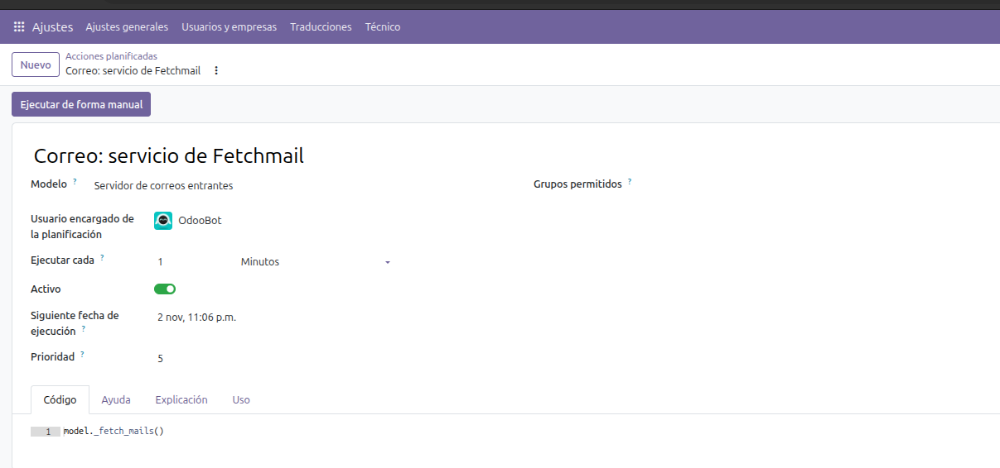

#### D. Prueba en vivo

1. Desde otra cuenta, envía al buzón un correo con un texto similar al de una
   factura y un PDF de factura adjunto.
2. Presiona **Fetch Now** en el servidor de correo (o espera a que se ejecute
   la tarea cron). Aparecerá un registro en Invoice Intake > Supplier Invoice
   Emails con el remitente, el buzón y la hora de recepción.
   
   Los mensajes clasificados como `review` por tener baja confianza aparecen
   en esta lista para que alguien los revise. Si un correo tiene un archivo
   adjunto y menciona explícitamente una factura en el asunto, el cuerpo o el
   nombre del archivo, también se envía a revisión cuando el clasificador
   devuelve `ignore`. Se excluyen otros mensajes que con alta confianza no son
   facturas. El enrutamiento a revisión nunca inicia la extracción ni crea una
   factura.
3. Abre el registro: el cuerpo del correo y sus adjuntos aparecen en el
   chatter, el estado de extracción es *Pending Extraction* y los importes son
   0.
   
4. Presiona **Extract Invoice Data**. Se llenan el RFC del proveedor, el
   número y la fecha de factura, el subtotal, los impuestos, el total y las
   partidas; el chatter registra cada campo que cambió.
   


### E. Prueba negativa y factura de proveedor

5. Prueba negativa: envía al buzón un mensaje que no sea una factura (por
   ejemplo, "te invito a comer el viernes") y presiona **Fetch Now**. Si la
   Function de filtrado devuelve `ignore`, no aparece ningún registro en
   **Supplier Emails**.
6. En un registro con datos extraídos, presiona **Create Vendor Bill**. La
   factura en borrador incluye el proveedor, número y fecha de factura, la
   partida extraída y el impuesto de compra (IVA de 16% = $5.60; total $40.60),
   además de copias de los archivos adjuntos.
   


### F. Respuestas en texto plano, parámetros del manual operativo y límite de frecuencia editable

- Las respuestas del modelo se procesan con `plain_text()` para que Telegram
  deje de mostrar el formato literal `**bold**`; las viñetas se normalizan a
  `•` y el prompt solicita texto plano.
- `deploy/README.md` y `scripts/telegram_webhook.py` ahora indican los
  argumentos obligatorios `--db_host/--db_user/--db_password/--addons-path/--http-port=0`
  para `odoo shell` y `odoo -u` (sin ellos, fallan con un error de socket de
  Postgres).
- El límite de consultas por usuario se puede editar en **Settings > Río Claro
  Chatbot** (solo administradores): *Queries per Telegram user* (5 de forma
  predeterminada) y *Window (minutes)* (5 de forma predeterminada). Se guardan
  en los parámetros del sistema `rioclaro_invoice_inbox.telegram_query_rate_limit`
  y `rioclaro_invoice_inbox.telegram_query_window_minutes`; los valores menores
  que 1 se consideran como 1. Después del despliegue, ejecuta
  `odoo -u rioclaro_invoice_inbox` para que se cargue la vista de Settings.

**ÚLTIMO PASO COMPLETADO:** ingreso de correo verificado en la VM (Function de
filtrado, IMAP, extracción, factura de proveedor con impuestos y prueba
negativa).
**Siguiente:** terminar M7 (ID de correlación y latencia por consulta,
interruptor de emergencia, alerta de presupuesto, límite de gasto y persona
responsable de incidentes).

### Periodos de fechas para las consultas

Las herramientas de solo lectura para ventas, compras, facturas, productos más
vendidos y márgenes aceptan un periodo vacío (los últimos 30 días), un número
de días, un rango explícito `YYYY-MM-DD,YYYY-MM-DD` o periodos naturales
comunes: `hoy`, `ayer`, `esta semana`, `semana pasada`, `este mes`, `mes
pasado`, `este año` y `últimos N días`. Los periodos naturales usan la fecha
local de negocio de `America/Mexico_City`. Por ejemplo, `este mes` abarca
desde el primer día del mes actual hasta hoy.

### M9 Consultas del propietario: verificación en producción

Verificado desde el contacto Owner de Telegram en la VM:

- Los productos principales mostraron los tres productos con mayores ventas
  antes de impuestos, unidades vendidas y moneda.
- La comparación de ventas semana contra semana mostró la semana actual, la
  anterior y la diferencia entre ambas.
- Los saldos abiertos mostraron las cuentas por cobrar y por pagar, así como
  los importes vencidos.
- La consulta por la categoría con mayor margen en `este mes` no devolvió
  resultados porque no había ventas confirmadas durante el mes actual. Al
  consultar los últimos 30 días, devolvió **Mercancías para Reventa / Limpieza
  e Higiene / Cuidado del Hogar y Superficies**, con un margen de **$76.00 MXN
  (49%)**, ingresos de **$155.00 MXN** y costo de **$79.00 MXN**.


## 17. Verificación de la función de facturas de proveedor en borrador

- Se iniciaron los contenedores de Odoo (`docker compose up -d`).
- Se ejecutaron las pruebas unitarias de `rioclaro_invoice_inbox` con las
  credenciales correctas de la base de datos y la ruta de módulos:
  ```bash
  docker compose exec odoo odoo -c /etc/odoo/odoo.conf -d test_db --test-enable -i rioclaro_invoice_inbox -t rioclaro_invoice_inbox --stop-after-init --db_host=odoo-db --db_user=odoo --db_password="$ODOO_DB_PASSWORD" --addons-path=/usr/lib/python3/dist-packages/odoo/addons,/usr/lib/python3/dist-packages/addons,/mnt/extra-addons --http-port=0
  ```
- Pasaron las 19 pruebas (0 fallas, 0 errores).
- Se verificaron las acciones de la interfaz: **Create Vendor Bill** crea una
  factura `account.move` en borrador con copias de los archivos adjuntos;
  **View Vendor Bill** abre esa misma factura.
- **Último paso completado:** se verificaron las pruebas; la rama
  `feature/invoice-extraction-draft-bill` está lista para publicarse y abrir un
  pull request.

## 20. IA para el chat en vivo del sitio web: asistente de contenido público

El incremento `feature/website-livechat-ai` conecta el chat en vivo del sitio
web de Odoo (`website_livechat`) con el agente existente de Azure OpenAI. Está
dirigido a visitantes anónimos del sitio; no conecta la bandeja de Discuss ni
expone los permisos de contactos de Telegram.

### Alcance y medidas de protección

- El asistente solo puede buscar nombres y descripciones de productos
  publicados, así como páginas publicadas del sitio web. Las recomendaciones
  enlazan los nombres de productos con sus páginas públicas en la tienda de
  Odoo y pueden incluir el precio que ve una persona visitante anónima según
  la lista de precios pública predeterminada del sitio, la moneda, la posición
  fiscal y la visualización de impuestos. No puede acceder al inventario,
  costos, márgenes, registros de clientes, pedidos, facturas, ventas ni compras.
- Las personas visitantes anónimas pueden enviar `/help`, `/ayuda` o
  `¿Qué puedes hacer?` para recibir un resumen determinista de las funciones
  públicas. La respuesta no enumera ni da a entender que haya acceso a las
  funciones privadas de Telegram sujetas a permisos.
- La función está deshabilitada de forma predeterminada. Habilítala únicamente
  en el canal de Live Chat destinado a visitantes del sitio web. Las
  conversaciones del chatbot nativo se quedan a cargo del chatbot. Odoo muestra
  la burbuja del chat e inicia una sesión solo mientras haya al menos una
  persona operadora conectada al canal, así que agrega una y mantenla
  conectada. La IA responde hasta que esa persona operadora escribe después
  del primer mensaje de la visita (el mensaje automático de bienvenida no
  cuenta); a partir de entonces, la IA guarda silencio.
- Cada invitado o contacto tiene un límite de cinco preguntas en una ventana
  móvil de cinco minutos entre todas sus conversaciones de Live Chat. Este
  límite no controla el gasto total de Azure; supervisa por separado el uso y
  las cuotas de Azure.
- Azure OpenAI usa la configuración existente `RIOCLARO_AOAI_ENDPOINT`,
  `RIOCLARO_AOAI_API_KEY` y `RIOCLARO_AOAI_DEPLOYMENT`. No se requiere crear
  otro recurso de Azure. Cada solicitud tiene un tiempo de espera de ocho
  segundos; una respuesta completa puede usar dos solicitudes y tardar hasta
  unos 16 segundos. Si la IA no está disponible, la persona visitante verá un
  mensaje que le pide dejar su pregunta para un agente humano.
- Para ofrecer respuestas útiles, se necesitan descripciones de productos y
  páginas de preguntas frecuentes o ayuda publicadas. Al definir el alcance de
  este incremento, el sitio activo tenía cuatro productos publicados sin
  descripción y solo las páginas estándar del sitio. Agrega contenido público
  antes de habilitar el asistente.

### Habilitar y verificar después del despliegue

1. Actualiza `rioclaro_invoice_inbox` en la instancia de Odoo. El módulo
   depende de `website_livechat` y `website_sale`; al instalarlo o actualizarlo
   también se instalan las dependencias de Odoo que hagan falta.
2. En Odoo, abre la aplicación **Live Chat**, selecciona el canal del sitio
   web y abre la pestaña **Options**. Habilita **Río Claro AI assistant** y
   guarda los cambios. Mantén deshabilitados los demás canales, salvo que
   también deban atender visitantes públicos.
3. Abre el sitio público en una ventana privada o de incógnito e inicia una
   conversación nueva de Live Chat. Haz una pregunta que pueda contestarse
   directamente con la descripción de un producto publicado o una página de
   preguntas frecuentes; confirma que la respuesta aparezca en el chat.
4. Pregunta el precio de un producto y luego cuál es el más barato de un grupo
   de productos coincidentes. Confirma que la respuesta use el precio de la
   tienda pública e indique la moneda y cómo se muestran los impuestos.
   Pregunta por existencias o detalles privados de pedidos; el asistente no
   debe proporcionarlos. Envía seis preguntas en cinco minutos para verificar
   que la sexta reciba el mensaje de límite de frecuencia.
5. Deshabilita **Río Claro AI assistant**, inicia una conversación nueva y
   confirma que la IA ya no responda. Las conversaciones del chatbot nativo y
   aquellas en las que ya respondió una persona agente no deben recibir
   respuestas simultáneas de la IA.

### Verificación en producción (2026-11-02)

Se verificó en el sitio de Odoo de producción después de desplegar el commit
`3eb8154`; el comportamiento general de la lista del catálogo se volvió a
probar después de desplegar `e10e514`. Estas comprobaciones son anteriores a
la compatibilidad con precios públicos:

- Una persona visitante anónima recibió una recomendación del producto Limpia
  Pisos Multiusos 1L. El asistente indicó correctamente que el texto disponible
  en el catálogo no confirmaba que tuviera aroma a lavanda.
- En ese momento, cuando se preguntó por precios y existencias, el asistente
  respondió que el catálogo no mostraba esos datos. Los precios públicos ya
  están disponibles; las existencias siguen siendo privadas.
- La sexta pregunta enviada dentro de la ventana de cinco minutos recibió
  `Espera unos minutos antes de volver a consultar.`
- Después de que respondió la persona operadora, la siguiente pregunta de la
  visita no recibió respuesta de la IA, como se esperaba.
- Al principio, la pregunta general `¿Qué productos tienen?` devolvió
  `No encontré resultados para tu consulta.` After deploying the general catalog
  Después de desplegar la corrección de búsqueda general del catálogo
  (`e10e514`), un chat anónimo nuevo devolvió una lista que incluía Limpia
  Pisos Multiusos 1L, Detergente Multiusos 1kg, Cloro Clorox Original, Harpic
  Power Ultra y Cloralex Total Power. En ese momento, la respuesta no incluía
  precios ni cantidades disponibles.

### Verificación local

Ejecuta la suite de pruebas del módulo con la pila de Odoo 20/PostgreSQL de
Compose del repositorio. Como en las demás pruebas de módulos, usa una base de
datos nueva para las pruebas y la ruta completa de módulos. Compose inyecta la
contraseña configurada de la base de datos en el contenedor temporal de Odoo;
el shell se la pasa a Odoo sin imprimirla:

```bash
docker compose up -d odoo-db
docker compose run --rm --no-deps -T odoo sh -c \
  'exec odoo -c /etc/odoo/odoo.conf -d livechat_ai_test \
  --test-enable -i rioclaro_invoice_inbox -t rioclaro_invoice_inbox \
  --stop-after-init --db_host=odoo-db --db_user=odoo \
  --db_password="$PASSWORD" \
  --addons-path=/usr/lib/python3/dist-packages/odoo/addons,/usr/lib/python3/dist-packages/addons,/mnt/extra-addons \
  --http-port=0'
```

Las pruebas cubren el filtrado de contenido publicado, el rechazo de nombres
de herramientas privadas, la lista de herramientas públicas permitidas para
Azure, las respuestas a visitantes, el comportamiento deshabilitado de forma
predeterminada y el límite de frecuencia por visitante.

## 21. Recomendaciones públicas de productos por Telegram

Las preguntas públicas por texto en Telegram usan el mismo catálogo de
productos publicados y el mismo contenido de preguntas frecuentes que el chat
en vivo del sitio web. El primer mensaje privado crea automáticamente un
contacto `public` de Telegram sin permisos e inicia el proceso de bienvenida.

- The bot asks for a name, then offers an optional email. It saves the email
  only when voluntarily provided; the prompt explains that Odoo administrators
  can see it. `Omitir` leaves the field blank. Public features become
  available after the user completes this choice.
- A new public contact has no company assignment or private permissions, and
  public contacts cannot be granted private permissions. Internal contacts
  must be assigned one or more allowed companies. Suppliers and customers also
  need a linked partner and remain limited to that partner's records.
- Every private Telegram query must explicitly name one or more allowed
  companies. If none is named, the bot asks the user to choose; if an
  unauthorized company is named, the query is denied. Company-specific results
  are labelled by company. Public catalog and FAQ queries do not require a
  company.
- Disabling **Bot access** blocks all bot features, including public answers
  and voice. Archived contacts are found by Telegram ID and are never
  recreated or reactivated automatically; an administrator can use the
  **Archived** filter to review or reactivate one.
- The initial message is not answered as a query. An attachment sent during
  onboarding is not downloaded or retained; resend it after an administrator
  grants invoice-submission permission. Group-chat messages remain ignored.
- Onboarding accepts text or voice replies. After onboarding, active contacts
  can ask public questions by text or voice; voice notes are limited to 60
  seconds and answers are sent as both audio and text. A private query still
  requires its matching Odoo permission.
- Public recommendations include only published names, website descriptions,
  and the price displayed to an anonymous visitor under the default public
  website pricelist, currency, fiscal position, and tax display. Cheapest-price
  questions compare matching public website prices. Unpublished products,
  stock, costs, margins, sales, invoices, and customer data remain excluded.
  In Telegram, exact product names link to their published shop pages using
  Odoo's configured `web.base.url`; only `/shop/...` paths are linked.
- The five-request per-user, per-five-minute limit includes onboarding and
  public questions. Audit records include onboarding metadata but never store
  message text, email addresses, voice audio, or transcripts.
- Administrators can set a global Telegram tone preset in **Settings → Río
  Claro Chatbot** (friendly, formal, concise, or detailed). It affects the
  first-contact name prompt and AI-generated Telegram answers. An optional
  custom style instruction (up to 500 characters) affects AI phrasing only;
  an optional custom greeting (up to 500 characters) replaces the preset
  greeting for new contacts. These settings do not alter facts, permissions,
  fixed error messages, or Website Live Chat.

After onboarding, a contact can use `/start`, `/help`, `/ayuda`, or ask
`¿Qué puedes hacer?` in a private chat to see public capabilities and only the
private queries or invoice submission enabled for their account. Help does not
use Azure OpenAI.

### Verify after deployment

1. Upgrade `rioclaro_invoice_inbox` on the Odoo instance.
2. From an unregistered Telegram account in a private chat, send a message.
   Confirm it creates a public Telegram Contact and asks for a name. Submit a
   name, then a valid email; confirm the email appears on the Odoo contact.
   Repeat with `Omitir` and confirm email stays blank while public options
   become available.
3. From the onboarded public contact, ask a public product question by text
   and voice. Confirm the reply contains text and audio, and that stock, costs,
   margins, sales, invoices, and customer data are not disclosed.
4. Change an authorized test contact to **Internal user**, assign one or more
   allowed companies, and grant only the needed private permissions. Ask a
   private question naming an allowed company and confirm results are labelled
   with that company. Omit the company to confirm the bot asks for it; name an
   unauthorized company to confirm access is denied. Revoke a permission and
   confirm the query is denied while public questions continue to work.
5. Disable **Bot access** for a contact and confirm even public text and voice
   requests are denied. Send an invoice attachment as a first message and
   confirm onboarding does not download or retain it.
